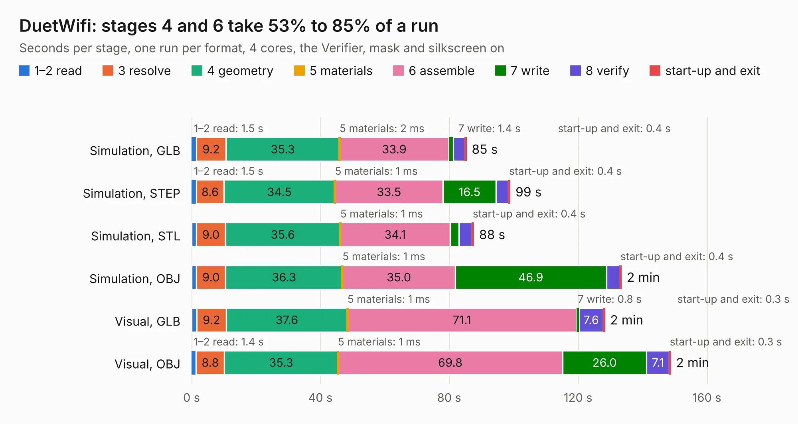

# 872. DuetWifi

Board 872 of the 3,128 of [Corpus Testing](../Corpus-Testing.md), on [Corpus Page 9](../CorpusTestingPages/Corpus-Testing-09.md#872-duetwifi).

| Mode and format | 1–2 read | 3 resolve | 4 geometry | 5 materials | 6 assemble | 7 write | 8 verify | start-up and exit | Total |
|---|---:|---:|---:|---:|---:|---:|---:|---:|---:|
| Simulation, GLB | 1.5 | 9.2 | 35.3 | 2&nbsp;ms | 33.9 | 1.4 | 3.6 | 0.4 | 85.2 |
| Simulation, STEP | 1.5 | 8.6 | 34.5 | 1&nbsp;ms | 33.5 | 16.5 | 3.8 | 0.4 | 98.8 |
| Simulation, STL | 1.5 | 9.0 | 35.6 | 1&nbsp;ms | 34.1 | 2.8 | 4.1 | 0.4 | 87.5 |
| Simulation, OBJ | 1.5 | 9.0 | 36.3 | 1&nbsp;ms | 35.0 | 46.9 | 4.2 | 0.4 | 133.4 |
| Visual, GLB | 1.6 | 9.2 | 37.6 | 1&nbsp;ms | 71.1 | 0.8 | 7.6 | 0.3 | 128.2 |
| Visual, OBJ | 1.4 | 8.8 | 35.3 | 1&nbsp;ms | 69.8 | 26.0 | 7.1 | 0.3 | 148.7 |

<table align="center"><tr><td valign="top">

| Board | Repo: [Duet3D/Duet-2-Hardware](https://github.com/Duet3D/Duet-2-Hardware) Board: `DuetWifi.kicad_pcb` |
|---|---|
| Folder | Duet2 / Duet2v1.04 |
| Complexity | 293&nbsp;/&nbsp;1000 (size&nbsp;248, features&nbsp;45) |
| KESE&nbsp;features | through vias, slotted holes, filled zones |
| Tested | 9th November 2026 |
| Copper&nbsp;layers | 4 |
| File&nbsp;format | KiCad 4 (4) |
| Parts,&nbsp;tracks,&nbsp;vias | 330, 7,068, 1,086 |
| Triangles,&nbsp;simulation | 6,864,890 in 294 parts |
| Verifier | PASS in all six runs |

</td><td valign="top">

<table>
<tr><th>File type</th><th>File size</th><th>Peak memory used</th></tr>
<tr><th colspan="3" align="left">Simulation</th></tr>
<tr><td>GLB</td><td align="right">240&nbsp;MB</td><td align="right">1.6&nbsp;GB</td></tr>
<tr><td>STEP</td><td align="right">965&nbsp;MB</td><td align="right">2.2&nbsp;GB</td></tr>
<tr><td>STL</td><td align="right">343&nbsp;MB</td><td align="right">1.6&nbsp;GB</td></tr>
<tr><td>OBJ</td><td align="right">765&nbsp;MB</td><td align="right">4.5&nbsp;GB</td></tr>
<tr><th colspan="3" align="left">Visual</th></tr>
<tr><td>GLB</td><td align="right">146&nbsp;MB</td><td align="right">2.3&nbsp;GB</td></tr>
<tr><td>OBJ</td><td align="right">474&nbsp;MB</td><td align="right">3.2&nbsp;GB</td></tr>
</table>

</td></tr></table>

| Previous | Next |
|:---|---:|
| [871. Duet2Maestro](b0871b_Duet-2-Hardware_Duet2Maestro.md) | [873. Duet2](b0873b_Duet-2-Hardware_Duet2-Duet2v1-05_Duet2.md) |
