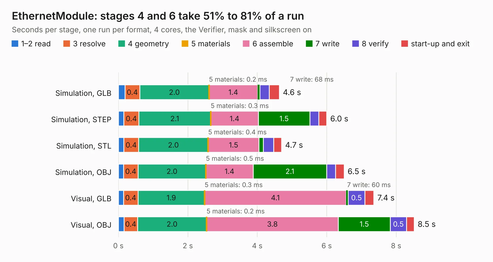

# 872. EthernetModule

Board 872 of the 3,106 of [Corpus Testing](../Corpus-Testing.md), on [Corpus Page 9](../CorpusTestingPages/Corpus-Testing-09.md#872-ethernetmodule).

| Mode and format | 1–2 read | 3 resolve | 4 geometry | 5 materials | 6 assemble | 7 write | 8 verify | start-up and exit | Total |
|---|---:|---:|---:|---:|---:|---:|---:|---:|---:|
| Simulation, GLB | 0.2 | 0.4 | 2.0 | 0.2&nbsp;ms | 1.4 | 68&nbsp;ms | 0.3 | 0.3 | 4.6 |
| Simulation, STEP | 0.2 | 0.4 | 2.1 | 0.3&nbsp;ms | 1.4 | 1.5 | 0.3 | 0.2 | 6.0 |
| Simulation, STL | 0.2 | 0.4 | 2.0 | 0.4&nbsp;ms | 1.5 | 0.1 | 0.3 | 0.2 | 4.7 |
| Simulation, OBJ | 0.1 | 0.4 | 2.0 | 0.5&nbsp;ms | 1.4 | 2.1 | 0.3 | 0.2 | 6.5 |
| Visual, GLB | 0.1 | 0.4 | 1.9 | 0.3&nbsp;ms | 4.1 | 60&nbsp;ms | 0.5 | 0.3 | 7.4 |
| Visual, OBJ | 0.2 | 0.4 | 2.0 | 0.2&nbsp;ms | 3.8 | 1.5 | 0.5 | 0.2 | 8.5 |

<table align="center"><tr><td valign="top">

| Board | Repo: [Duet3D/Duet-2-Hardware](https://github.com/Duet3D/Duet-2-Hardware) Board: `EthernetModule.kicad_pcb` |
|---|---|
| Folder | Ethernet_Module |
| Complexity | 246&nbsp;/&nbsp;1000 (size&nbsp;201, features&nbsp;45) |
| KESE&nbsp;features | through vias, filled zones, copper text |
| Tested | 9th November 2026 |
| Copper&nbsp;layers | 2 |
| File&nbsp;format | KiCad 5 (20171130) |
| Parts,&nbsp;tracks,&nbsp;vias | 36, 475, 44 |
| Triangles,&nbsp;simulation | 416,418 in 44 parts |
| Verifier | PASS in all six runs |

</td><td valign="top">

<table>
<tr><th>File type</th><th>File size</th><th>Peak memory used</th></tr>
<tr><th colspan="3" align="left">Simulation</th></tr>
<tr><td>GLB</td><td align="right">15&nbsp;MB</td><td align="right">282&nbsp;MB</td></tr>
<tr><td>STEP</td><td align="right">72&nbsp;MB</td><td align="right">306&nbsp;MB</td></tr>
<tr><td>STL</td><td align="right">21&nbsp;MB</td><td align="right">289&nbsp;MB</td></tr>
<tr><td>OBJ</td><td align="right">43&nbsp;MB</td><td align="right">332&nbsp;MB</td></tr>
<tr><th colspan="3" align="left">Visual</th></tr>
<tr><td>GLB</td><td align="right">11&nbsp;MB</td><td align="right">310&nbsp;MB</td></tr>
<tr><td>OBJ</td><td align="right">33&nbsp;MB</td><td align="right">306&nbsp;MB</td></tr>
</table>

</td></tr></table>

| Previous | Next |
|:---|---:|
| [871. ExpBreakout](b0871b_Duet-2-Hardware_ExpBreakout.md) | [873. Zephyr-80-CPU](b0873b_Zephyr-80_Zephyr-80-CPU.md) |
