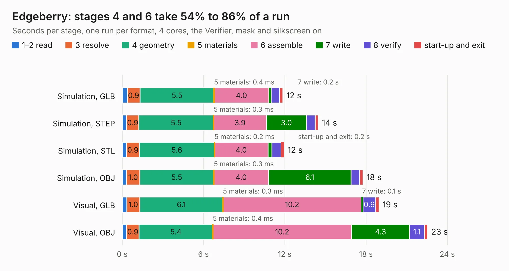

# 873. Edgeberry

Board 873 of the 3,100 of [Corpus Testing](../Corpus-Testing.md), on [Corpus Page 9](../CorpusTestingPages/Corpus-Testing-09.md#873-edgeberry).

| Mode and format | 1–2 read | 3 resolve | 4 geometry | 5 materials | 6 assemble | 7 write | 8 verify | start-up and exit | Total |
|---|---:|---:|---:|---:|---:|---:|---:|---:|---:|
| Simulation, GLB | 0.4 | 0.9 | 5.5 | 0.4&nbsp;ms | 4.0 | 0.2 | 0.6 | 0.2 | 11.9 |
| Simulation, STEP | 0.3 | 0.9 | 5.5 | 0.3&nbsp;ms | 3.9 | 3.0 | 0.6 | 0.2 | 14.5 |
| Simulation, STL | 0.3 | 0.9 | 5.6 | 0.2&nbsp;ms | 4.0 | 0.3 | 0.7 | 0.2 | 11.9 |
| Simulation, OBJ | 0.3 | 1.0 | 5.5 | 0.3&nbsp;ms | 4.0 | 6.1 | 0.6 | 0.2 | 17.8 |
| Visual, GLB | 0.3 | 1.0 | 6.1 | 0.3&nbsp;ms | 10.2 | 0.1 | 0.9 | 0.2 | 19.0 |
| Visual, OBJ | 0.3 | 0.9 | 5.4 | 0.4&nbsp;ms | 10.2 | 4.3 | 1.1 | 0.2 | 22.5 |

<table align="center"><tr><td valign="top">

| Board | Repo: [Edgeberry/Edgeberry-Baseboard](https://github.com/Edgeberry/Edgeberry-Baseboard) Board: `Edgeberry.kicad_pcb` |
|---|---|
| Complexity | 248&nbsp;/&nbsp;1000 (size&nbsp;158, features&nbsp;90) |
| KESE&nbsp;features | through vias, slotted holes, rounded, trapezoid or chamfered pads, filled zones, copper text, curved board outline, TrueType text |
| Tested | 9th November 2026 |
| Copper&nbsp;layers | 2 |
| File&nbsp;format | KiCad 8 (20240108) |
| Parts,&nbsp;tracks,&nbsp;vias | 28, 303, 97 |
| Triangles,&nbsp;simulation | 1,044,388 in 55 parts |
| Verifier | PASS in all six runs |

</td><td valign="top">

<table>
<tr><th>File type</th><th>File size</th><th>Peak memory used</th></tr>
<tr><th colspan="3" align="left">Simulation</th></tr>
<tr><td>GLB</td><td align="right">38&nbsp;MB</td><td align="right">472&nbsp;MB</td></tr>
<tr><td>STEP</td><td align="right">208&nbsp;MB</td><td align="right">531&nbsp;MB</td></tr>
<tr><td>STL</td><td align="right">52&nbsp;MB</td><td align="right">495&nbsp;MB</td></tr>
<tr><td>OBJ</td><td align="right">110&nbsp;MB</td><td align="right">776&nbsp;MB</td></tr>
<tr><th colspan="3" align="left">Visual</th></tr>
<tr><td>GLB</td><td align="right">27&nbsp;MB</td><td align="right">619&nbsp;MB</td></tr>
<tr><td>OBJ</td><td align="right">81&nbsp;MB</td><td align="right">597&nbsp;MB</td></tr>
</table>

</td></tr></table>

| Previous | Next |
|:---|---:|
| [872. PCIe-Adapter](b0872b_ecp5-pcie_PCIe-Adapter.md) | [874. k-1008-visable-memory](b0874b_k-1008-visable-memory-card-replica_k-1008-visable-memory.md) |
