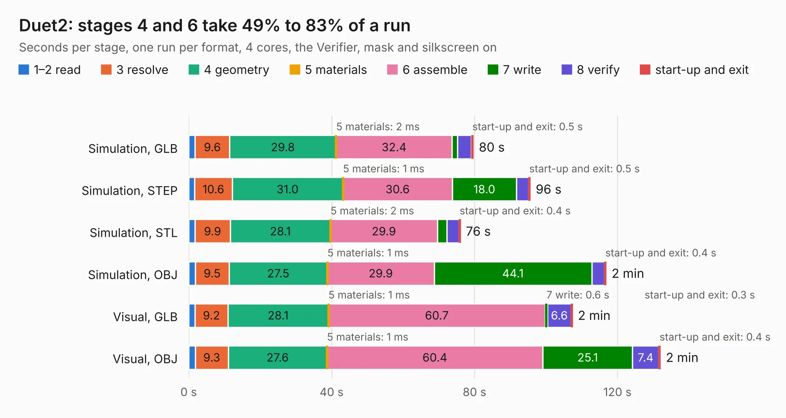

# 874. Duet2

Board 874 of the 3,123 of [Corpus Testing](../Corpus-Testing.md), on [Corpus Page 9](../CorpusTestingPages/Corpus-Testing-09.md#874-duet2).

| Mode and format | 1–2 read | 3 resolve | 4 geometry | 5 materials | 6 assemble | 7 write | 8 verify | start-up and exit | Total |
|---|---:|---:|---:|---:|---:|---:|---:|---:|---:|
| Simulation, GLB | 1.8 | 9.6 | 29.8 | 2&nbsp;ms | 32.4 | 1.5 | 3.9 | 0.5 | 79.6 |
| Simulation, STEP | 1.6 | 10.6 | 31.0 | 1&nbsp;ms | 30.6 | 18.0 | 3.3 | 0.5 | 95.6 |
| Simulation, STL | 1.7 | 9.9 | 28.1 | 2&nbsp;ms | 29.9 | 2.7 | 3.4 | 0.4 | 76.0 |
| Simulation, OBJ | 1.8 | 9.5 | 27.5 | 1&nbsp;ms | 29.9 | 44.1 | 3.6 | 0.4 | 116.8 |
| Visual, GLB | 1.8 | 9.2 | 28.1 | 1&nbsp;ms | 60.7 | 0.6 | 6.6 | 0.3 | 107.3 |
| Visual, OBJ | 1.8 | 9.3 | 27.6 | 1&nbsp;ms | 60.4 | 25.1 | 7.4 | 0.4 | 132.0 |

<table align="center"><tr><td valign="top">

| Board | Repo: [Duet3D/Duet-2-Hardware](https://github.com/Duet3D/Duet-2-Hardware) Board: `Duet2.kicad_pcb` |
|---|---|
| Folder | Duet2 / Duet2v1.06 |
| Complexity | 370&nbsp;/&nbsp;1000 (size&nbsp;285, features&nbsp;85) |
| KESE&nbsp;features | through vias, slotted holes, rounded, trapezoid or chamfered pads, filled zones, stack-up, dielectric εr and tanδ |
| Tested | 9th November 2026 |
| Copper&nbsp;layers | 4 |
| File&nbsp;format | KiCad 6 (20211014) |
| Parts,&nbsp;tracks,&nbsp;vias | 338, 5,521, 1,073 |
| Triangles,&nbsp;simulation | 6,360,830 in 315 parts |
| Verifier | PASS in all six runs |

</td><td valign="top">

<table>
<tr><th>File type</th><th>File size</th><th>Peak memory used</th></tr>
<tr><th colspan="3" align="left">Simulation</th></tr>
<tr><td>GLB</td><td align="right">216&nbsp;MB</td><td align="right">1.6&nbsp;GB</td></tr>
<tr><td>STEP</td><td align="right">836&nbsp;MB</td><td align="right">2.2&nbsp;GB</td></tr>
<tr><td>STL</td><td align="right">318&nbsp;MB</td><td align="right">1.6&nbsp;GB</td></tr>
<tr><td>OBJ</td><td align="right">685&nbsp;MB</td><td align="right">4.1&nbsp;GB</td></tr>
<tr><th colspan="3" align="left">Visual</th></tr>
<tr><td>GLB</td><td align="right">133&nbsp;MB</td><td align="right">2.2&nbsp;GB</td></tr>
<tr><td>OBJ</td><td align="right">428&nbsp;MB</td><td align="right">2.8&nbsp;GB</td></tr>
</table>

</td></tr></table>

| Previous | Next |
|:---|---:|
| [873. Duet2](b0873b_Duet-2-Hardware_Duet2-Duet2v1-05_Duet2.md) | [875. DuetEthernet](b0875b_Duet-2-Hardware_DuetEthernet.md) |
