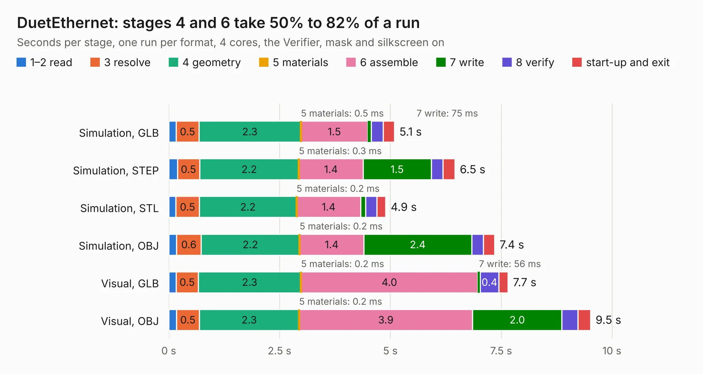

# 874. DuetEthernet

Board 874 of the 3,120 of [Corpus Testing](../Corpus-Testing.md), on [Corpus Page 9](../CorpusTestingPages/Corpus-Testing-09.md#874-duetethernet).

| Mode and format | 1–2 read | 3 resolve | 4 geometry | 5 materials | 6 assemble | 7 write | 8 verify | start-up and exit | Total |
|---|---:|---:|---:|---:|---:|---:|---:|---:|---:|
| Simulation, GLB | 0.2 | 0.5 | 2.3 | 0.5&nbsp;ms | 1.5 | 75&nbsp;ms | 0.3 | 0.3 | 5.1 |
| Simulation, STEP | 0.2 | 0.5 | 2.2 | 0.3&nbsp;ms | 1.4 | 1.5 | 0.3 | 0.3 | 6.5 |
| Simulation, STL | 0.2 | 0.5 | 2.2 | 0.2&nbsp;ms | 1.4 | 0.1 | 0.3 | 0.2 | 4.9 |
| Simulation, OBJ | 0.2 | 0.6 | 2.2 | 0.2&nbsp;ms | 1.4 | 2.4 | 0.3 | 0.3 | 7.4 |
| Visual, GLB | 0.2 | 0.5 | 2.3 | 0.2&nbsp;ms | 4.0 | 56&nbsp;ms | 0.4 | 0.2 | 7.7 |
| Visual, OBJ | 0.2 | 0.5 | 2.3 | 0.2&nbsp;ms | 3.9 | 2.0 | 0.4 | 0.3 | 9.5 |

<table align="center"><tr><td valign="top">

| Board | Repo: [Duet3D/Duet-2-Hardware](https://github.com/Duet3D/Duet-2-Hardware) Board: `DuetEthernet.kicad_pcb` |
|---|---|
| Folder | Duet2 / EthernetModule |
| Complexity | 246&nbsp;/&nbsp;1000 (size&nbsp;201, features&nbsp;45) |
| KESE&nbsp;features | through vias, filled zones, copper text |
| Tested | 9th November 2026 |
| Copper&nbsp;layers | 2 |
| File&nbsp;format | KiCad 4 (4) |
| Parts,&nbsp;tracks,&nbsp;vias | 36, 475, 44 |
| Triangles,&nbsp;simulation | 421,536 in 44 parts |
| Verifier | PASS in all six runs |

</td><td valign="top">

<table>
<tr><th>File type</th><th>File size</th><th>Peak memory used</th></tr>
<tr><th colspan="3" align="left">Simulation</th></tr>
<tr><td>GLB</td><td align="right">15&nbsp;MB</td><td align="right">296&nbsp;MB</td></tr>
<tr><td>STEP</td><td align="right">74&nbsp;MB</td><td align="right">307&nbsp;MB</td></tr>
<tr><td>STL</td><td align="right">21&nbsp;MB</td><td align="right">292&nbsp;MB</td></tr>
<tr><td>OBJ</td><td align="right">43&nbsp;MB</td><td align="right">343&nbsp;MB</td></tr>
<tr><th colspan="3" align="left">Visual</th></tr>
<tr><td>GLB</td><td align="right">11&nbsp;MB</td><td align="right">312&nbsp;MB</td></tr>
<tr><td>OBJ</td><td align="right">33&nbsp;MB</td><td align="right">317&nbsp;MB</td></tr>
</table>

</td></tr></table>

| Previous | Next |
|:---|---:|
| [873. Duet2](b0873b_Duet-2-Hardware_Duet2-Duet2v1-06_Duet2.md) | [875. Duex5](b0875b_Duet-2-Hardware_Duet-Expansion-Duex5v0-11_Duex5.md) |
