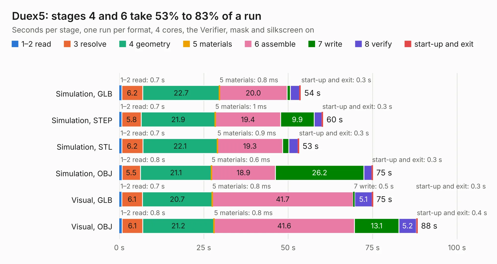

# 878. Duex5

Board 878 of the 3,128 of [Corpus Testing](../Corpus-Testing.md), on [Corpus Page 9](../CorpusTestingPages/Corpus-Testing-09.md#878-duex5).

| Mode and format | 1–2 read | 3 resolve | 4 geometry | 5 materials | 6 assemble | 7 write | 8 verify | start-up and exit | Total |
|---|---:|---:|---:|---:|---:|---:|---:|---:|---:|
| Simulation, GLB | 0.7 | 6.2 | 22.7 | 0.8&nbsp;ms | 20.0 | 1.0 | 2.7 | 0.3 | 53.7 |
| Simulation, STEP | 0.7 | 5.8 | 21.9 | 1&nbsp;ms | 19.4 | 9.9 | 2.3 | 0.3 | 60.3 |
| Simulation, STL | 0.7 | 6.2 | 22.1 | 0.9&nbsp;ms | 19.3 | 1.9 | 2.7 | 0.3 | 53.2 |
| Simulation, OBJ | 0.8 | 5.5 | 21.1 | 0.6&nbsp;ms | 18.9 | 26.2 | 2.3 | 0.3 | 75.1 |
| Visual, GLB | 0.7 | 6.1 | 20.7 | 0.8&nbsp;ms | 41.7 | 0.5 | 5.1 | 0.3 | 75.1 |
| Visual, OBJ | 0.8 | 6.1 | 21.2 | 0.8&nbsp;ms | 41.6 | 13.1 | 5.2 | 0.4 | 88.3 |

<table align="center"><tr><td valign="top">

| Board | Repo: [Duet3D/Duet-2-Hardware](https://github.com/Duet3D/Duet-2-Hardware) Board: `Duex5.kicad_pcb` |
|---|---|
| Folder | Duet_Expansion / Duex5v0.8 |
| Complexity | 272&nbsp;/&nbsp;1000 (size&nbsp;237, features&nbsp;35) |
| KESE&nbsp;features | through vias, filled zones |
| Tested | 9th November 2026 |
| Copper&nbsp;layers | 4 |
| File&nbsp;format | KiCad 4 (4) |
| Parts,&nbsp;tracks,&nbsp;vias | 212, 3,656, 1,153 |
| Triangles,&nbsp;simulation | 5,703,054 in 193 parts |
| Verifier | PASS in all six runs |

</td><td valign="top">

<table>
<tr><th>File type</th><th>File size</th><th>Peak memory used</th></tr>
<tr><th colspan="3" align="left">Simulation</th></tr>
<tr><td>GLB</td><td align="right">197&nbsp;MB</td><td align="right">1.2&nbsp;GB</td></tr>
<tr><td>STEP</td><td align="right">657&nbsp;MB</td><td align="right">1.6&nbsp;GB</td></tr>
<tr><td>STL</td><td align="right">285&nbsp;MB</td><td align="right">1.2&nbsp;GB</td></tr>
<tr><td>OBJ</td><td align="right">631&nbsp;MB</td><td align="right">3.7&nbsp;GB</td></tr>
<tr><th colspan="3" align="left">Visual</th></tr>
<tr><td>GLB</td><td align="right">104&nbsp;MB</td><td align="right">1.7&nbsp;GB</td></tr>
<tr><td>OBJ</td><td align="right">336&nbsp;MB</td><td align="right">2.2&nbsp;GB</td></tr>
</table>

</td></tr></table>

| Previous | Next |
|:---|---:|
| [877. Duex5](b0877b_Duet-2-Hardware_Duet-Expansion-Duex5v0-7_Duex5.md) | [879. Duex5](b0879b_Duet-2-Hardware_Duet-Expansion-Duex5v0-9a_Duex5.md) |
