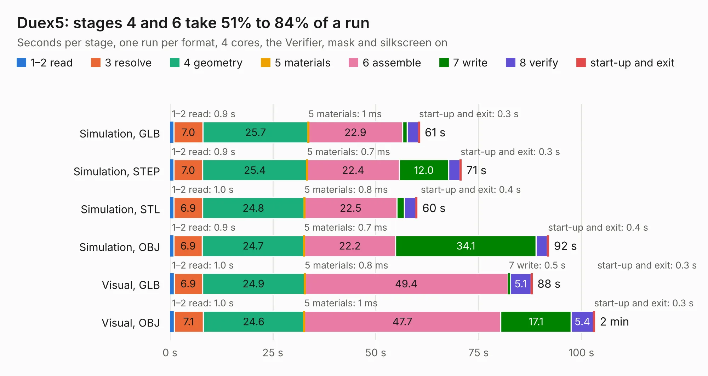

# 878. Duex5

Board 878 of the 3,121 of [Corpus Testing](../Corpus-Testing.md), on [Corpus Page 9](../CorpusTestingPages/Corpus-Testing-09.md#878-duex5).

| Mode and format | 1–2 read | 3 resolve | 4 geometry | 5 materials | 6 assemble | 7 write | 8 verify | start-up and exit | Total |
|---|---:|---:|---:|---:|---:|---:|---:|---:|---:|
| Simulation, GLB | 0.9 | 7.0 | 25.7 | 1&nbsp;ms | 22.9 | 1.1 | 2.8 | 0.3 | 60.7 |
| Simulation, STEP | 0.9 | 7.0 | 25.4 | 0.7&nbsp;ms | 22.4 | 12.0 | 2.7 | 0.3 | 70.8 |
| Simulation, STL | 1.0 | 6.9 | 24.8 | 0.8&nbsp;ms | 22.5 | 1.8 | 2.8 | 0.4 | 60.1 |
| Simulation, OBJ | 0.9 | 6.9 | 24.7 | 0.7&nbsp;ms | 22.2 | 34.1 | 2.8 | 0.4 | 92.1 |
| Visual, GLB | 1.0 | 6.9 | 24.9 | 0.8&nbsp;ms | 49.4 | 0.5 | 5.1 | 0.3 | 88.1 |
| Visual, OBJ | 1.0 | 7.1 | 24.6 | 1&nbsp;ms | 47.7 | 17.1 | 5.4 | 0.3 | 103.2 |

<table align="center"><tr><td valign="top">

| Board | Repo: [Duet3D/Duet-2-Hardware](https://github.com/Duet3D/Duet-2-Hardware) Board: `Duex5.kicad_pcb` |
|---|---|
| Folder | Duet_Expansion / Duex5v0.9a |
| Complexity | 283&nbsp;/&nbsp;1000 (size&nbsp;238, features&nbsp;45) |
| KESE&nbsp;features | through vias, slotted holes, filled zones |
| Tested | 9th November 2026 |
| Copper&nbsp;layers | 4 |
| File&nbsp;format | KiCad 4 (4) |
| Parts,&nbsp;tracks,&nbsp;vias | 233, 3,810, 1,144 |
| Triangles,&nbsp;simulation | 5,782,378 in 195 parts |
| Verifier | PASS in all six runs |

</td><td valign="top">

<table>
<tr><th>File type</th><th>File size</th><th>Peak memory used</th></tr>
<tr><th colspan="3" align="left">Simulation</th></tr>
<tr><td>GLB</td><td align="right">200&nbsp;MB</td><td align="right">1.3&nbsp;GB</td></tr>
<tr><td>STEP</td><td align="right">680&nbsp;MB</td><td align="right">1.7&nbsp;GB</td></tr>
<tr><td>STL</td><td align="right">289&nbsp;MB</td><td align="right">1.2&nbsp;GB</td></tr>
<tr><td>OBJ</td><td align="right">640&nbsp;MB</td><td align="right">3.8&nbsp;GB</td></tr>
<tr><th colspan="3" align="left">Visual</th></tr>
<tr><td>GLB</td><td align="right">106&nbsp;MB</td><td align="right">1.7&nbsp;GB</td></tr>
<tr><td>OBJ</td><td align="right">343&nbsp;MB</td><td align="right">2.3&nbsp;GB</td></tr>
</table>

</td></tr></table>

| Previous | Next |
|:---|---:|
| [877. Duex5](b0877b_Duet-2-Hardware_Duet-Expansion-Duex5v0-8_Duex5.md) | [879. ExpBreakout](b0879b_Duet-2-Hardware_ExpBreakout.md) |
