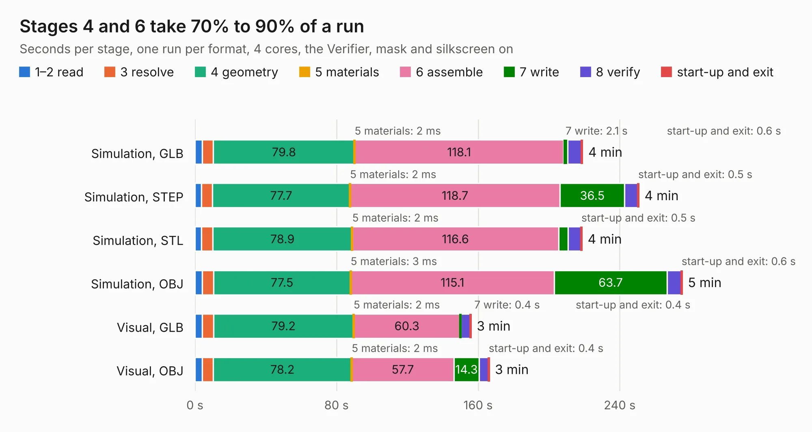

# 878. k-1013-floppy-controller-replica

Board 878 of the 3,103 of [Corpus Testing](../Corpus-Testing.md), on [Corpus Page 9](../CorpusTestingPages/Corpus-Testing-09.md#878-k-1013-floppy-controller-replica).

| Mode and format | 1–2 read | 3 resolve | 4 geometry | 5 materials | 6 assemble | 7 write | 8 verify | start-up and exit | Total |
|---|---:|---:|---:|---:|---:|---:|---:|---:|---:|
| Simulation, GLB | 4.1 | 6.3 | 79.8 | 2&nbsp;ms | 118.1 | 2.1 | 7.8 | 0.6 | 219.0 |
| Simulation, STEP | 3.6 | 6.3 | 77.7 | 2&nbsp;ms | 118.7 | 36.5 | 7.5 | 0.5 | 250.7 |
| Simulation, STL | 3.7 | 6.3 | 78.9 | 2&nbsp;ms | 116.6 | 5.3 | 7.4 | 0.5 | 218.6 |
| Simulation, OBJ | 4.1 | 6.3 | 77.5 | 3&nbsp;ms | 115.1 | 63.7 | 7.9 | 0.6 | 275.3 |
| Visual, GLB | 4.1 | 6.4 | 79.2 | 2&nbsp;ms | 60.3 | 0.4 | 5.2 | 0.4 | 156.0 |
| Visual, OBJ | 4.0 | 6.3 | 78.2 | 2&nbsp;ms | 57.7 | 14.3 | 5.2 | 0.4 | 166.2 |

<table align="center"><tr><td valign="top">

| Board | Repo: [eduardocasino/k-1013-floppy-disk-controller-replica](https://github.com/eduardocasino/k-1013-floppy-disk-controller-replica) Board: `k-1013-floppy-controller-replica.kicad_pcb` |
|---|---|
| Complexity | 380&nbsp;/&nbsp;1000 (size&nbsp;230, features&nbsp;150) |
| KESE&nbsp;features | through vias, custom pads, rounded, trapezoid or chamfered pads, arc tracks, filled zones, copper drawings, copper text, curved board outline, TrueType text, stack-up, dielectric εr and tanδ |
| Tested | 9th November 2026 |
| Copper&nbsp;layers | 2 |
| File&nbsp;format | KiCad 7 (20221018) |
| Parts,&nbsp;tracks,&nbsp;vias | 239, 10,519, 385 |
| Triangles,&nbsp;simulation | 10,474,278 in 405 parts |
| Verifier | PASS in all six runs |

</td><td valign="top">

<table>
<tr><th>File type</th><th>File size</th><th>Peak memory used</th></tr>
<tr><th colspan="3" align="left">Simulation</th></tr>
<tr><td>GLB</td><td align="right">351&nbsp;MB</td><td align="right">2.8&nbsp;GB</td></tr>
<tr><td>STEP</td><td align="right">1.9&nbsp;GB</td><td align="right">4.3&nbsp;GB</td></tr>
<tr><td>STL</td><td align="right">524&nbsp;MB</td><td align="right">2.9&nbsp;GB</td></tr>
<tr><td>OBJ</td><td align="right">1.1&nbsp;GB</td><td align="right">6.7&nbsp;GB</td></tr>
<tr><th colspan="3" align="left">Visual</th></tr>
<tr><td>GLB</td><td align="right">89&nbsp;MB</td><td align="right">2.6&nbsp;GB</td></tr>
<tr><td>OBJ</td><td align="right">284&nbsp;MB</td><td align="right">2.6&nbsp;GB</td></tr>
</table>

</td></tr></table>

| Previous | Next |
|:---|---:|
| [877. k-1008-visable-memory](b0877b_k-1008-visable-memory-card-replica_k-1008-visable-memory.md) | [879. kim-1](b0879b_kim-1_kim-1.md) |
