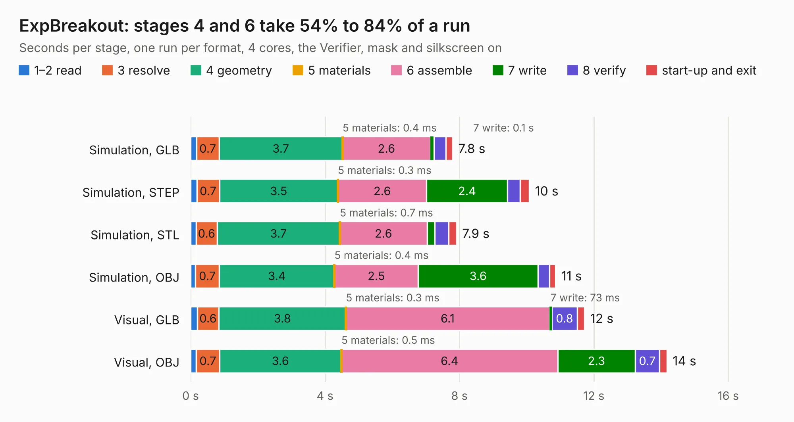

# 881. ExpBreakout

Board 881 of the 3,131 of [Corpus Testing](../Corpus-Testing.md), on [Corpus Page 9](../CorpusTestingPages/Corpus-Testing-09.md#881-expbreakout).

| Mode and format | 1–2 read | 3 resolve | 4 geometry | 5 materials | 6 assemble | 7 write | 8 verify | start-up and exit | Total |
|---|---:|---:|---:|---:|---:|---:|---:|---:|---:|
| Simulation, GLB | 0.2 | 0.7 | 3.7 | 0.4&nbsp;ms | 2.6 | 0.1 | 0.4 | 0.2 | 7.8 |
| Simulation, STEP | 0.2 | 0.7 | 3.5 | 0.3&nbsp;ms | 2.6 | 2.4 | 0.4 | 0.3 | 10.1 |
| Simulation, STL | 0.2 | 0.6 | 3.7 | 0.7&nbsp;ms | 2.6 | 0.2 | 0.4 | 0.2 | 7.9 |
| Simulation, OBJ | 0.1 | 0.7 | 3.4 | 0.4&nbsp;ms | 2.5 | 3.6 | 0.3 | 0.2 | 10.9 |
| Visual, GLB | 0.2 | 0.6 | 3.8 | 0.3&nbsp;ms | 6.1 | 73&nbsp;ms | 0.8 | 0.2 | 11.7 |
| Visual, OBJ | 0.2 | 0.7 | 3.6 | 0.5&nbsp;ms | 6.4 | 2.3 | 0.7 | 0.2 | 14.2 |

<table align="center"><tr><td valign="top">

| Board | Repo: [Duet3D/Duet-2-Hardware](https://github.com/Duet3D/Duet-2-Hardware) Board: `ExpBreakout.kicad_pcb` |
|---|---|
| Folder | Duet_Expansion / Expansion_Breakoutv1.1 |
| Complexity | 188&nbsp;/&nbsp;1000 (size&nbsp;153, features&nbsp;35) |
| KESE&nbsp;features | through vias, filled zones |
| Tested | 9th November 2026 |
| Copper&nbsp;layers | 2 |
| File&nbsp;format | KiCad 4 (4) |
| Parts,&nbsp;tracks,&nbsp;vias | 18, 472, 37 |
| Triangles,&nbsp;simulation | 811,298 in 65 parts |
| Verifier | PASS in all six runs |

</td><td valign="top">

<table>
<tr><th>File type</th><th>File size</th><th>Peak memory used</th></tr>
<tr><th colspan="3" align="left">Simulation</th></tr>
<tr><td>GLB</td><td align="right">28&nbsp;MB</td><td align="right">347&nbsp;MB</td></tr>
<tr><td>STEP</td><td align="right">151&nbsp;MB</td><td align="right">423&nbsp;MB</td></tr>
<tr><td>STL</td><td align="right">41&nbsp;MB</td><td align="right">353&nbsp;MB</td></tr>
<tr><td>OBJ</td><td align="right">85&nbsp;MB</td><td align="right">577&nbsp;MB</td></tr>
<tr><th colspan="3" align="left">Visual</th></tr>
<tr><td>GLB</td><td align="right">17&nbsp;MB</td><td align="right">427&nbsp;MB</td></tr>
<tr><td>OBJ</td><td align="right">52&nbsp;MB</td><td align="right">436&nbsp;MB</td></tr>
</table>

</td></tr></table>

| Previous | Next |
|:---|---:|
| [880. Duex5](b0880b_Duet-2-Hardware_Duet-Expansion-Duex5v0-9a_Duex5.md) | [882. EthernetModule](b0882b_Duet-2-Hardware_EthernetModule.md) |
