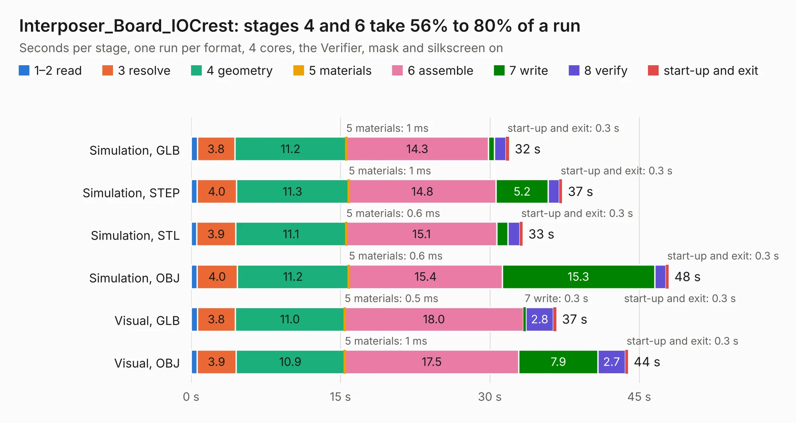

# 881. Interposer_Board_IOCrest

Board 881 of the 3,105 of [Corpus Testing](../Corpus-Testing.md), on [Corpus Page 9](../CorpusTestingPages/Corpus-Testing-09.md#881-interposer_board_iocrest).

| Mode and format | 1–2 read | 3 resolve | 4 geometry | 5 materials | 6 assemble | 7 write | 8 verify | start-up and exit | Total |
|---|---:|---:|---:|---:|---:|---:|---:|---:|---:|
| Simulation, GLB | 0.6 | 3.8 | 11.2 | 1&nbsp;ms | 14.3 | 0.6 | 1.2 | 0.3 | 31.9 |
| Simulation, STEP | 0.6 | 4.0 | 11.3 | 1&nbsp;ms | 14.8 | 5.2 | 1.1 | 0.3 | 37.3 |
| Simulation, STL | 0.5 | 3.9 | 11.1 | 0.6&nbsp;ms | 15.1 | 1.1 | 1.2 | 0.3 | 33.3 |
| Simulation, OBJ | 0.6 | 4.0 | 11.2 | 0.6&nbsp;ms | 15.4 | 15.3 | 1.1 | 0.3 | 48.0 |
| Visual, GLB | 0.6 | 3.8 | 11.0 | 0.5&nbsp;ms | 18.0 | 0.3 | 2.8 | 0.3 | 36.7 |
| Visual, OBJ | 0.6 | 3.9 | 10.9 | 1&nbsp;ms | 17.5 | 7.9 | 2.7 | 0.3 | 43.9 |

<table align="center"><tr><td valign="top">

| Board | Repo: [EEVengers/ThunderScope](https://github.com/EEVengers/ThunderScope) Board: `Interposer_Board_IOCrest.kicad_pcb` |
|---|---|
| Folder | Hardware / Interposer_Board_IOCrest |
| Complexity | 282&nbsp;/&nbsp;1000 (size&nbsp;192, features&nbsp;90) |
| KESE&nbsp;features | through vias, arc tracks, filled zones, curved board outline, stack-up, dielectric εr and tanδ |
| Tested | 9th November 2026 |
| Copper&nbsp;layers | 4 |
| File&nbsp;format | KiCad 9 (20241229) |
| Parts,&nbsp;tracks,&nbsp;vias | 7, 211, 1,239 |
| Triangles,&nbsp;simulation | 3,285,988 in 83 parts |
| Verifier | PASS in all six runs |

</td><td valign="top">

<table>
<tr><th>File type</th><th>File size</th><th>Peak memory used</th></tr>
<tr><th colspan="3" align="left">Simulation</th></tr>
<tr><td>GLB</td><td align="right">110&nbsp;MB</td><td align="right">1.2&nbsp;GB</td></tr>
<tr><td>STEP</td><td align="right">241&nbsp;MB</td><td align="right">1.5&nbsp;GB</td></tr>
<tr><td>STL</td><td align="right">164&nbsp;MB</td><td align="right">1.2&nbsp;GB</td></tr>
<tr><td>OBJ</td><td align="right">343&nbsp;MB</td><td align="right">2.2&nbsp;GB</td></tr>
<tr><th colspan="3" align="left">Visual</th></tr>
<tr><td>GLB</td><td align="right">58&nbsp;MB</td><td align="right">1.2&nbsp;GB</td></tr>
<tr><td>OBJ</td><td align="right">182&nbsp;MB</td><td align="right">1.2&nbsp;GB</td></tr>
</table>

</td></tr></table>

| Previous | Next |
|:---|---:|
| [880. kim-1](b0880b_kim-1_kim-1.md) | [882. Interposer_Board_JoneyTech](b0882b_ThunderScope_Interposer-Board-JoneyTech.md) |
