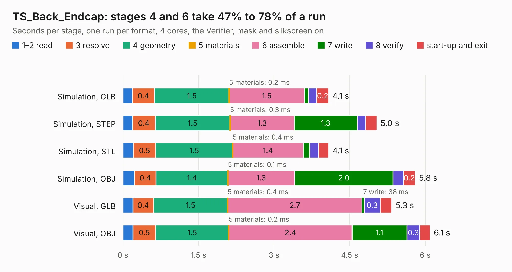

# 885. TS_Back_Endcap

Board 885 of the 3,109 of [Corpus Testing](../Corpus-Testing.md), on [Corpus Page 9](../CorpusTestingPages/Corpus-Testing-09.md#885-ts_back_endcap).

| Mode and format | 1–2 read | 3 resolve | 4 geometry | 5 materials | 6 assemble | 7 write | 8 verify | start-up and exit | Total |
|---|---:|---:|---:|---:|---:|---:|---:|---:|---:|
| Simulation, GLB | 0.2 | 0.4 | 1.5 | 0.2&nbsp;ms | 1.5 | 82&nbsp;ms | 0.2 | 0.2 | 4.1 |
| Simulation, STEP | 0.2 | 0.4 | 1.5 | 0.3&nbsp;ms | 1.3 | 1.3 | 0.2 | 0.2 | 5.0 |
| Simulation, STL | 0.2 | 0.5 | 1.5 | 0.4&nbsp;ms | 1.4 | 0.1 | 0.2 | 0.2 | 4.1 |
| Simulation, OBJ | 0.2 | 0.4 | 1.4 | 0.1&nbsp;ms | 1.3 | 2.0 | 0.2 | 0.2 | 5.8 |
| Visual, GLB | 0.2 | 0.4 | 1.5 | 0.4&nbsp;ms | 2.7 | 38&nbsp;ms | 0.3 | 0.2 | 5.3 |
| Visual, OBJ | 0.2 | 0.5 | 1.5 | 0.2&nbsp;ms | 2.4 | 1.1 | 0.3 | 0.2 | 6.1 |

<table align="center"><tr><td valign="top">

| Board | Repo: [EEVengers/ThunderScope](https://github.com/EEVengers/ThunderScope) Board: `TS_Back_Endcap.kicad_pcb` |
|---|---|
| Folder | Hardware / TS_Back_Endcap |
| Complexity | 257&nbsp;/&nbsp;1000 (size&nbsp;127, features&nbsp;130) |
| KESE&nbsp;features | through vias, padstacks, rounded, trapezoid or chamfered pads, filled zones, curved board outline, TrueType text, stack-up, dielectric εr and tanδ |
| Tested | 9th November 2026 |
| Copper&nbsp;layers | 2 |
| File&nbsp;format | KiCad 9 (20241229) |
| Parts,&nbsp;tracks,&nbsp;vias | 1, 4, 171 |
| Triangles,&nbsp;simulation | 462,308 in 13 parts |
| Verifier | PASS in all six runs |

</td><td valign="top">

<table>
<tr><th>File type</th><th>File size</th><th>Peak memory used</th></tr>
<tr><th colspan="3" align="left">Simulation</th></tr>
<tr><td>GLB</td><td align="right">16&nbsp;MB</td><td align="right">320&nbsp;MB</td></tr>
<tr><td>STEP</td><td align="right">46&nbsp;MB</td><td align="right">336&nbsp;MB</td></tr>
<tr><td>STL</td><td align="right">23&nbsp;MB</td><td align="right">307&nbsp;MB</td></tr>
<tr><td>OBJ</td><td align="right">47&nbsp;MB</td><td align="right">367&nbsp;MB</td></tr>
<tr><th colspan="3" align="left">Visual</th></tr>
<tr><td>GLB</td><td align="right">8.5&nbsp;MB</td><td align="right">270&nbsp;MB</td></tr>
<tr><td>OBJ</td><td align="right">25&nbsp;MB</td><td align="right">275&nbsp;MB</td></tr>
</table>

</td></tr></table>

| Previous | Next |
|:---|---:|
| [884. Thunderscope_Rev5.3](b0884b_ThunderScope_Thunderscope-Rev5-3.md) | [886. TS_Front_Endcap](b0886b_ThunderScope_TS-Front-Endcap.md) |
