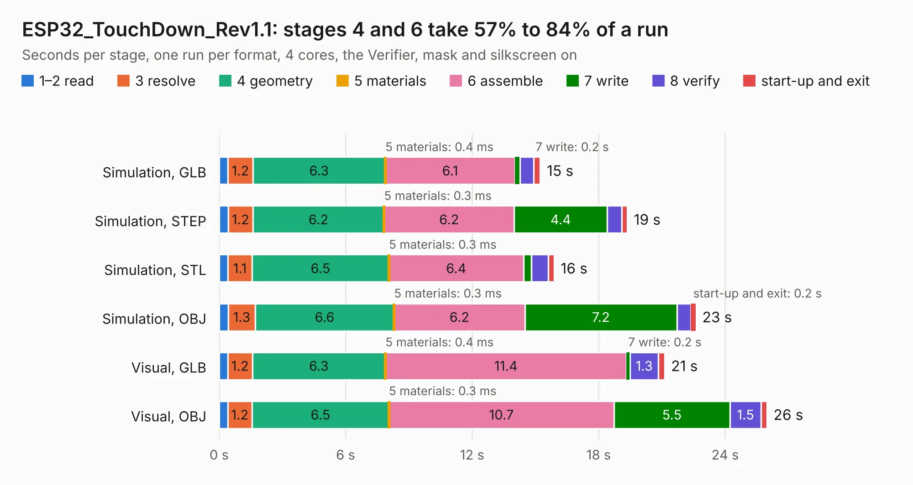

# 885 ESP32_TouchDown_Rev1.1

Board 885 of the 3,138 of [Corpus Testing](../Corpus-Testing.md), on [Corpus Page 9](../CorpusTestingPages/Corpus-Testing-09.md#885-esp32_touchdown_rev11).

| Mode and format | 1–2 read | 3 resolve | 4 geometry | 5 materials | 6 assemble | 7 write | 8 verify | start-up and exit | Total |
|---|---:|---:|---:|---:|---:|---:|---:|---:|---:|
| Simulation, GLB | 0.4 | 1.2 | 6.3 | 0.4&nbsp;ms | 6.1 | 0.2 | 0.7 | 0.3 | 15.2 |
| Simulation, STEP | 0.4 | 1.2 | 6.2 | 0.3&nbsp;ms | 6.2 | 4.4 | 0.7 | 0.3 | 19.4 |
| Simulation, STL | 0.4 | 1.1 | 6.5 | 0.3&nbsp;ms | 6.4 | 0.4 | 0.8 | 0.3 | 15.9 |
| Simulation, OBJ | 0.4 | 1.3 | 6.6 | 0.3&nbsp;ms | 6.2 | 7.2 | 0.7 | 0.2 | 22.6 |
| Visual, GLB | 0.4 | 1.2 | 6.3 | 0.4&nbsp;ms | 11.4 | 0.2 | 1.3 | 0.3 | 21.1 |
| Visual, OBJ | 0.4 | 1.2 | 6.5 | 0.3&nbsp;ms | 10.7 | 5.5 | 1.5 | 0.3 | 26.0 |

<table align="center"><tr><td valign="top">

| Board | Repo: [DustinWatts/esp32-touchdown](https://github.com/DustinWatts/esp32-touchdown) Board: `ESP32_TouchDown_Rev1.1.kicad_pcb` |
|---|---|
| Folder | Hardware / ESP32_TouchDown_Rev1.1 |
| Complexity | 309&nbsp;/&nbsp;1000 (size&nbsp;219, features&nbsp;90) |
| KESE&nbsp;features | through vias, slotted holes, custom pads, rounded, trapezoid or chamfered pads, filled zones, copper drawings, curved board outline |
| Tested | 9th November 2026 |
| Copper&nbsp;layers | 2 |
| File&nbsp;format | KiCad 5 (20171130) |
| Parts,&nbsp;tracks,&nbsp;vias | 65, 802, 157 |
| Triangles,&nbsp;simulation | 1,157,818 in 107 parts |
| Verifier | PASS in all six runs |

</td><td valign="top">

<table>
<tr><th>File type</th><th>File size</th><th>Peak memory used</th></tr>
<tr><th colspan="3" align="left">Simulation</th></tr>
<tr><td>GLB</td><td align="right">40&nbsp;MB</td><td align="right">543&nbsp;MB</td></tr>
<tr><td>STEP</td><td align="right">199&nbsp;MB</td><td align="right">647&nbsp;MB</td></tr>
<tr><td>STL</td><td align="right">58&nbsp;MB</td><td align="right">547&nbsp;MB</td></tr>
<tr><td>OBJ</td><td align="right">119&nbsp;MB</td><td align="right">824&nbsp;MB</td></tr>
<tr><th colspan="3" align="left">Visual</th></tr>
<tr><td>GLB</td><td align="right">33&nbsp;MB</td><td align="right">728&nbsp;MB</td></tr>
<tr><td>OBJ</td><td align="right">98&nbsp;MB</td><td align="right">743&nbsp;MB</td></tr>
</table>

</td></tr></table>

| Previous | Next |
|:---|---:|
| [884 Zephyr-80-IO](b0884b_Zephyr-80_Zephyr-80-IO.md) | [886 ESP32_TouchDown](b0886b_esp32-touchdown_ESP32-TouchDown.md) |
