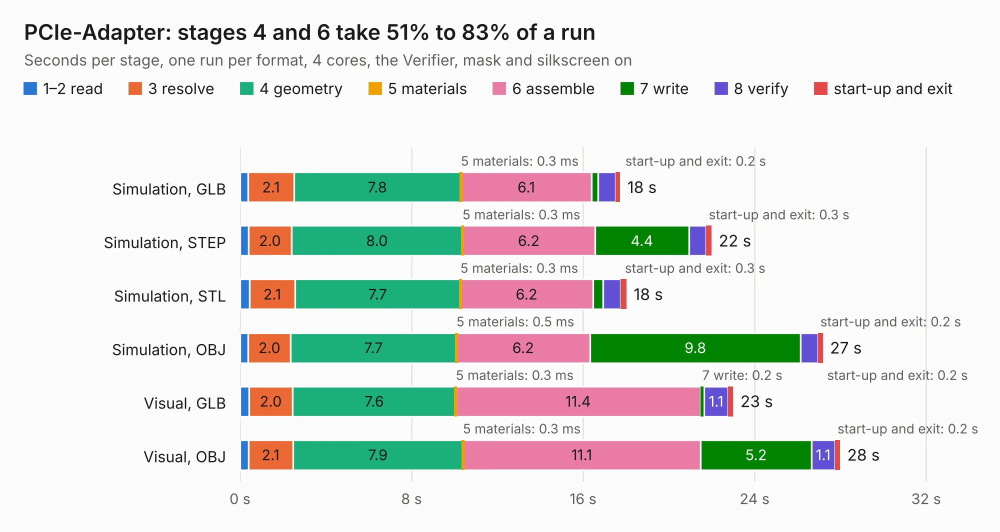

# 886. PCIe-Adapter

Board 886 of the 3,124 of [Corpus Testing](../Corpus-Testing.md), on [Corpus Page 9](../CorpusTestingPages/Corpus-Testing-09.md#886-pcie-adapter).

| Mode and format | 1–2 read | 3 resolve | 4 geometry | 5 materials | 6 assemble | 7 write | 8 verify | start-up and exit | Total |
|---|---:|---:|---:|---:|---:|---:|---:|---:|---:|
| Simulation, GLB | 0.4 | 2.1 | 7.8 | 0.3&nbsp;ms | 6.1 | 0.3 | 0.8 | 0.2 | 17.7 |
| Simulation, STEP | 0.4 | 2.0 | 8.0 | 0.3&nbsp;ms | 6.2 | 4.4 | 0.8 | 0.3 | 22.0 |
| Simulation, STL | 0.4 | 2.1 | 7.7 | 0.3&nbsp;ms | 6.2 | 0.5 | 0.8 | 0.3 | 18.0 |
| Simulation, OBJ | 0.4 | 2.0 | 7.7 | 0.5&nbsp;ms | 6.2 | 9.8 | 0.8 | 0.2 | 27.2 |
| Visual, GLB | 0.4 | 2.0 | 7.6 | 0.3&nbsp;ms | 11.4 | 0.2 | 1.1 | 0.2 | 23.0 |
| Visual, OBJ | 0.4 | 2.1 | 7.9 | 0.3&nbsp;ms | 11.1 | 5.2 | 1.1 | 0.2 | 28.0 |

<table align="center"><tr><td valign="top">

| Board | Repo: [ecp5-pcie/ecp5-pcie](https://github.com/ecp5-pcie/ecp5-pcie) Board: `PCIe-Adapter.kicad_pcb` |
|---|---|
| Folder | PCIe-Adapter |
| Complexity | 313&nbsp;/&nbsp;1000 (size&nbsp;248, features&nbsp;65) |
| KESE&nbsp;features | through vias, rounded, trapezoid or chamfered pads, filled zones, copper text, curved board outline |
| Tested | 9th November 2026 |
| Copper&nbsp;layers | 4 |
| File&nbsp;format | KiCad 5 (20171130) |
| Parts,&nbsp;tracks,&nbsp;vias | 50, 1,628, 146 |
| Triangles,&nbsp;simulation | 1,930,774 in 107 parts |
| Verifier | PASS in all six runs |

</td><td valign="top">

<table>
<tr><th>File type</th><th>File size</th><th>Peak memory used</th></tr>
<tr><th colspan="3" align="left">Simulation</th></tr>
<tr><td>GLB</td><td align="right">66&nbsp;MB</td><td align="right">694&nbsp;MB</td></tr>
<tr><td>STEP</td><td align="right">290&nbsp;MB</td><td align="right">786&nbsp;MB</td></tr>
<tr><td>STL</td><td align="right">97&nbsp;MB</td><td align="right">665&nbsp;MB</td></tr>
<tr><td>OBJ</td><td align="right">202&nbsp;MB</td><td align="right">1.3&nbsp;GB</td></tr>
<tr><th colspan="3" align="left">Visual</th></tr>
<tr><td>GLB</td><td align="right">35&nbsp;MB</td><td align="right">855&nbsp;MB</td></tr>
<tr><td>OBJ</td><td align="right">105&nbsp;MB</td><td align="right">801&nbsp;MB</td></tr>
</table>

</td></tr></table>

| Previous | Next |
|:---|---:|
| [885. ESP32_TouchDown](b0885b_esp32-touchdown_ESP32-TouchDown.md) | [887. Edgeberry](b0887b_Edgeberry-Baseboard_Edgeberry.md) |
