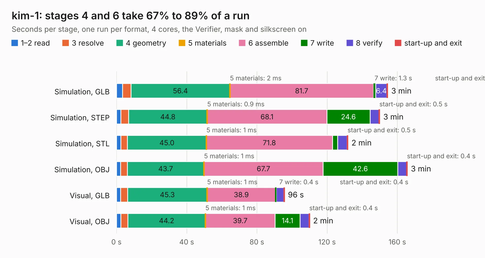

# 887. kim-1

Board 887 of the 3,117 of [Corpus Testing](../Corpus-Testing.md), on [Corpus Page 9](../CorpusTestingPages/Corpus-Testing-09.md#887-kim-1).

| Mode and format | 1–2 read | 3 resolve | 4 geometry | 5 materials | 6 assemble | 7 write | 8 verify | start-up and exit | Total |
|---|---:|---:|---:|---:|---:|---:|---:|---:|---:|
| Simulation, GLB | 3.4 | 4.8 | 56.4 | 2&nbsp;ms | 81.7 | 1.3 | 6.4 | 0.5 | 154.6 |
| Simulation, STEP | 2.5 | 4.4 | 44.8 | 0.9&nbsp;ms | 68.1 | 24.6 | 5.1 | 0.5 | 150.0 |
| Simulation, STL | 2.4 | 3.8 | 45.0 | 1&nbsp;ms | 71.8 | 3.0 | 5.4 | 0.5 | 131.9 |
| Simulation, OBJ | 2.4 | 3.8 | 43.7 | 1&nbsp;ms | 67.7 | 42.6 | 5.1 | 0.4 | 165.8 |
| Visual, GLB | 2.4 | 3.9 | 45.3 | 1&nbsp;ms | 38.9 | 0.4 | 4.4 | 0.4 | 95.7 |
| Visual, OBJ | 2.5 | 4.0 | 44.2 | 1&nbsp;ms | 39.7 | 14.1 | 5.2 | 0.4 | 110.1 |

<table align="center"><tr><td valign="top">

| Board | Repo: [eduardocasino/kim-1](https://github.com/eduardocasino/kim-1) Board: `kim-1.kicad_pcb` |
|---|---|
| Complexity | 355&nbsp;/&nbsp;1000 (size&nbsp;235, features&nbsp;120) |
| KESE&nbsp;features | through vias, slotted holes, custom pads, rounded, trapezoid or chamfered pads, filled zones, copper drawings, curved board outline, stack-up, dielectric εr and tanδ |
| Tested | 9th November 2026 |
| Copper&nbsp;layers | 2 |
| File&nbsp;format | KiCad 7 (20221018) |
| Parts,&nbsp;tracks,&nbsp;vias | 118, 26,242, 112 |
| Triangles,&nbsp;simulation | 6,263,966 in 210 parts |
| Verifier | PASS in all six runs |

</td><td valign="top">

<table>
<tr><th>File type</th><th>File size</th><th>Peak memory used</th></tr>
<tr><th colspan="3" align="left">Simulation</th></tr>
<tr><td>GLB</td><td align="right">213&nbsp;MB</td><td align="right">2.0&nbsp;GB</td></tr>
<tr><td>STEP</td><td align="right">1.4&nbsp;GB</td><td align="right">2.8&nbsp;GB</td></tr>
<tr><td>STL</td><td align="right">313&nbsp;MB</td><td align="right">1.9&nbsp;GB</td></tr>
<tr><td>OBJ</td><td align="right">667&nbsp;MB</td><td align="right">4.1&nbsp;GB</td></tr>
<tr><th colspan="3" align="left">Visual</th></tr>
<tr><td>GLB</td><td align="right">75&nbsp;MB</td><td align="right">1.7&nbsp;GB</td></tr>
<tr><td>OBJ</td><td align="right">237&nbsp;MB</td><td align="right">1.8&nbsp;GB</td></tr>
</table>

</td></tr></table>

| Previous | Next |
|:---|---:|
| [886. k-1013-floppy-controller-replica](b0886b_k-1013-floppy-disk-controller-replica_k-1013-floppy-controller-replica.md) | [888. Interposer_Board_IOCrest](b0888b_ThunderScope_Interposer-Board-IOCrest.md) |
