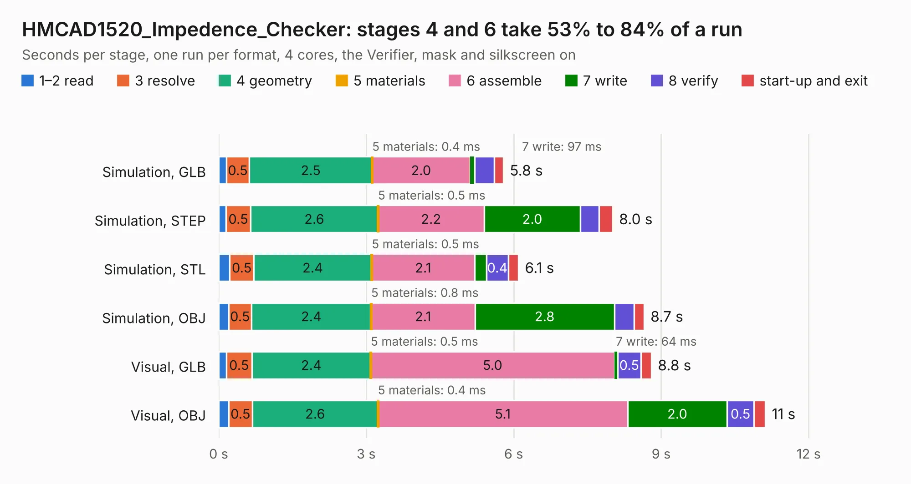

# 887. HMCAD1520_Impedence_Checker

Board 887 of the 3,100 of [Corpus Testing](../Corpus-Testing.md), on [Corpus Page 9](../CorpusTestingPages/Corpus-Testing-09.md#887-hmcad1520_impedence_checker).

| Mode and format | 1–2 read | 3 resolve | 4 geometry | 5 materials | 6 assemble | 7 write | 8 verify | start-up and exit | Total |
|---|---:|---:|---:|---:|---:|---:|---:|---:|---:|
| Simulation, GLB | 0.2 | 0.5 | 2.5 | 0.4&nbsp;ms | 2.0 | 97&nbsp;ms | 0.4 | 0.2 | 5.8 |
| Simulation, STEP | 0.1 | 0.5 | 2.6 | 0.5&nbsp;ms | 2.2 | 2.0 | 0.4 | 0.3 | 8.0 |
| Simulation, STL | 0.2 | 0.5 | 2.4 | 0.5&nbsp;ms | 2.1 | 0.2 | 0.4 | 0.2 | 6.1 |
| Simulation, OBJ | 0.2 | 0.5 | 2.4 | 0.8&nbsp;ms | 2.1 | 2.8 | 0.4 | 0.2 | 8.7 |
| Visual, GLB | 0.2 | 0.5 | 2.4 | 0.5&nbsp;ms | 5.0 | 64&nbsp;ms | 0.5 | 0.2 | 8.8 |
| Visual, OBJ | 0.2 | 0.5 | 2.6 | 0.4&nbsp;ms | 5.1 | 2.0 | 0.5 | 0.2 | 11.1 |

<table align="center"><tr><td valign="top">

| Board | Repo: [EEVengers/ts_test_fixtures](https://github.com/EEVengers/ts_test_fixtures) Board: `HMCAD1520_Impedence_Checker.kicad_pcb` |
|---|---|
| Folder | HMCAD1520_Impedence_Checker |
| Complexity | 223&nbsp;/&nbsp;1000 (size&nbsp;138, features&nbsp;85) |
| KESE&nbsp;features | through vias, rounded, trapezoid or chamfered pads, drill offsets, filled zones, stack-up, dielectric εr and tanδ |
| Tested | 9th November 2026 |
| Copper&nbsp;layers | 2 |
| File&nbsp;format | KiCad 8 (20240108) |
| Parts,&nbsp;tracks,&nbsp;vias | 24, 164, 8 |
| Triangles,&nbsp;simulation | 651,784 in 134 parts |
| Verifier | PASS in all six runs |

</td><td valign="top">

<table>
<tr><th>File type</th><th>File size</th><th>Peak memory used</th></tr>
<tr><th colspan="3" align="left">Simulation</th></tr>
<tr><td>GLB</td><td align="right">21&nbsp;MB</td><td align="right">364&nbsp;MB</td></tr>
<tr><td>STEP</td><td align="right">94&nbsp;MB</td><td align="right">395&nbsp;MB</td></tr>
<tr><td>STL</td><td align="right">33&nbsp;MB</td><td align="right">348&nbsp;MB</td></tr>
<tr><td>OBJ</td><td align="right">65&nbsp;MB</td><td align="right">467&nbsp;MB</td></tr>
<tr><th colspan="3" align="left">Visual</th></tr>
<tr><td>GLB</td><td align="right">14&nbsp;MB</td><td align="right">408&nbsp;MB</td></tr>
<tr><td>OBJ</td><td align="right">41&nbsp;MB</td><td align="right">439&nbsp;MB</td></tr>
</table>

</td></tr></table>

| Previous | Next |
|:---|---:|
| [886. Thunderscope_Rev5_Mech_Model](b0886b_ts-hardware-archive_Thunderscope-Rev5-Mech-Model.md) | [888. Interposer_Board_Test_Fixture](b0888b_ts-test-fixtures_Interposer-Board-Test-Fixture.md) |
