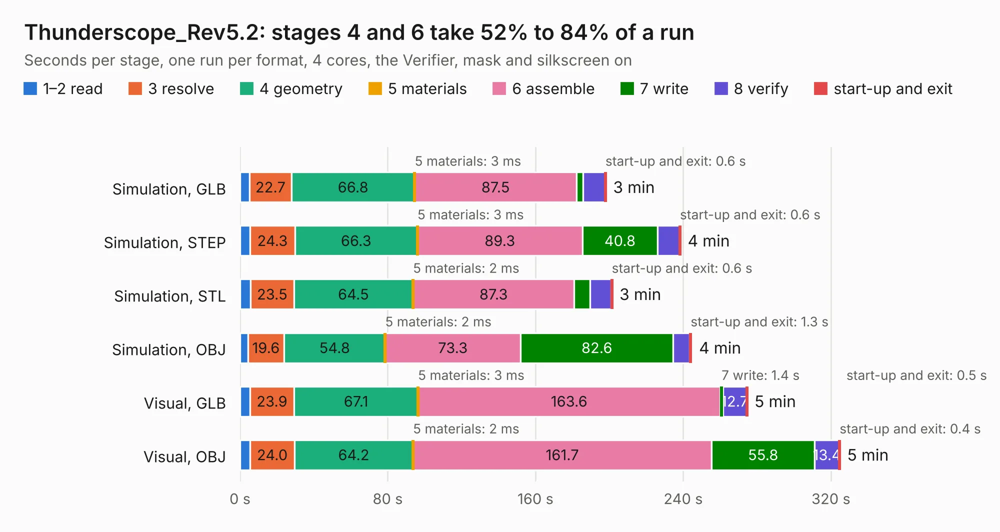

# 888. Thunderscope_Rev5.2

Board 888 of the 3,105 of [Corpus Testing](../Corpus-Testing.md), on [Corpus Page 9](../CorpusTestingPages/Corpus-Testing-09.md#888-thunderscope_rev52).

| Mode and format | 1–2 read | 3 resolve | 4 geometry | 5 materials | 6 assemble | 7 write | 8 verify | start-up and exit | Total |
|---|---:|---:|---:|---:|---:|---:|---:|---:|---:|
| Simulation, GLB | 5.1 | 22.7 | 66.8 | 3&nbsp;ms | 87.5 | 3.7 | 11.7 | 0.6 | 198.2 |
| Simulation, STEP | 5.4 | 24.3 | 66.3 | 3&nbsp;ms | 89.3 | 40.8 | 11.8 | 0.6 | 238.6 |
| Simulation, STL | 5.7 | 23.5 | 64.5 | 2&nbsp;ms | 87.3 | 8.5 | 11.6 | 0.6 | 201.6 |
| Simulation, OBJ | 4.2 | 19.6 | 54.8 | 2&nbsp;ms | 73.3 | 82.6 | 8.8 | 1.3 | 244.7 |
| Visual, GLB | 5.4 | 23.9 | 67.1 | 3&nbsp;ms | 163.6 | 1.4 | 12.7 | 0.5 | 274.7 |
| Visual, OBJ | 5.5 | 24.0 | 64.2 | 2&nbsp;ms | 161.7 | 55.8 | 13.4 | 0.4 | 324.9 |

<table align="center"><tr><td valign="top">

| Board | Repo: [EEVengers/ts_hardware_archive](https://github.com/EEVengers/ts_hardware_archive) Board: `Thunderscope_Rev5.2.kicad_pcb` |
|---|---|
| Folder | KiCad / Thunderscope_Rev5.2 |
| Complexity | 514&nbsp;/&nbsp;1000 (size&nbsp;324, features&nbsp;190) |
| KESE&nbsp;features | through vias, padstacks, slotted holes, custom pads, rounded, trapezoid or chamfered pads, arc tracks, filled zones, copper drawings, copper text, curved board outline, TrueType text, stack-up, dielectric εr and tanδ |
| Tested | 9th November 2026 to 10th November 2026 |
| Copper&nbsp;layers | 6 |
| File&nbsp;format | KiCad 9 (20241229) |
| Parts,&nbsp;tracks,&nbsp;vias | 765, 8,886, 3,810 |
| Triangles,&nbsp;simulation | 18,239,728 in 618 parts |
| Verifier | PASS in all six runs |
| Run&nbsp;again | Simulation, OBJ: failed in the corpus run, run again with the memory cap raised from 11 GB to 14.5 GB, and passed |

</td><td valign="top">

<table>
<tr><th>File type</th><th>File size</th><th>Peak memory used</th></tr>
<tr><th colspan="3" align="left">Simulation</th></tr>
<tr><td>GLB</td><td align="right">601&nbsp;MB</td><td align="right">4.8&nbsp;GB</td></tr>
<tr><td>STEP</td><td align="right">1.7&nbsp;GB</td><td align="right">6.5&nbsp;GB</td></tr>
<tr><td>STL</td><td align="right">912&nbsp;MB</td><td align="right">4.9&nbsp;GB</td></tr>
<tr><td>OBJ</td><td align="right">2.0&nbsp;GB</td><td align="right">12&nbsp;GB</td></tr>
<tr><th colspan="3" align="left">Visual</th></tr>
<tr><td>GLB</td><td align="right">326&nbsp;MB</td><td align="right">5.3&nbsp;GB</td></tr>
<tr><td>OBJ</td><td align="right">1.1&nbsp;GB</td><td align="right">6.5&nbsp;GB</td></tr>
</table>

</td></tr></table>

| Previous | Next |
|:---|---:|
| [887. Thunderscope_Rev5.1](b0887b_ts-hardware-archive_Thunderscope-Rev5-1.md) | [889. Thunderscope_Rev5](b0889b_ts-hardware-archive_Thunderscope-Rev5.md) |
