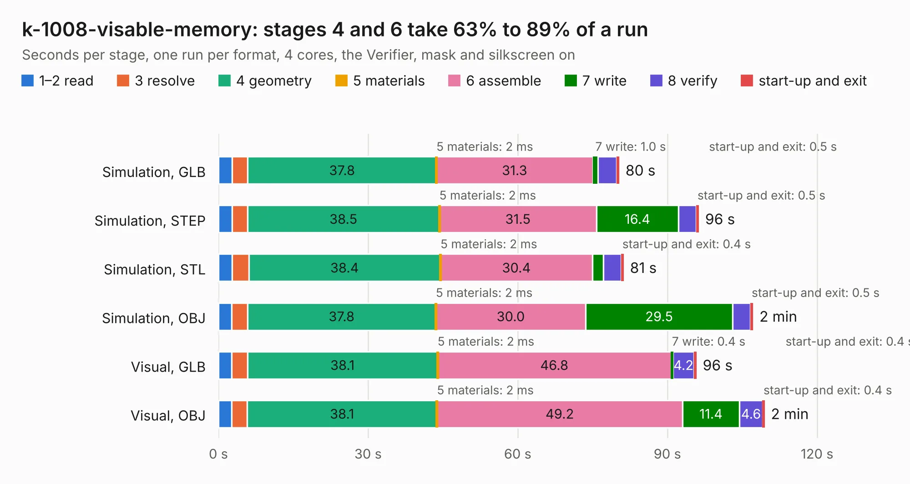

# 889. k-1008-visable-memory

Board 889 of the 3,131 of [Corpus Testing](../Corpus-Testing.md), on [Corpus Page 9](../CorpusTestingPages/Corpus-Testing-09.md#889-k-1008-visable-memory).

| Mode and format | 1–2 read | 3 resolve | 4 geometry | 5 materials | 6 assemble | 7 write | 8 verify | start-up and exit | Total |
|---|---:|---:|---:|---:|---:|---:|---:|---:|---:|
| Simulation, GLB | 2.7 | 3.2 | 37.8 | 2&nbsp;ms | 31.3 | 1.0 | 3.7 | 0.5 | 80.3 |
| Simulation, STEP | 2.7 | 3.1 | 38.5 | 2&nbsp;ms | 31.5 | 16.4 | 3.6 | 0.5 | 96.3 |
| Simulation, STL | 2.7 | 3.3 | 38.4 | 2&nbsp;ms | 30.4 | 2.2 | 3.6 | 0.4 | 81.2 |
| Simulation, OBJ | 2.6 | 3.2 | 37.8 | 2&nbsp;ms | 30.0 | 29.5 | 3.6 | 0.5 | 107.1 |
| Visual, GLB | 2.6 | 3.2 | 38.1 | 2&nbsp;ms | 46.8 | 0.4 | 4.2 | 0.4 | 95.8 |
| Visual, OBJ | 2.6 | 3.1 | 38.1 | 2&nbsp;ms | 49.2 | 11.4 | 4.6 | 0.4 | 109.4 |

<table align="center"><tr><td valign="top">

| Board | Repo: [eduardocasino/k-1008-visable-memory-card-replica](https://github.com/eduardocasino/k-1008-visable-memory-card-replica) Board: `k-1008-visable-memory.kicad_pcb` |
|---|---|
| Complexity | 303&nbsp;/&nbsp;1000 (size&nbsp;203, features&nbsp;100) |
| KESE&nbsp;features | through vias, rounded, trapezoid or chamfered pads, filled zones, curved board outline, stack-up, dielectric εr and tanδ, copper finish |
| Tested | 9th November 2026 |
| Copper&nbsp;layers | 2 |
| File&nbsp;format | KiCad 7 (20221018) |
| Parts,&nbsp;tracks,&nbsp;vias | 134, 2,849, 141 |
| Triangles,&nbsp;simulation | 5,533,298 in 229 parts |
| Verifier | PASS in all six runs |

</td><td valign="top">

<table>
<tr><th>File type</th><th>File size</th><th>Peak memory used</th></tr>
<tr><th colspan="3" align="left">Simulation</th></tr>
<tr><td>GLB</td><td align="right">189&nbsp;MB</td><td align="right">1.9&nbsp;GB</td></tr>
<tr><td>STEP</td><td align="right">914&nbsp;MB</td><td align="right">2.3&nbsp;GB</td></tr>
<tr><td>STL</td><td align="right">277&nbsp;MB</td><td align="right">1.8&nbsp;GB</td></tr>
<tr><td>OBJ</td><td align="right">588&nbsp;MB</td><td align="right">3.7&nbsp;GB</td></tr>
<tr><th colspan="3" align="left">Visual</th></tr>
<tr><td>GLB</td><td align="right">70&nbsp;MB</td><td align="right">1.7&nbsp;GB</td></tr>
<tr><td>OBJ</td><td align="right">221&nbsp;MB</td><td align="right">1.8&nbsp;GB</td></tr>
</table>

</td></tr></table>

| Previous | Next |
|:---|---:|
| [888. Edgeberry](b0888b_Edgeberry-Baseboard_Edgeberry.md) | [890. k-1013-floppy-controller-replica](b0890b_k-1013-floppy-disk-controller-replica_k-1013-floppy-controller-replica.md) |
