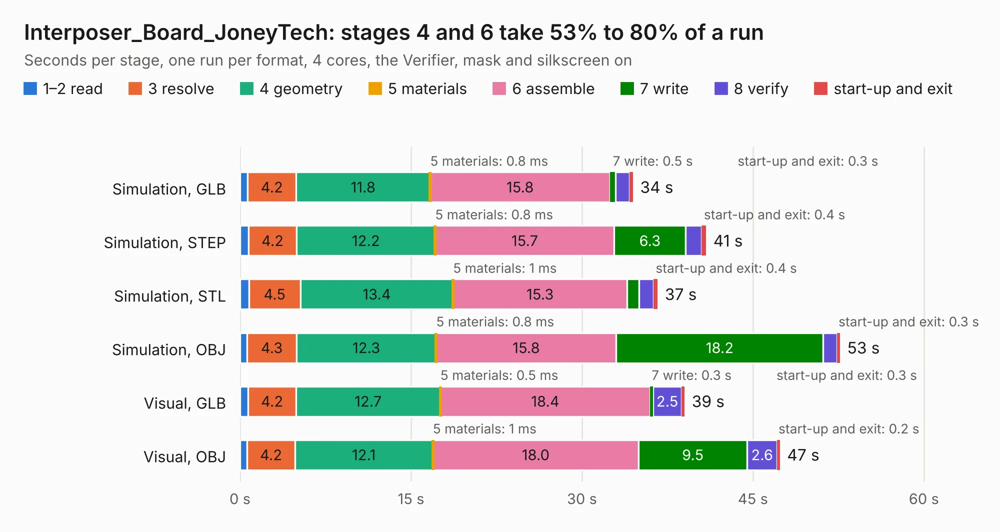

# 892. Interposer_Board_JoneyTech

Board 892 of the 3,129 of [Corpus Testing](../Corpus-Testing.md), on [Corpus Page 9](../CorpusTestingPages/Corpus-Testing-09.md#892-interposer_board_joneytech).

| Mode and format | 1–2 read | 3 resolve | 4 geometry | 5 materials | 6 assemble | 7 write | 8 verify | start-up and exit | Total |
|---|---:|---:|---:|---:|---:|---:|---:|---:|---:|
| Simulation, GLB | 0.7 | 4.2 | 11.8 | 0.8&nbsp;ms | 15.8 | 0.5 | 1.2 | 0.3 | 34.5 |
| Simulation, STEP | 0.7 | 4.2 | 12.2 | 0.8&nbsp;ms | 15.7 | 6.3 | 1.4 | 0.4 | 40.9 |
| Simulation, STL | 0.8 | 4.5 | 13.4 | 1&nbsp;ms | 15.3 | 1.1 | 1.3 | 0.4 | 36.6 |
| Simulation, OBJ | 0.6 | 4.3 | 12.3 | 0.8&nbsp;ms | 15.8 | 18.2 | 1.2 | 0.3 | 52.6 |
| Visual, GLB | 0.7 | 4.2 | 12.7 | 0.5&nbsp;ms | 18.4 | 0.3 | 2.5 | 0.3 | 39.0 |
| Visual, OBJ | 0.6 | 4.2 | 12.1 | 1&nbsp;ms | 18.0 | 9.5 | 2.6 | 0.2 | 47.4 |

<table align="center"><tr><td valign="top">

| Board | Repo: [EEVengers/ThunderScope](https://github.com/EEVengers/ThunderScope) Board: `Interposer_Board_JoneyTech.kicad_pcb` |
|---|---|
| Folder | Hardware / Interposer_Board_JoneyTech |
| Complexity | 281&nbsp;/&nbsp;1000 (size&nbsp;191, features&nbsp;90) |
| KESE&nbsp;features | through vias, arc tracks, filled zones, curved board outline, stack-up, dielectric εr and tanδ |
| Tested | 9th November 2026 |
| Copper&nbsp;layers | 4 |
| File&nbsp;format | KiCad 9 (20241229) |
| Parts,&nbsp;tracks,&nbsp;vias | 7, 261, 1,191 |
| Triangles,&nbsp;simulation | 3,142,600 in 83 parts |
| Verifier | PASS in all six runs |

</td><td valign="top">

<table>
<tr><th>File type</th><th>File size</th><th>Peak memory used</th></tr>
<tr><th colspan="3" align="left">Simulation</th></tr>
<tr><td>GLB</td><td align="right">105&nbsp;MB</td><td align="right">1.2&nbsp;GB</td></tr>
<tr><td>STEP</td><td align="right">230&nbsp;MB</td><td align="right">1.5&nbsp;GB</td></tr>
<tr><td>STL</td><td align="right">157&nbsp;MB</td><td align="right">1.2&nbsp;GB</td></tr>
<tr><td>OBJ</td><td align="right">328&nbsp;MB</td><td align="right">2.0&nbsp;GB</td></tr>
<tr><th colspan="3" align="left">Visual</th></tr>
<tr><td>GLB</td><td align="right">55&nbsp;MB</td><td align="right">1.1&nbsp;GB</td></tr>
<tr><td>OBJ</td><td align="right">172&nbsp;MB</td><td align="right">1.2&nbsp;GB</td></tr>
</table>

</td></tr></table>

| Previous | Next |
|:---|---:|
| [891. Interposer_Board_IOCrest](b0891b_ThunderScope_Interposer-Board-IOCrest.md) | [893. Thunderscope_Rev5.3](b0893b_ThunderScope_Thunderscope-Rev5-3.md) |
