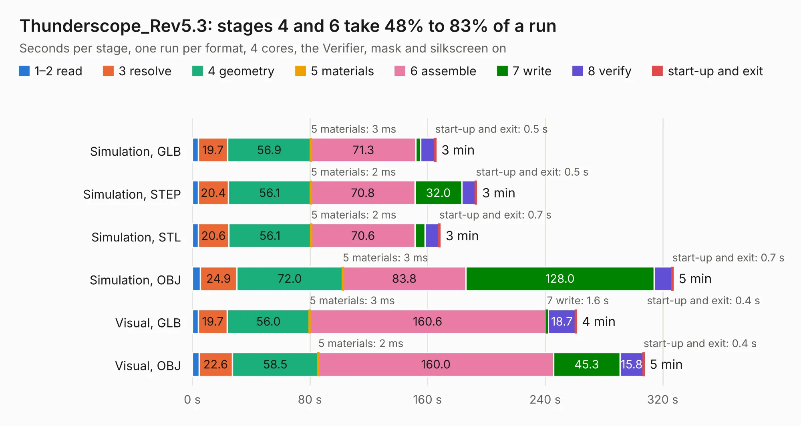

# 893. Thunderscope_Rev5.3

Board 893 of the 3,123 of [Corpus Testing](../Corpus-Testing.md), on [Corpus Page 9](../CorpusTestingPages/Corpus-Testing-09.md#893-thunderscope_rev53).

| Mode and format | 1–2 read | 3 resolve | 4 geometry | 5 materials | 6 assemble | 7 write | 8 verify | start-up and exit | Total |
|---|---:|---:|---:|---:|---:|---:|---:|---:|---:|
| Simulation, GLB | 4.2 | 19.7 | 56.9 | 3&nbsp;ms | 71.3 | 3.3 | 9.6 | 0.5 | 165.6 |
| Simulation, STEP | 4.1 | 20.4 | 56.1 | 2&nbsp;ms | 70.8 | 32.0 | 9.3 | 0.5 | 193.3 |
| Simulation, STL | 4.2 | 20.6 | 56.1 | 2&nbsp;ms | 70.6 | 6.8 | 9.5 | 0.7 | 168.4 |
| Simulation, OBJ | 5.5 | 24.9 | 72.0 | 3&nbsp;ms | 83.8 | 128.0 | 12.1 | 0.7 | 326.9 |
| Visual, GLB | 4.1 | 19.7 | 56.0 | 3&nbsp;ms | 160.6 | 1.6 | 18.7 | 0.4 | 261.2 |
| Visual, OBJ | 4.6 | 22.6 | 58.5 | 2&nbsp;ms | 160.0 | 45.3 | 15.8 | 0.4 | 307.2 |

<table align="center"><tr><td valign="top">

| Board | Repo: [EEVengers/ThunderScope](https://github.com/EEVengers/ThunderScope) Board: `Thunderscope_Rev5.3.kicad_pcb` |
|---|---|
| Folder | Hardware / Thunderscope_Rev5.3 |
| Complexity | 535&nbsp;/&nbsp;1000 (size&nbsp;325, features&nbsp;210) |
| KESE&nbsp;features | through vias, padstacks, slotted holes, custom pads, rounded, trapezoid or chamfered pads, arc tracks, filled zones, copper drawings, copper text, curved board outline, TrueType text, stack-up, dielectric εr and tanδ, copper finish, mask and silkscreen colours |
| Tested | 9th November 2026 to 10th November 2026 |
| Copper&nbsp;layers | 6 |
| File&nbsp;format | KiCad 9 (20241229) |
| Parts,&nbsp;tracks,&nbsp;vias | 811, 9,180, 3,741 |
| Triangles,&nbsp;simulation | 18,225,752 in 648 parts |
| Verifier | PASS in all six runs |
| Run&nbsp;again | Simulation, OBJ: failed in the corpus run, run again with the memory cap raised from 11 GB to 14.5 GB, and passed |

</td><td valign="top">

<table>
<tr><th>File type</th><th>File size</th><th>Peak memory used</th></tr>
<tr><th colspan="3" align="left">Simulation</th></tr>
<tr><td>GLB</td><td align="right">601&nbsp;MB</td><td align="right">4.9&nbsp;GB</td></tr>
<tr><td>STEP</td><td align="right">1.8&nbsp;GB</td><td align="right">6.4&nbsp;GB</td></tr>
<tr><td>STL</td><td align="right">911&nbsp;MB</td><td align="right">4.8&nbsp;GB</td></tr>
<tr><td>OBJ</td><td align="right">2.0&nbsp;GB</td><td align="right">11&nbsp;GB</td></tr>
<tr><th colspan="3" align="left">Visual</th></tr>
<tr><td>GLB</td><td align="right">327&nbsp;MB</td><td align="right">5.3&nbsp;GB</td></tr>
<tr><td>OBJ</td><td align="right">1.1&nbsp;GB</td><td align="right">6.6&nbsp;GB</td></tr>
</table>

</td></tr></table>

| Previous | Next |
|:---|---:|
| [892. Interposer_Board_JoneyTech](b0892b_ThunderScope_Interposer-Board-JoneyTech.md) | [894. TS_Back_Endcap](b0894b_ThunderScope_TS-Back-Endcap.md) |
