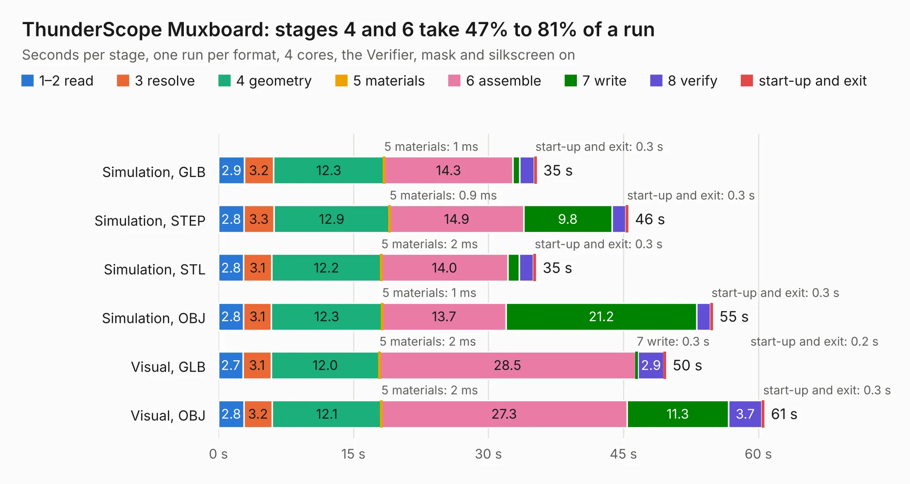

# 895. ThunderScope Muxboard

Board 895 of the 3,109 of [Corpus Testing](../Corpus-Testing.md), on [Corpus Page 9](../CorpusTestingPages/Corpus-Testing-09.md#895-thunderscope-muxboard).

| Mode and format | 1–2 read | 3 resolve | 4 geometry | 5 materials | 6 assemble | 7 write | 8 verify | start-up and exit | Total |
|---|---:|---:|---:|---:|---:|---:|---:|---:|---:|
| Simulation, GLB | 2.9 | 3.2 | 12.3 | 1&nbsp;ms | 14.3 | 0.8 | 1.6 | 0.3 | 35.4 |
| Simulation, STEP | 2.8 | 3.3 | 12.9 | 0.9&nbsp;ms | 14.9 | 9.8 | 1.5 | 0.3 | 45.6 |
| Simulation, STL | 2.8 | 3.1 | 12.2 | 2&nbsp;ms | 14.0 | 1.3 | 1.6 | 0.3 | 35.3 |
| Simulation, OBJ | 2.8 | 3.1 | 12.3 | 1&nbsp;ms | 13.7 | 21.2 | 1.5 | 0.3 | 54.9 |
| Visual, GLB | 2.7 | 3.1 | 12.0 | 2&nbsp;ms | 28.5 | 0.3 | 2.9 | 0.2 | 49.7 |
| Visual, OBJ | 2.8 | 3.2 | 12.1 | 2&nbsp;ms | 27.3 | 11.3 | 3.7 | 0.3 | 60.7 |

<table align="center"><tr><td valign="top">

| Board | Repo: [EEVengers/ts_test_fixtures](https://github.com/EEVengers/ts_test_fixtures) Board: `ThunderScope Muxboard.kicad_pcb` |
|---|---|
| Folder | ThunderScope MUXboard |
| Complexity | 295&nbsp;/&nbsp;1000 (size&nbsp;220, features&nbsp;75) |
| KESE&nbsp;features | through vias, rounded, trapezoid or chamfered pads, filled zones, stack-up, dielectric εr and tanδ |
| Tested | 9th November 2026 |
| Copper&nbsp;layers | 4 |
| File&nbsp;format | KiCad 9 (20241229) |
| Parts,&nbsp;tracks,&nbsp;vias | 167, 1,860, 395 |
| Triangles,&nbsp;simulation | 3,883,746 in 427 parts |
| Verifier | PASS in all six runs |

</td><td valign="top">

<table>
<tr><th>File type</th><th>File size</th><th>Peak memory used</th></tr>
<tr><th colspan="3" align="left">Simulation</th></tr>
<tr><td>GLB</td><td align="right">127&nbsp;MB</td><td align="right">1.2&nbsp;GB</td></tr>
<tr><td>STEP</td><td align="right">437&nbsp;MB</td><td align="right">1.5&nbsp;GB</td></tr>
<tr><td>STL</td><td align="right">194&nbsp;MB</td><td align="right">1.2&nbsp;GB</td></tr>
<tr><td>OBJ</td><td align="right">407&nbsp;MB</td><td align="right">2.6&nbsp;GB</td></tr>
<tr><th colspan="3" align="left">Visual</th></tr>
<tr><td>GLB</td><td align="right">71&nbsp;MB</td><td align="right">1.4&nbsp;GB</td></tr>
<tr><td>OBJ</td><td align="right">226&nbsp;MB</td><td align="right">1.6&nbsp;GB</td></tr>
</table>

</td></tr></table>

| Previous | Next |
|:---|---:|
| [894. Thunderscope Digital Test](b0894b_ts-test-fixtures_Thunderscope-Digital-Test.md) | [896. Thunderscope_Rev5.1_Bed_Of_Nails](b0896b_ts-test-fixtures_Thunderscope-Rev5-1-Bed-Of-Nails.md) |
