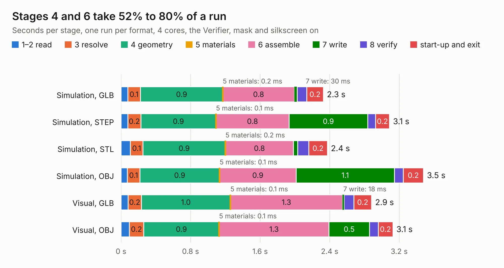

# 896. EEZ DIB DCP405plus front mask (Basic)

Board 896 of the 3,105 of [Corpus Testing](../Corpus-Testing.md), on [Corpus Page 9](../CorpusTestingPages/Corpus-Testing-09.md#896-eez-dib-dcp405plus-front-mask-basic).

| Mode and format | 1–2 read | 3 resolve | 4 geometry | 5 materials | 6 assemble | 7 write | 8 verify | start-up and exit | Total |
|---|---:|---:|---:|---:|---:|---:|---:|---:|---:|
| Simulation, GLB | 77&nbsp;ms | 0.1 | 0.9 | 0.2&nbsp;ms | 0.8 | 30&nbsp;ms | 0.1 | 0.2 | 2.3 |
| Simulation, STEP | 78&nbsp;ms | 0.2 | 0.9 | 0.1&nbsp;ms | 0.8 | 0.9 | 87&nbsp;ms | 0.2 | 3.1 |
| Simulation, STL | 0.1 | 0.1 | 0.9 | 0.2&nbsp;ms | 0.8 | 48&nbsp;ms | 0.1 | 0.2 | 2.4 |
| Simulation, OBJ | 74&nbsp;ms | 0.1 | 0.9 | 0.1&nbsp;ms | 0.9 | 1.1 | 0.1 | 0.2 | 3.5 |
| Visual, GLB | 81&nbsp;ms | 0.2 | 1.0 | 0.1&nbsp;ms | 1.3 | 18&nbsp;ms | 0.1 | 0.2 | 2.9 |
| Visual, OBJ | 94&nbsp;ms | 0.2 | 0.9 | 0.1&nbsp;ms | 1.3 | 0.5 | 0.1 | 0.2 | 3.1 |

<table align="center"><tr><td valign="top">

| Board | Repo: [eez-open/dib-dcp405plus](https://github.com/eez-open/dib-dcp405plus) Board: `EEZ DIB DCP405plus front mask (Basic).kicad_pcb` |
|---|---|
| Folder | KiCad |
| Complexity | 103&nbsp;/&nbsp;1000 (size&nbsp;38, features&nbsp;65) |
| KESE&nbsp;features | filled zones, curved board outline, stack-up, dielectric εr and tanδ, mask and silkscreen colours |
| Tested | 9th November 2026 |
| Copper&nbsp;layers | 2 |
| File&nbsp;format | KiCad 10 (20260206) |
| Parts,&nbsp;tracks,&nbsp;vias | 6, 0, 0 |
| Triangles,&nbsp;simulation | 217,728 in 11 parts |
| Verifier | PASS in all six runs |

</td><td valign="top">

<table>
<tr><th>File type</th><th>File size</th><th>Peak memory used</th></tr>
<tr><th colspan="3" align="left">Simulation</th></tr>
<tr><td>GLB</td><td align="right">7.3&nbsp;MB</td><td align="right">193&nbsp;MB</td></tr>
<tr><td>STEP</td><td align="right">28&nbsp;MB</td><td align="right">213&nbsp;MB</td></tr>
<tr><td>STL</td><td align="right">11&nbsp;MB</td><td align="right">198&nbsp;MB</td></tr>
<tr><td>OBJ</td><td align="right">21&nbsp;MB</td><td align="right">198&nbsp;MB</td></tr>
<tr><th colspan="3" align="left">Visual</th></tr>
<tr><td>GLB</td><td align="right">3.2&nbsp;MB</td><td align="right">145&nbsp;MB</td></tr>
<tr><td>OBJ</td><td align="right">9.1&nbsp;MB</td><td align="right">146&nbsp;MB</td></tr>
</table>

</td></tr></table>

| Previous | Next |
|:---|---:|
| [895. Thunderscope_Rev5.1_Bed_Of_Nails](b0895b_ts-test-fixtures_Thunderscope-Rev5-1-Bed-Of-Nails.md) | [897. EEZ DIB DCP405plus front mask](b0897b_dib-dcp405plus_EEZ-DIB-DCP405plus-front-mask.md) |
