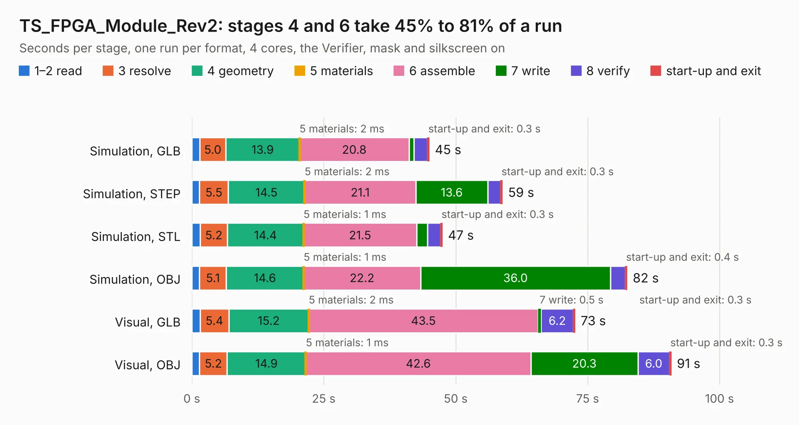

# 896. TS_FPGA_Module_Rev2

Board 896 of the 3,127 of [Corpus Testing](../Corpus-Testing.md), on [Corpus Page 9](../CorpusTestingPages/Corpus-Testing-09.md#896-ts_fpga_module_rev2).

| Mode and format | 1–2 read | 3 resolve | 4 geometry | 5 materials | 6 assemble | 7 write | 8 verify | start-up and exit | Total |
|---|---:|---:|---:|---:|---:|---:|---:|---:|---:|
| Simulation, GLB | 1.5 | 5.0 | 13.9 | 2&nbsp;ms | 20.8 | 0.9 | 2.5 | 0.3 | 45.0 |
| Simulation, STEP | 1.5 | 5.5 | 14.5 | 2&nbsp;ms | 21.1 | 13.6 | 2.4 | 0.3 | 58.9 |
| Simulation, STL | 1.6 | 5.2 | 14.4 | 1&nbsp;ms | 21.5 | 2.0 | 2.5 | 0.3 | 47.5 |
| Simulation, OBJ | 1.5 | 5.1 | 14.6 | 1&nbsp;ms | 22.2 | 36.0 | 2.8 | 0.4 | 82.5 |
| Visual, GLB | 1.6 | 5.4 | 15.2 | 2&nbsp;ms | 43.5 | 0.5 | 6.2 | 0.3 | 72.6 |
| Visual, OBJ | 1.5 | 5.2 | 14.9 | 1&nbsp;ms | 42.6 | 20.3 | 6.0 | 0.3 | 90.8 |

<table align="center"><tr><td valign="top">

| Board | Repo: [EEVengers/ts_hardware_archive](https://github.com/EEVengers/ts_hardware_archive) Board: `TS_FPGA_Module_Rev2.kicad_pcb` |
|---|---|
| Folder | KiCad / FPGA_Module_Rev2 |
| Complexity | 340&nbsp;/&nbsp;1000 (size&nbsp;250, features&nbsp;90) |
| KESE&nbsp;features | through vias, rounded, trapezoid or chamfered pads, arc tracks, filled zones, stack-up, dielectric εr and tanδ |
| Tested | 9th November 2026 |
| Copper&nbsp;layers | 6 |
| File&nbsp;format | KiCad 7 (20221018) |
| Parts,&nbsp;tracks,&nbsp;vias | 170, 8,286, 669 |
| Triangles,&nbsp;simulation | 5,769,364 in 405 parts |
| Verifier | PASS in all six runs |

</td><td valign="top">

<table>
<tr><th>File type</th><th>File size</th><th>Peak memory used</th></tr>
<tr><th colspan="3" align="left">Simulation</th></tr>
<tr><td>GLB</td><td align="right">191&nbsp;MB</td><td align="right">1.6&nbsp;GB</td></tr>
<tr><td>STEP</td><td align="right">710&nbsp;MB</td><td align="right">2.1&nbsp;GB</td></tr>
<tr><td>STL</td><td align="right">289&nbsp;MB</td><td align="right">1.7&nbsp;GB</td></tr>
<tr><td>OBJ</td><td align="right">612&nbsp;MB</td><td align="right">3.6&nbsp;GB</td></tr>
<tr><th colspan="3" align="left">Visual</th></tr>
<tr><td>GLB</td><td align="right">111&nbsp;MB</td><td align="right">1.9&nbsp;GB</td></tr>
<tr><td>OBJ</td><td align="right">361&nbsp;MB</td><td align="right">2.5&nbsp;GB</td></tr>
</table>

</td></tr></table>

| Previous | Next |
|:---|---:|
| [895. TS_Front_Endcap](b0895b_ThunderScope_TS-Front-Endcap.md) | [897. Thunderscope_Rev5.1](b0897b_ts-hardware-archive_Thunderscope-Rev5-1.md) |
