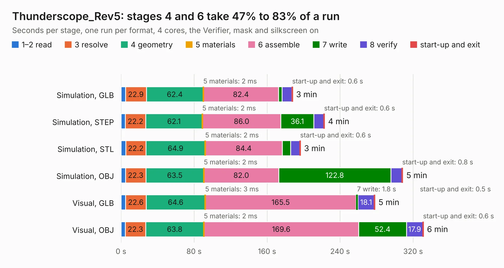

# 897. Thunderscope_Rev5

Board 897 of the 3,118 of [Corpus Testing](../Corpus-Testing.md), on [Corpus Page 9](../CorpusTestingPages/Corpus-Testing-09.md#897-thunderscope_rev5).

| Mode and format | 1–2 read | 3 resolve | 4 geometry | 5 materials | 6 assemble | 7 write | 8 verify | start-up and exit | Total |
|---|---:|---:|---:|---:|---:|---:|---:|---:|---:|
| Simulation, GLB | 4.8 | 22.9 | 62.4 | 2&nbsp;ms | 82.4 | 3.8 | 10.9 | 0.6 | 187.9 |
| Simulation, STEP | 4.8 | 22.2 | 62.1 | 2&nbsp;ms | 86.0 | 36.1 | 11.1 | 0.6 | 222.9 |
| Simulation, STL | 5.1 | 22.2 | 64.9 | 2&nbsp;ms | 84.4 | 9.0 | 10.4 | 0.6 | 196.7 |
| Simulation, OBJ | 4.9 | 22.3 | 63.5 | 2&nbsp;ms | 82.0 | 122.8 | 12.2 | 0.8 | 308.6 |
| Visual, GLB | 4.9 | 22.6 | 64.6 | 3&nbsp;ms | 165.5 | 1.8 | 18.1 | 0.5 | 278.0 |
| Visual, OBJ | 4.7 | 22.3 | 63.8 | 2&nbsp;ms | 169.6 | 52.4 | 17.9 | 0.6 | 331.3 |

<table align="center"><tr><td valign="top">

| Board | Repo: [EEVengers/ts_hardware_archive](https://github.com/EEVengers/ts_hardware_archive) Board: `Thunderscope_Rev5.kicad_pcb` |
|---|---|
| Folder | KiCad / Thunderscope_Rev5 |
| Complexity | 488&nbsp;/&nbsp;1000 (size&nbsp;323, features&nbsp;165) |
| KESE&nbsp;features | through vias, padstacks, slotted holes, rounded, trapezoid or chamfered pads, arc tracks, filled zones, copper text, curved board outline, TrueType text, stack-up, dielectric εr and tanδ |
| Tested | 9th November 2026 to 10th November 2026 |
| Copper&nbsp;layers | 6 |
| File&nbsp;format | KiCad 9 (20241229) |
| Parts,&nbsp;tracks,&nbsp;vias | 698, 8,782, 3,768 |
| Triangles,&nbsp;simulation | 18,033,920 in 603 parts |
| Verifier | PASS in all six runs |
| Run&nbsp;again | Simulation, OBJ: failed in the corpus run, run again with the memory cap raised from 11 GB to 14.5 GB, and passed |

</td><td valign="top">

<table>
<tr><th>File type</th><th>File size</th><th>Peak memory used</th></tr>
<tr><th colspan="3" align="left">Simulation</th></tr>
<tr><td>GLB</td><td align="right">594&nbsp;MB</td><td align="right">5.1&nbsp;GB</td></tr>
<tr><td>STEP</td><td align="right">1.7&nbsp;GB</td><td align="right">6.3&nbsp;GB</td></tr>
<tr><td>STL</td><td align="right">902&nbsp;MB</td><td align="right">5.3&nbsp;GB</td></tr>
<tr><td>OBJ</td><td align="right">2.0&nbsp;GB</td><td align="right">11&nbsp;GB</td></tr>
<tr><th colspan="3" align="left">Visual</th></tr>
<tr><td>GLB</td><td align="right">321&nbsp;MB</td><td align="right">5.2&nbsp;GB</td></tr>
<tr><td>OBJ</td><td align="right">1.1&nbsp;GB</td><td align="right">6.7&nbsp;GB</td></tr>
</table>

</td></tr></table>

| Previous | Next |
|:---|---:|
| [896. Thunderscope_Rev5.2](b0896b_ts-hardware-archive_Thunderscope-Rev5-2.md) | [898. Thunderscope_Rev5_Mech_Model](b0898b_ts-hardware-archive_Thunderscope-Rev5-Mech-Model.md) |
