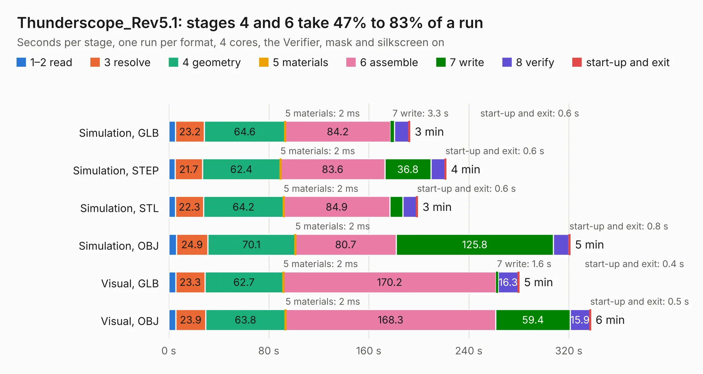

# 898. Thunderscope_Rev5.1

Board 898 of the 3,139 of [Corpus Testing](../Corpus-Testing.md), on [Corpus Page 9](../CorpusTestingPages/Corpus-Testing-09.md#898-thunderscope_rev51).

| Mode and format | 1–2 read | 3 resolve | 4 geometry | 5 materials | 6 assemble | 7 write | 8 verify | start-up and exit | Total |
|---|---:|---:|---:|---:|---:|---:|---:|---:|---:|
| Simulation, GLB | 5.3 | 23.2 | 64.6 | 2&nbsp;ms | 84.2 | 3.3 | 11.5 | 0.6 | 192.7 |
| Simulation, STEP | 5.2 | 21.7 | 62.4 | 2&nbsp;ms | 83.6 | 36.8 | 11.4 | 0.6 | 221.6 |
| Simulation, STL | 5.4 | 22.3 | 64.2 | 2&nbsp;ms | 84.9 | 10.4 | 11.2 | 0.6 | 199.0 |
| Simulation, OBJ | 6.2 | 24.9 | 70.1 | 2&nbsp;ms | 80.7 | 125.8 | 12.5 | 0.8 | 320.9 |
| Visual, GLB | 5.5 | 23.3 | 62.7 | 2&nbsp;ms | 170.2 | 1.6 | 16.3 | 0.4 | 280.1 |
| Visual, OBJ | 5.6 | 23.9 | 63.8 | 2&nbsp;ms | 168.3 | 59.4 | 15.9 | 0.5 | 337.4 |

<table align="center"><tr><td valign="top">

| Board | Repo: [EEVengers/ts_hardware_archive](https://github.com/EEVengers/ts_hardware_archive) Board: `Thunderscope_Rev5.1.kicad_pcb` |
|---|---|
| Folder | KiCad / Thunderscope_Rev5.1 |
| Complexity | 514&nbsp;/&nbsp;1000 (size&nbsp;324, features&nbsp;190) |
| KESE&nbsp;features | through vias, padstacks, slotted holes, custom pads, rounded, trapezoid or chamfered pads, arc tracks, filled zones, copper drawings, copper text, curved board outline, TrueType text, stack-up, dielectric εr and tanδ |
| Tested | 9th November 2026 to 10th November 2026 |
| Copper&nbsp;layers | 6 |
| File&nbsp;format | KiCad 9 (20241229) |
| Parts,&nbsp;tracks,&nbsp;vias | 757, 8,814, 3,766 |
| Triangles,&nbsp;simulation | 18,063,610 in 618 parts |
| Verifier | PASS in all six runs |
| Run&nbsp;again | Simulation, OBJ: failed in the corpus run, run again with the memory cap raised from 11 GB to 14.5 GB, and passed |

</td><td valign="top">

<table>
<tr><th>File type</th><th>File size</th><th>Peak memory used</th></tr>
<tr><th colspan="3" align="left">Simulation</th></tr>
<tr><td>GLB</td><td align="right">595&nbsp;MB</td><td align="right">5.3&nbsp;GB</td></tr>
<tr><td>STEP</td><td align="right">1.7&nbsp;GB</td><td align="right">6.5&nbsp;GB</td></tr>
<tr><td>STL</td><td align="right">903&nbsp;MB</td><td align="right">4.8&nbsp;GB</td></tr>
<tr><td>OBJ</td><td align="right">2.0&nbsp;GB</td><td align="right">11&nbsp;GB</td></tr>
<tr><th colspan="3" align="left">Visual</th></tr>
<tr><td>GLB</td><td align="right">322&nbsp;MB</td><td align="right">5.2&nbsp;GB</td></tr>
<tr><td>OBJ</td><td align="right">1.1&nbsp;GB</td><td align="right">6.5&nbsp;GB</td></tr>
</table>

</td></tr></table>

| Previous | Next |
|:---|---:|
| [897. TS_FPGA_Module_Rev2](b0897b_ts-hardware-archive_TS-FPGA-Module-Rev2.md) | [899. Thunderscope_Rev5.2](b0899b_ts-hardware-archive_Thunderscope-Rev5-2.md) |
