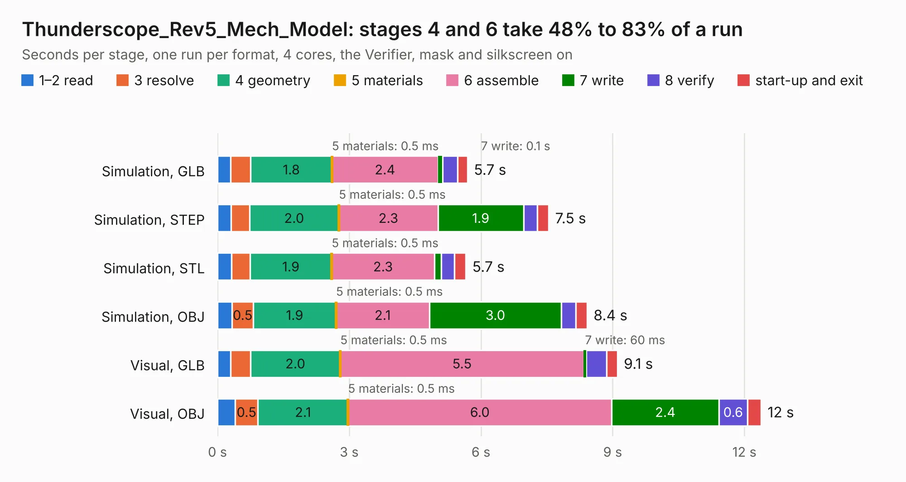

# 901 Thunderscope_Rev5_Mech_Model

Board 901 of the 3,138 of [Corpus Testing](../Corpus-Testing.md), on [Corpus Page 9](../CorpusTestingPages/Corpus-Testing-09.md#901-thunderscope_rev5_mech_model).

| Mode and format | 1–2 read | 3 resolve | 4 geometry | 5 materials | 6 assemble | 7 write | 8 verify | start-up and exit | Total |
|---|---:|---:|---:|---:|---:|---:|---:|---:|---:|
| Simulation, GLB | 0.3 | 0.5 | 1.8 | 0.5&nbsp;ms | 2.4 | 0.1 | 0.3 | 0.2 | 5.7 |
| Simulation, STEP | 0.3 | 0.4 | 2.0 | 0.5&nbsp;ms | 2.3 | 1.9 | 0.3 | 0.3 | 7.5 |
| Simulation, STL | 0.3 | 0.4 | 1.9 | 0.5&nbsp;ms | 2.3 | 0.2 | 0.3 | 0.3 | 5.7 |
| Simulation, OBJ | 0.3 | 0.5 | 1.9 | 0.5&nbsp;ms | 2.1 | 3.0 | 0.3 | 0.3 | 8.4 |
| Visual, GLB | 0.3 | 0.5 | 2.0 | 0.5&nbsp;ms | 5.5 | 60&nbsp;ms | 0.5 | 0.2 | 9.1 |
| Visual, OBJ | 0.4 | 0.5 | 2.1 | 0.5&nbsp;ms | 6.0 | 2.4 | 0.6 | 0.3 | 12.4 |

<table align="center"><tr><td valign="top">

| Board | Repo: [EEVengers/ts_hardware_archive](https://github.com/EEVengers/ts_hardware_archive) Board: `Thunderscope_Rev5_Mech_Model.kicad_pcb` |
|---|---|
| Folder | KiCad / Thunderscope_Rev5_Mech_Model |
| Complexity | 228&nbsp;/&nbsp;1000 (size&nbsp;98, features&nbsp;130) |
| KESE&nbsp;features | padstacks, rounded, trapezoid or chamfered pads, arc tracks, filled zones, curved board outline, TrueType text, stack-up, dielectric εr and tanδ |
| Tested | 9th November 2026 |
| Copper&nbsp;layers | 2 |
| File&nbsp;format | KiCad 9 (20241228) |
| Parts,&nbsp;tracks,&nbsp;vias | 20, 18, 0 |
| Triangles,&nbsp;simulation | 524,420 in 183 parts |
| Verifier | PASS in all six runs |

</td><td valign="top">

<table>
<tr><th>File type</th><th>File size</th><th>Peak memory used</th></tr>
<tr><th colspan="3" align="left">Simulation</th></tr>
<tr><td>GLB</td><td align="right">18&nbsp;MB</td><td align="right">316&nbsp;MB</td></tr>
<tr><td>STEP</td><td align="right">83&nbsp;MB</td><td align="right">374&nbsp;MB</td></tr>
<tr><td>STL</td><td align="right">26&nbsp;MB</td><td align="right">343&nbsp;MB</td></tr>
<tr><td>OBJ</td><td align="right">53&nbsp;MB</td><td align="right">402&nbsp;MB</td></tr>
<tr><th colspan="3" align="left">Visual</th></tr>
<tr><td>GLB</td><td align="right">13&nbsp;MB</td><td align="right">388&nbsp;MB</td></tr>
<tr><td>OBJ</td><td align="right">38&nbsp;MB</td><td align="right">383&nbsp;MB</td></tr>
</table>

</td></tr></table>

| Previous | Next |
|:---|---:|
| [900 Thunderscope_Rev5](b0900b_ts-hardware-archive_Thunderscope-Rev5.md) | [902 HMCAD1520_Impedence_Checker](b0902b_ts-test-fixtures_HMCAD1520-Impedence-Checker.md) |
