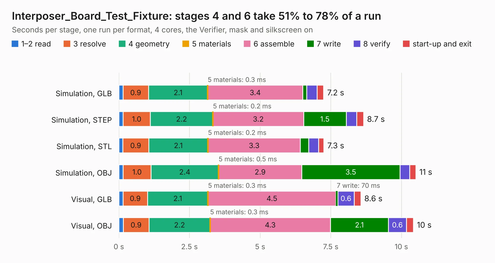

# 902. Interposer_Board_Test_Fixture

Board 902 of the 3,123 of [Corpus Testing](../Corpus-Testing.md), on [Corpus Page 9](../CorpusTestingPages/Corpus-Testing-09.md#902-interposer_board_test_fixture).

| Mode and format | 1–2 read | 3 resolve | 4 geometry | 5 materials | 6 assemble | 7 write | 8 verify | start-up and exit | Total |
|---|---:|---:|---:|---:|---:|---:|---:|---:|---:|
| Simulation, GLB | 0.1 | 0.9 | 2.1 | 0.3&nbsp;ms | 3.4 | 0.1 | 0.4 | 0.2 | 7.2 |
| Simulation, STEP | 0.2 | 1.0 | 2.2 | 0.2&nbsp;ms | 3.2 | 1.5 | 0.4 | 0.2 | 8.7 |
| Simulation, STL | 0.1 | 0.9 | 2.1 | 0.2&nbsp;ms | 3.3 | 0.3 | 0.4 | 0.2 | 7.3 |
| Simulation, OBJ | 0.2 | 1.0 | 2.4 | 0.5&nbsp;ms | 2.9 | 3.5 | 0.3 | 0.2 | 10.5 |
| Visual, GLB | 0.1 | 0.9 | 2.1 | 0.3&nbsp;ms | 4.5 | 70&nbsp;ms | 0.6 | 0.2 | 8.6 |
| Visual, OBJ | 0.2 | 0.9 | 2.2 | 0.3&nbsp;ms | 4.3 | 2.1 | 0.6 | 0.2 | 10.4 |

<table align="center"><tr><td valign="top">

| Board | Repo: [EEVengers/ts_test_fixtures](https://github.com/EEVengers/ts_test_fixtures) Board: `Interposer_Board_Test_Fixture.kicad_pcb` |
|---|---|
| Folder | Interposer_Board_Test_Fixture |
| Complexity | 266&nbsp;/&nbsp;1000 (size&nbsp;176, features&nbsp;90) |
| KESE&nbsp;features | through vias, arc tracks, filled zones, curved board outline, stack-up, dielectric εr and tanδ |
| Tested | 9th November 2026 |
| Copper&nbsp;layers | 4 |
| File&nbsp;format | KiCad 9 (20241229) |
| Parts,&nbsp;tracks,&nbsp;vias | 7, 444, 355 |
| Triangles,&nbsp;simulation | 923,008 in 100 parts |
| Verifier | PASS in all six runs |

</td><td valign="top">

<table>
<tr><th>File type</th><th>File size</th><th>Peak memory used</th></tr>
<tr><th colspan="3" align="left">Simulation</th></tr>
<tr><td>GLB</td><td align="right">31&nbsp;MB</td><td align="right">458&nbsp;MB</td></tr>
<tr><td>STEP</td><td align="right">63&nbsp;MB</td><td align="right">552&nbsp;MB</td></tr>
<tr><td>STL</td><td align="right">46&nbsp;MB</td><td align="right">460&nbsp;MB</td></tr>
<tr><td>OBJ</td><td align="right">92&nbsp;MB</td><td align="right">639&nbsp;MB</td></tr>
<tr><th colspan="3" align="left">Visual</th></tr>
<tr><td>GLB</td><td align="right">17&nbsp;MB</td><td align="right">470&nbsp;MB</td></tr>
<tr><td>OBJ</td><td align="right">51&nbsp;MB</td><td align="right">467&nbsp;MB</td></tr>
</table>

</td></tr></table>

| Previous | Next |
|:---|---:|
| [901. HMCAD1520_Impedence_Checker](b0901b_ts-test-fixtures_HMCAD1520-Impedence-Checker.md) | [903. Thunderscope Digital Test](b0903b_ts-test-fixtures_Thunderscope-Digital-Test.md) |
