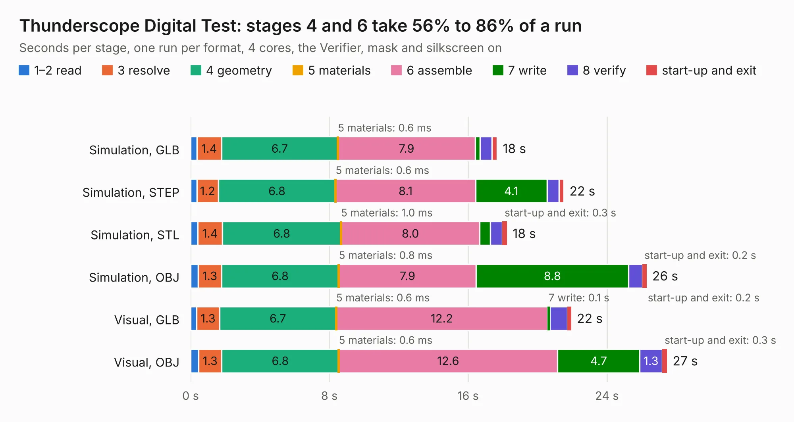

# 903. Thunderscope Digital Test

Board 903 of the 3,130 of [Corpus Testing](../Corpus-Testing.md), on [Corpus Page 9](../CorpusTestingPages/Corpus-Testing-09.md#903-thunderscope-digital-test).

| Mode and format | 1–2 read | 3 resolve | 4 geometry | 5 materials | 6 assemble | 7 write | 8 verify | start-up and exit | Total |
|---|---:|---:|---:|---:|---:|---:|---:|---:|---:|
| Simulation, GLB | 0.4 | 1.4 | 6.7 | 0.6&nbsp;ms | 7.9 | 0.3 | 0.7 | 0.3 | 17.7 |
| Simulation, STEP | 0.4 | 1.2 | 6.8 | 0.6&nbsp;ms | 8.1 | 4.1 | 0.7 | 0.3 | 21.5 |
| Simulation, STL | 0.4 | 1.4 | 6.8 | 1.0&nbsp;ms | 8.0 | 0.6 | 0.7 | 0.3 | 18.2 |
| Simulation, OBJ | 0.4 | 1.3 | 6.8 | 0.8&nbsp;ms | 7.9 | 8.8 | 0.8 | 0.2 | 26.3 |
| Visual, GLB | 0.3 | 1.3 | 6.7 | 0.6&nbsp;ms | 12.2 | 0.1 | 1.0 | 0.2 | 21.9 |
| Visual, OBJ | 0.5 | 1.3 | 6.8 | 0.6&nbsp;ms | 12.6 | 4.7 | 1.3 | 0.3 | 27.5 |

<table align="center"><tr><td valign="top">

| Board | Repo: [EEVengers/ts_test_fixtures](https://github.com/EEVengers/ts_test_fixtures) Board: `Thunderscope Digital Test.kicad_pcb` |
|---|---|
| Folder | Thunderscope Digital Test Fixture / Thunderscope Digital Test |
| Complexity | 322&nbsp;/&nbsp;1000 (size&nbsp;232, features&nbsp;90) |
| KESE&nbsp;features | through vias, rounded, trapezoid or chamfered pads, filled zones, TrueType text, stack-up, dielectric εr and tanδ |
| Tested | 9th November 2026 |
| Copper&nbsp;layers | 4 |
| File&nbsp;format | KiCad 9 (20241229) |
| Parts,&nbsp;tracks,&nbsp;vias | 68, 750, 80 |
| Triangles,&nbsp;simulation | 1,825,262 in 167 parts |
| Verifier | PASS in all six runs |

</td><td valign="top">

<table>
<tr><th>File type</th><th>File size</th><th>Peak memory used</th></tr>
<tr><th colspan="3" align="left">Simulation</th></tr>
<tr><td>GLB</td><td align="right">61&nbsp;MB</td><td align="right">610&nbsp;MB</td></tr>
<tr><td>STEP</td><td align="right">222&nbsp;MB</td><td align="right">795&nbsp;MB</td></tr>
<tr><td>STL</td><td align="right">91&nbsp;MB</td><td align="right">604&nbsp;MB</td></tr>
<tr><td>OBJ</td><td align="right">188&nbsp;MB</td><td align="right">1.2&nbsp;GB</td></tr>
<tr><th colspan="3" align="left">Visual</th></tr>
<tr><td>GLB</td><td align="right">31&nbsp;MB</td><td align="right">776&nbsp;MB</td></tr>
<tr><td>OBJ</td><td align="right">95&nbsp;MB</td><td align="right">729&nbsp;MB</td></tr>
</table>

</td></tr></table>

| Previous | Next |
|:---|---:|
| [902. Interposer_Board_Test_Fixture](b0902b_ts-test-fixtures_Interposer-Board-Test-Fixture.md) | [904. ThunderScope Muxboard](b0904b_ts-test-fixtures_ThunderScope-Muxboard.md) |
