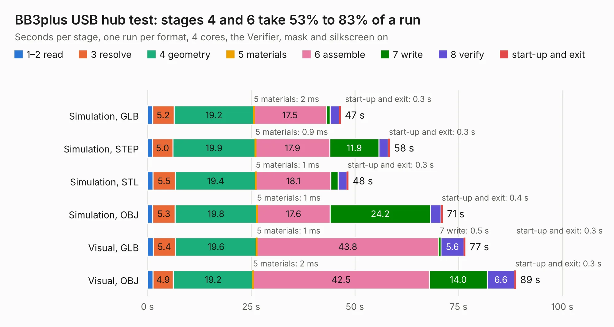

# 904. BB3plus USB hub test

Board 904 of the 3,105 of [Corpus Testing](../Corpus-Testing.md), on [Corpus Page 9](../CorpusTestingPages/Corpus-Testing-09.md#904-bb3plus-usb-hub-test).

| Mode and format | 1–2 read | 3 resolve | 4 geometry | 5 materials | 6 assemble | 7 write | 8 verify | start-up and exit | Total |
|---|---:|---:|---:|---:|---:|---:|---:|---:|---:|
| Simulation, GLB | 1.2 | 5.2 | 19.2 | 2&nbsp;ms | 17.5 | 1.0 | 2.2 | 0.3 | 46.5 |
| Simulation, STEP | 1.1 | 5.0 | 19.9 | 0.9&nbsp;ms | 17.9 | 11.9 | 2.2 | 0.3 | 58.4 |
| Simulation, STL | 1.3 | 5.5 | 19.4 | 1&nbsp;ms | 18.1 | 1.8 | 2.1 | 0.3 | 48.4 |
| Simulation, OBJ | 1.3 | 5.3 | 19.8 | 1&nbsp;ms | 17.6 | 24.2 | 2.5 | 0.4 | 71.1 |
| Visual, GLB | 1.4 | 5.4 | 19.6 | 1&nbsp;ms | 43.8 | 0.5 | 5.6 | 0.3 | 76.6 |
| Visual, OBJ | 1.3 | 4.9 | 19.2 | 2&nbsp;ms | 42.5 | 14.0 | 6.6 | 0.3 | 88.8 |

<table align="center"><tr><td valign="top">

| Board | Repo: [eez-open/eez-bb3plus](https://github.com/eez-open/eez-bb3plus) Board: `BB3plus USB hub test.kicad_pcb` |
|---|---|
| Folder | Experimental / KiCad / BB3plus USB hub test |
| Complexity | 434&nbsp;/&nbsp;1000 (size&nbsp;284, features&nbsp;150) |
| KESE&nbsp;features | through vias, slotted holes, custom pads, rounded, trapezoid or chamfered pads, arc tracks, filled zones, copper drawings, curved board outline, knockout text, stack-up, dielectric εr and tanδ |
| Tested | 9th November 2026 |
| Copper&nbsp;layers | 4 |
| File&nbsp;format | KiCad 9 (20241229) |
| Parts,&nbsp;tracks,&nbsp;vias | 248, 4,383, 713 |
| Triangles,&nbsp;simulation | 5,494,414 in 442 parts |
| Verifier | PASS in all six runs |

</td><td valign="top">

<table>
<tr><th>File type</th><th>File size</th><th>Peak memory used</th></tr>
<tr><th colspan="3" align="left">Simulation</th></tr>
<tr><td>GLB</td><td align="right">188&nbsp;MB</td><td align="right">1.6&nbsp;GB</td></tr>
<tr><td>STEP</td><td align="right">735&nbsp;MB</td><td align="right">2.0&nbsp;GB</td></tr>
<tr><td>STL</td><td align="right">275&nbsp;MB</td><td align="right">1.6&nbsp;GB</td></tr>
<tr><td>OBJ</td><td align="right">592&nbsp;MB</td><td align="right">3.6&nbsp;GB</td></tr>
<tr><th colspan="3" align="left">Visual</th></tr>
<tr><td>GLB</td><td align="right">115&nbsp;MB</td><td align="right">1.9&nbsp;GB</td></tr>
<tr><td>OBJ</td><td align="right">367&nbsp;MB</td><td align="right">2.3&nbsp;GB</td></tr>
</table>

</td></tr></table>

| Previous | Next |
|:---|---:|
| [903. BB3plus test mainboard](b0903b_eez-bb3plus_BB3plus-test-mainboard.md) | [905. DIB2 USB adapter front mask](b0905b_eez-bb3plus_DIB2-USB-adapter-front-mask.md) |
