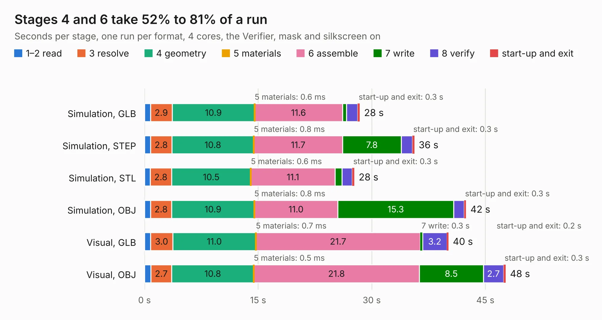

# 905. Thunderscope_Rev5.1_Bed_Of_Nails

Board 905 of the 3,127 of [Corpus Testing](../Corpus-Testing.md), on [Corpus Page 9](../CorpusTestingPages/Corpus-Testing-09.md#905-thunderscope_rev51_bed_of_nails).

| Mode and format | 1–2 read | 3 resolve | 4 geometry | 5 materials | 6 assemble | 7 write | 8 verify | start-up and exit | Total |
|---|---:|---:|---:|---:|---:|---:|---:|---:|---:|
| Simulation, GLB | 0.8 | 2.9 | 10.9 | 0.6&nbsp;ms | 11.6 | 0.6 | 1.5 | 0.3 | 28.4 |
| Simulation, STEP | 0.8 | 2.8 | 10.8 | 0.8&nbsp;ms | 11.7 | 7.8 | 1.4 | 0.3 | 35.6 |
| Simulation, STL | 0.7 | 2.8 | 10.5 | 0.6&nbsp;ms | 11.1 | 0.9 | 1.3 | 0.3 | 27.7 |
| Simulation, OBJ | 0.8 | 2.8 | 10.9 | 0.8&nbsp;ms | 11.0 | 15.3 | 1.4 | 0.3 | 42.5 |
| Visual, GLB | 0.8 | 3.0 | 11.0 | 0.7&nbsp;ms | 21.7 | 0.3 | 3.2 | 0.2 | 40.1 |
| Visual, OBJ | 0.8 | 2.7 | 10.8 | 0.5&nbsp;ms | 21.8 | 8.5 | 2.7 | 0.3 | 47.7 |

<table align="center"><tr><td valign="top">

| Board | Repo: [EEVengers/ts_test_fixtures](https://github.com/EEVengers/ts_test_fixtures) Board: `Thunderscope_Rev5.1_Bed_Of_Nails.kicad_pcb` |
|---|---|
| Folder | Thunderscope_Rev5.1_Bed_Of_Nails_Adaptor |
| Complexity | 295&nbsp;/&nbsp;1000 (size&nbsp;205, features&nbsp;90) |
| KESE&nbsp;features | through vias, rounded, trapezoid or chamfered pads, filled zones, TrueType text, stack-up, dielectric εr and tanδ |
| Tested | 9th November 2026 |
| Copper&nbsp;layers | 4 |
| File&nbsp;format | KiCad 9 (20241229) |
| Parts,&nbsp;tracks,&nbsp;vias | 170, 595, 202 |
| Triangles,&nbsp;simulation | 3,683,612 in 177 parts |
| Verifier | PASS in all six runs |

</td><td valign="top">

<table>
<tr><th>File type</th><th>File size</th><th>Peak memory used</th></tr>
<tr><th colspan="3" align="left">Simulation</th></tr>
<tr><td>GLB</td><td align="right">123&nbsp;MB</td><td align="right">1.1&nbsp;GB</td></tr>
<tr><td>STEP</td><td align="right">452&nbsp;MB</td><td align="right">1.5&nbsp;GB</td></tr>
<tr><td>STL</td><td align="right">184&nbsp;MB</td><td align="right">1.2&nbsp;GB</td></tr>
<tr><td>OBJ</td><td align="right">386&nbsp;MB</td><td align="right">2.3&nbsp;GB</td></tr>
<tr><th colspan="3" align="left">Visual</th></tr>
<tr><td>GLB</td><td align="right">70&nbsp;MB</td><td align="right">1.2&nbsp;GB</td></tr>
<tr><td>OBJ</td><td align="right">217&nbsp;MB</td><td align="right">1.5&nbsp;GB</td></tr>
</table>

</td></tr></table>

| Previous | Next |
|:---|---:|
| [904. ThunderScope Muxboard](b0904b_ts-test-fixtures_ThunderScope-Muxboard.md) | [906. EEZ DIB DCP405plus front mask (Basic)](b0906b_dib-dcp405plus_EEZ-DIB-DCP405plus-front-mask-Basic.md) |
