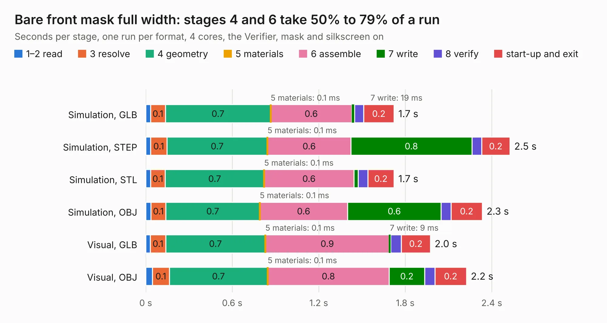

# 907. Bare front mask full width

Board 907 of the 3,102 of [Corpus Testing](../Corpus-Testing.md), on [Corpus Page 9](../CorpusTestingPages/Corpus-Testing-09.md#907-bare-front-mask-full-width).

| Mode and format | 1–2 read | 3 resolve | 4 geometry | 5 materials | 6 assemble | 7 write | 8 verify | start-up and exit | Total |
|---|---:|---:|---:|---:|---:|---:|---:|---:|---:|
| Simulation, GLB | 33&nbsp;ms | 0.1 | 0.7 | 0.1&nbsp;ms | 0.6 | 19&nbsp;ms | 63&nbsp;ms | 0.2 | 1.7 |
| Simulation, STEP | 34&nbsp;ms | 0.1 | 0.7 | 0.1&nbsp;ms | 0.6 | 0.8 | 67&nbsp;ms | 0.2 | 2.5 |
| Simulation, STL | 33&nbsp;ms | 0.1 | 0.7 | 0.1&nbsp;ms | 0.6 | 30&nbsp;ms | 66&nbsp;ms | 0.2 | 1.7 |
| Simulation, OBJ | 36&nbsp;ms | 0.1 | 0.7 | 0.1&nbsp;ms | 0.6 | 0.6 | 69&nbsp;ms | 0.2 | 2.3 |
| Visual, GLB | 32&nbsp;ms | 0.1 | 0.7 | 0.1&nbsp;ms | 0.9 | 9&nbsp;ms | 75&nbsp;ms | 0.2 | 2.0 |
| Visual, OBJ | 46&nbsp;ms | 0.1 | 0.7 | 0.1&nbsp;ms | 0.8 | 0.2 | 70&nbsp;ms | 0.2 | 2.2 |

<table align="center"><tr><td valign="top">

| Board | Repo: [eez-open/eez-bb3plus](https://github.com/eez-open/eez-bb3plus) Board: `Bare front mask full width.kicad_pcb` |
|---|---|
| Folder | KiCad / Front masks |
| Complexity | 93&nbsp;/&nbsp;1000 (size&nbsp;38, features&nbsp;55) |
| KESE&nbsp;features | filled zones, stack-up, dielectric εr and tanδ, mask and silkscreen colours |
| Tested | 9th November 2026 |
| Copper&nbsp;layers | 2 |
| File&nbsp;format | KiCad 10 (20260206) |
| Parts,&nbsp;tracks,&nbsp;vias | 6, 0, 0 |
| Triangles,&nbsp;simulation | 137,530 in 9 parts |
| Verifier | PASS in all six runs |

</td><td valign="top">

<table>
<tr><th>File type</th><th>File size</th><th>Peak memory used</th></tr>
<tr><th colspan="3" align="left">Simulation</th></tr>
<tr><td>GLB</td><td align="right">4.6&nbsp;MB</td><td align="right">178&nbsp;MB</td></tr>
<tr><td>STEP</td><td align="right">14&nbsp;MB</td><td align="right">184&nbsp;MB</td></tr>
<tr><td>STL</td><td align="right">6.9&nbsp;MB</td><td align="right">176&nbsp;MB</td></tr>
<tr><td>OBJ</td><td align="right">13&nbsp;MB</td><td align="right">180&nbsp;MB</td></tr>
<tr><th colspan="3" align="left">Visual</th></tr>
<tr><td>GLB</td><td align="right">1.9&nbsp;MB</td><td align="right">139&nbsp;MB</td></tr>
<tr><td>OBJ</td><td align="right">5.3&nbsp;MB</td><td align="right">141&nbsp;MB</td></tr>
</table>

</td></tr></table>

| Previous | Next |
|:---|---:|
| [906. BB3plus mainboard](b0906b_eez-bb3plus_BB3plus-mainboard.md) | [908. Bare front mask half width](b0908b_eez-bb3plus_Bare-front-mask-half-width.md) |
