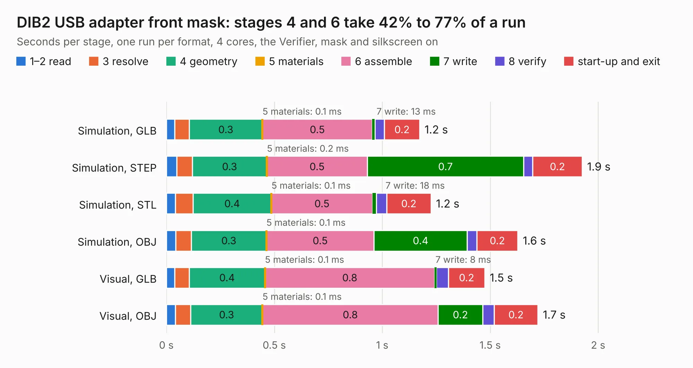

# 907. DIB2 USB adapter front mask

Board 907 of the 3,111 of [Corpus Testing](../Corpus-Testing.md), on [Corpus Page 9](../CorpusTestingPages/Corpus-Testing-09.md#907-dib2-usb-adapter-front-mask).

| Mode and format | 1–2 read | 3 resolve | 4 geometry | 5 materials | 6 assemble | 7 write | 8 verify | start-up and exit | Total |
|---|---:|---:|---:|---:|---:|---:|---:|---:|---:|
| Simulation, GLB | 39&nbsp;ms | 67&nbsp;ms | 0.3 | 0.1&nbsp;ms | 0.5 | 13&nbsp;ms | 44&nbsp;ms | 0.2 | 1.2 |
| Simulation, STEP | 49&nbsp;ms | 72&nbsp;ms | 0.3 | 0.2&nbsp;ms | 0.5 | 0.7 | 42&nbsp;ms | 0.2 | 1.9 |
| Simulation, STL | 41&nbsp;ms | 82&nbsp;ms | 0.4 | 0.1&nbsp;ms | 0.5 | 18&nbsp;ms | 48&nbsp;ms | 0.2 | 1.2 |
| Simulation, OBJ | 43&nbsp;ms | 73&nbsp;ms | 0.3 | 0.1&nbsp;ms | 0.5 | 0.4 | 45&nbsp;ms | 0.2 | 1.6 |
| Visual, GLB | 38&nbsp;ms | 68&nbsp;ms | 0.4 | 0.1&nbsp;ms | 0.8 | 8&nbsp;ms | 56&nbsp;ms | 0.2 | 1.5 |
| Visual, OBJ | 42&nbsp;ms | 71&nbsp;ms | 0.3 | 0.1&nbsp;ms | 0.8 | 0.2 | 53&nbsp;ms | 0.2 | 1.7 |

<table align="center"><tr><td valign="top">

| Board | Repo: [eez-open/eez-bb3plus](https://github.com/eez-open/eez-bb3plus) Board: `DIB2 USB adapter front mask.kicad_pcb` |
|---|---|
| Folder | Experimental / KiCad / DIB2 USB adapter |
| Complexity | 89&nbsp;/&nbsp;1000 (size&nbsp;29, features&nbsp;60) |
| KESE&nbsp;features | filled zones, curved board outline, stack-up, dielectric εr and tanδ |
| Tested | 9th November 2026 |
| Copper&nbsp;layers | 2 |
| File&nbsp;format | KiCad 10 (20260206) |
| Parts,&nbsp;tracks,&nbsp;vias | 2, 0, 0 |
| Triangles,&nbsp;simulation | 76,636 in 13 parts |
| Verifier | PASS in all six runs |

</td><td valign="top">

<table>
<tr><th>File type</th><th>File size</th><th>Peak memory used</th></tr>
<tr><th colspan="3" align="left">Simulation</th></tr>
<tr><td>GLB</td><td align="right">2.6&nbsp;MB</td><td align="right">156&nbsp;MB</td></tr>
<tr><td>STEP</td><td align="right">11&nbsp;MB</td><td align="right">157&nbsp;MB</td></tr>
<tr><td>STL</td><td align="right">3.8&nbsp;MB</td><td align="right">155&nbsp;MB</td></tr>
<tr><td>OBJ</td><td align="right">7.2&nbsp;MB</td><td align="right">150&nbsp;MB</td></tr>
<tr><th colspan="3" align="left">Visual</th></tr>
<tr><td>GLB</td><td align="right">1.3&nbsp;MB</td><td align="right">134&nbsp;MB</td></tr>
<tr><td>OBJ</td><td align="right">3.5&nbsp;MB</td><td align="right">133&nbsp;MB</td></tr>
</table>

</td></tr></table>

| Previous | Next |
|:---|---:|
| [906. BB3plus USB hub test](b0906b_eez-bb3plus_BB3plus-USB-hub-test.md) | [908. DIB2 USB adapter](b0908b_eez-bb3plus_DIB2-USB-adapter.md) |
