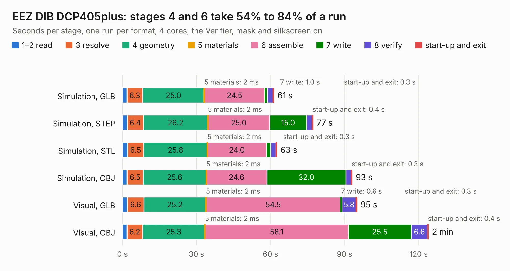

# 908. EEZ DIB DCP405plus

Board 908 of the 3,128 of [Corpus Testing](../Corpus-Testing.md), on [Corpus Page 9](../CorpusTestingPages/Corpus-Testing-09.md#908-eez-dib-dcp405plus).

| Mode and format | 1–2 read | 3 resolve | 4 geometry | 5 materials | 6 assemble | 7 write | 8 verify | start-up and exit | Total |
|---|---:|---:|---:|---:|---:|---:|---:|---:|---:|
| Simulation, GLB | 1.9 | 6.3 | 25.0 | 2&nbsp;ms | 24.5 | 1.0 | 2.4 | 0.3 | 61.4 |
| Simulation, STEP | 2.0 | 6.4 | 26.2 | 2&nbsp;ms | 25.0 | 15.0 | 2.3 | 0.4 | 77.2 |
| Simulation, STL | 2.1 | 6.5 | 25.8 | 2&nbsp;ms | 24.0 | 1.6 | 2.2 | 0.3 | 62.5 |
| Simulation, OBJ | 1.9 | 6.5 | 25.6 | 2&nbsp;ms | 24.6 | 32.0 | 2.2 | 0.3 | 93.1 |
| Visual, GLB | 2.0 | 6.6 | 25.2 | 2&nbsp;ms | 54.5 | 0.6 | 5.8 | 0.3 | 95.0 |
| Visual, OBJ | 1.9 | 6.2 | 25.3 | 2&nbsp;ms | 58.1 | 25.5 | 6.6 | 0.4 | 124.0 |

<table align="center"><tr><td valign="top">

| Board | Repo: [eez-open/dib-dcp405plus](https://github.com/eez-open/dib-dcp405plus) Board: `EEZ DIB DCP405plus.kicad_pcb` |
|---|---|
| Folder | KiCad |
| Complexity | 424&nbsp;/&nbsp;1000 (size&nbsp;289, features&nbsp;135) |
| KESE&nbsp;features | through vias, slotted holes, rounded, trapezoid or chamfered pads, filled zones, copper text, curved board outline, knockout text, TrueType text, stack-up, dielectric εr and tanδ |
| Tested | 9th November 2026 |
| Copper&nbsp;layers | 4 |
| File&nbsp;format | KiCad 10 (20260206) |
| Parts,&nbsp;tracks,&nbsp;vias | 407, 3,169, 692 |
| Triangles,&nbsp;simulation | 4,974,744 in 339 parts |
| Verifier | PASS in all six runs |

</td><td valign="top">

<table>
<tr><th>File type</th><th>File size</th><th>Peak memory used</th></tr>
<tr><th colspan="3" align="left">Simulation</th></tr>
<tr><td>GLB</td><td align="right">169&nbsp;MB</td><td align="right">1.5&nbsp;GB</td></tr>
<tr><td>STEP</td><td align="right">744&nbsp;MB</td><td align="right">1.9&nbsp;GB</td></tr>
<tr><td>STL</td><td align="right">249&nbsp;MB</td><td align="right">1.5&nbsp;GB</td></tr>
<tr><td>OBJ</td><td align="right">533&nbsp;MB</td><td align="right">3.3&nbsp;GB</td></tr>
<tr><th colspan="3" align="left">Visual</th></tr>
<tr><td>GLB</td><td align="right">110&nbsp;MB</td><td align="right">1.9&nbsp;GB</td></tr>
<tr><td>OBJ</td><td align="right">349&nbsp;MB</td><td align="right">2.4&nbsp;GB</td></tr>
</table>

</td></tr></table>

| Previous | Next |
|:---|---:|
| [907. EEZ DIB DCP405plus front mask](b0907b_dib-dcp405plus_EEZ-DIB-DCP405plus-front-mask.md) | [909. EEZ DIB MIO168plus front mask](b0909b_dib-mio168plus_EEZ-DIB-MIO168plus-front-mask.md) |
