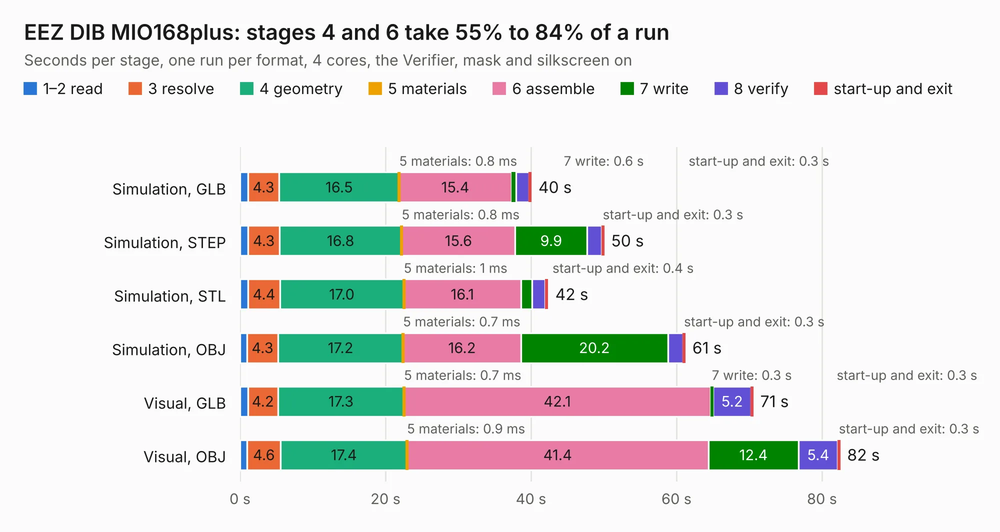

# 910. EEZ DIB MIO168plus

Board 910 of the 3,129 of [Corpus Testing](../Corpus-Testing.md), on [Corpus Page 9](../CorpusTestingPages/Corpus-Testing-09.md#910-eez-dib-mio168plus).

| Mode and format | 1–2 read | 3 resolve | 4 geometry | 5 materials | 6 assemble | 7 write | 8 verify | start-up and exit | Total |
|---|---:|---:|---:|---:|---:|---:|---:|---:|---:|
| Simulation, GLB | 1.1 | 4.3 | 16.5 | 0.8&nbsp;ms | 15.4 | 0.6 | 1.9 | 0.3 | 40.0 |
| Simulation, STEP | 1.1 | 4.3 | 16.8 | 0.8&nbsp;ms | 15.6 | 9.9 | 2.0 | 0.3 | 50.0 |
| Simulation, STL | 1.1 | 4.4 | 17.0 | 1&nbsp;ms | 16.1 | 1.5 | 1.8 | 0.4 | 42.4 |
| Simulation, OBJ | 0.9 | 4.3 | 17.2 | 0.7&nbsp;ms | 16.2 | 20.2 | 2.1 | 0.3 | 61.2 |
| Visual, GLB | 1.1 | 4.2 | 17.3 | 0.7&nbsp;ms | 42.1 | 0.3 | 5.2 | 0.3 | 70.5 |
| Visual, OBJ | 1.0 | 4.6 | 17.4 | 0.9&nbsp;ms | 41.4 | 12.4 | 5.4 | 0.3 | 82.5 |

<table align="center"><tr><td valign="top">

| Board | Repo: [eez-open/dib-mio168plus](https://github.com/eez-open/dib-mio168plus) Board: `EEZ DIB MIO168plus.kicad_pcb` |
|---|---|
| Folder | KiCad |
| Complexity | 409&nbsp;/&nbsp;1000 (size&nbsp;279, features&nbsp;130) |
| KESE&nbsp;features | through vias, rounded, trapezoid or chamfered pads, arc tracks, filled zones, curved board outline, knockout text, TrueType text, stack-up, dielectric εr and tanδ |
| Tested | 9th November 2026 |
| Copper&nbsp;layers | 4 |
| File&nbsp;format | KiCad 10 (20260206) |
| Parts,&nbsp;tracks,&nbsp;vias | 241, 3,356, 585 |
| Triangles,&nbsp;simulation | 4,042,762 in 289 parts |
| Verifier | PASS in all six runs |

</td><td valign="top">

<table>
<tr><th>File type</th><th>File size</th><th>Peak memory used</th></tr>
<tr><th colspan="3" align="left">Simulation</th></tr>
<tr><td>GLB</td><td align="right">137&nbsp;MB</td><td align="right">1.2&nbsp;GB</td></tr>
<tr><td>STEP</td><td align="right">589&nbsp;MB</td><td align="right">1.5&nbsp;GB</td></tr>
<tr><td>STL</td><td align="right">202&nbsp;MB</td><td align="right">1.2&nbsp;GB</td></tr>
<tr><td>OBJ</td><td align="right">438&nbsp;MB</td><td align="right">2.7&nbsp;GB</td></tr>
<tr><th colspan="3" align="left">Visual</th></tr>
<tr><td>GLB</td><td align="right">87&nbsp;MB</td><td align="right">1.5&nbsp;GB</td></tr>
<tr><td>OBJ</td><td align="right">280&nbsp;MB</td><td align="right">1.8&nbsp;GB</td></tr>
</table>

</td></tr></table>

| Previous | Next |
|:---|---:|
| [909. EEZ DIB MIO168plus front mask](b0909b_dib-mio168plus_EEZ-DIB-MIO168plus-front-mask.md) | [911. EEZ DIB AFE3plus](b0911b_dib-mio168plus-afe3_EEZ-DIB-AFE3plus.md) |
