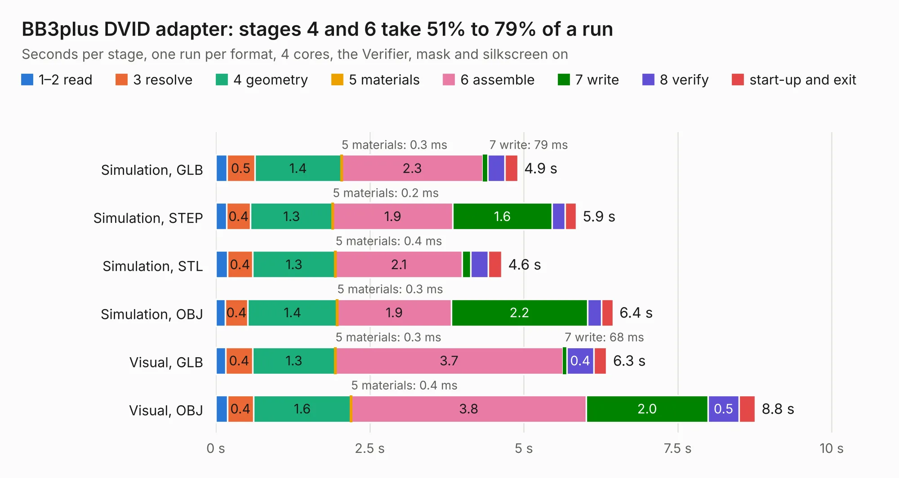

# 910. BB3plus DVID adapter

Board 910 of the 3,118 of [Corpus Testing](../Corpus-Testing.md), on [Corpus Page 9](../CorpusTestingPages/Corpus-Testing-09.md#910-bb3plus-dvid-adapter).

| Mode and format | 1–2 read | 3 resolve | 4 geometry | 5 materials | 6 assemble | 7 write | 8 verify | start-up and exit | Total |
|---|---:|---:|---:|---:|---:|---:|---:|---:|---:|
| Simulation, GLB | 0.2 | 0.5 | 1.4 | 0.3&nbsp;ms | 2.3 | 79&nbsp;ms | 0.3 | 0.2 | 4.9 |
| Simulation, STEP | 0.2 | 0.4 | 1.3 | 0.2&nbsp;ms | 1.9 | 1.6 | 0.2 | 0.2 | 5.9 |
| Simulation, STL | 0.2 | 0.4 | 1.3 | 0.4&nbsp;ms | 2.1 | 0.1 | 0.3 | 0.2 | 4.6 |
| Simulation, OBJ | 0.2 | 0.4 | 1.4 | 0.3&nbsp;ms | 1.9 | 2.2 | 0.2 | 0.2 | 6.4 |
| Visual, GLB | 0.2 | 0.4 | 1.3 | 0.3&nbsp;ms | 3.7 | 68&nbsp;ms | 0.4 | 0.2 | 6.3 |
| Visual, OBJ | 0.2 | 0.4 | 1.6 | 0.4&nbsp;ms | 3.8 | 2.0 | 0.5 | 0.3 | 8.8 |

<table align="center"><tr><td valign="top">

| Board | Repo: [eez-open/eez-bb3plus](https://github.com/eez-open/eez-bb3plus) Board: `BB3plus DVID adapter.kicad_pcb` |
|---|---|
| Folder | Experimental / KiCad / BB3plus DVID adapter |
| Complexity | 277&nbsp;/&nbsp;1000 (size&nbsp;177, features&nbsp;100) |
| KESE&nbsp;features | through vias, rounded, trapezoid or chamfered pads, arc tracks, filled zones, curved board outline, stack-up, dielectric εr and tanδ |
| Tested | 9th November 2026 |
| Copper&nbsp;layers | 4 |
| File&nbsp;format | KiCad 9 (20241229) |
| Parts,&nbsp;tracks,&nbsp;vias | 16, 781, 61 |
| Triangles,&nbsp;simulation | 509,226 in 41 parts |
| Verifier | PASS in all six runs |

</td><td valign="top">

<table>
<tr><th>File type</th><th>File size</th><th>Peak memory used</th></tr>
<tr><th colspan="3" align="left">Simulation</th></tr>
<tr><td>GLB</td><td align="right">17&nbsp;MB</td><td align="right">300&nbsp;MB</td></tr>
<tr><td>STEP</td><td align="right">75&nbsp;MB</td><td align="right">361&nbsp;MB</td></tr>
<tr><td>STL</td><td align="right">25&nbsp;MB</td><td align="right">300&nbsp;MB</td></tr>
<tr><td>OBJ</td><td align="right">50&nbsp;MB</td><td align="right">389&nbsp;MB</td></tr>
<tr><th colspan="3" align="left">Visual</th></tr>
<tr><td>GLB</td><td align="right">13&nbsp;MB</td><td align="right">373&nbsp;MB</td></tr>
<tr><td>OBJ</td><td align="right">37&nbsp;MB</td><td align="right">351&nbsp;MB</td></tr>
</table>

</td></tr></table>

| Previous | Next |
|:---|---:|
| [909. EEZ DIB AFE3plus](b0909b_dib-mio168plus-afe3_EEZ-DIB-AFE3plus.md) | [911. BB3plus test mainboard](b0911b_eez-bb3plus_BB3plus-test-mainboard.md) |
