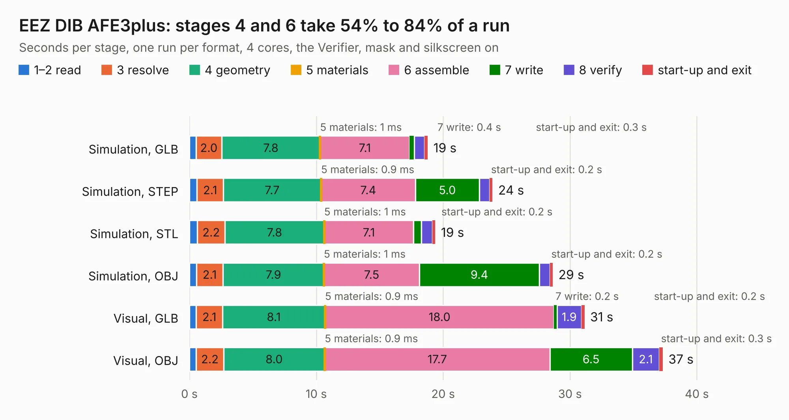

# 911. EEZ DIB AFE3plus

Board 911 of the 3,124 of [Corpus Testing](../Corpus-Testing.md), on [Corpus Page 9](../CorpusTestingPages/Corpus-Testing-09.md#911-eez-dib-afe3plus).

| Mode and format | 1–2 read | 3 resolve | 4 geometry | 5 materials | 6 assemble | 7 write | 8 verify | start-up and exit | Total |
|---|---:|---:|---:|---:|---:|---:|---:|---:|---:|
| Simulation, GLB | 0.5 | 2.0 | 7.8 | 1&nbsp;ms | 7.1 | 0.4 | 0.8 | 0.3 | 18.8 |
| Simulation, STEP | 0.6 | 2.1 | 7.7 | 0.9&nbsp;ms | 7.4 | 5.0 | 0.8 | 0.2 | 23.9 |
| Simulation, STL | 0.6 | 2.2 | 7.8 | 1&nbsp;ms | 7.1 | 0.6 | 0.9 | 0.2 | 19.4 |
| Simulation, OBJ | 0.5 | 2.1 | 7.9 | 1&nbsp;ms | 7.5 | 9.4 | 0.8 | 0.2 | 28.6 |
| Visual, GLB | 0.5 | 2.1 | 8.1 | 0.9&nbsp;ms | 18.0 | 0.2 | 1.9 | 0.2 | 31.1 |
| Visual, OBJ | 0.5 | 2.2 | 8.0 | 0.9&nbsp;ms | 17.7 | 6.5 | 2.1 | 0.3 | 37.3 |

<table align="center"><tr><td valign="top">

| Board | Repo: [eez-open/dib-mio168plus-afe3](https://github.com/eez-open/dib-mio168plus-afe3) Board: `EEZ DIB AFE3plus.kicad_pcb` |
|---|---|
| Folder | KiCad |
| Complexity | 332&nbsp;/&nbsp;1000 (size&nbsp;217, features&nbsp;115) |
| KESE&nbsp;features | through vias, rounded, trapezoid or chamfered pads, filled zones, curved board outline, knockout text, TrueType text, stack-up, dielectric εr and tanδ |
| Tested | 9th November 2026 |
| Copper&nbsp;layers | 4 |
| File&nbsp;format | KiCad 10 (20260206) |
| Parts,&nbsp;tracks,&nbsp;vias | 153, 1,420, 388 |
| Triangles,&nbsp;simulation | 2,307,398 in 182 parts |
| Verifier | PASS in all six runs |

</td><td valign="top">

<table>
<tr><th>File type</th><th>File size</th><th>Peak memory used</th></tr>
<tr><th colspan="3" align="left">Simulation</th></tr>
<tr><td>GLB</td><td align="right">78&nbsp;MB</td><td align="right">757&nbsp;MB</td></tr>
<tr><td>STEP</td><td align="right">328&nbsp;MB</td><td align="right">937&nbsp;MB</td></tr>
<tr><td>STL</td><td align="right">115&nbsp;MB</td><td align="right">785&nbsp;MB</td></tr>
<tr><td>OBJ</td><td align="right">243&nbsp;MB</td><td align="right">1.6&nbsp;GB</td></tr>
<tr><th colspan="3" align="left">Visual</th></tr>
<tr><td>GLB</td><td align="right">52&nbsp;MB</td><td align="right">1.0&nbsp;GB</td></tr>
<tr><td>OBJ</td><td align="right">161&nbsp;MB</td><td align="right">1.1&nbsp;GB</td></tr>
</table>

</td></tr></table>

| Previous | Next |
|:---|---:|
| [910. EEZ DIB MIO168plus](b0910b_dib-mio168plus_EEZ-DIB-MIO168plus.md) | [912. BB3plus DVID adapter](b0912b_eez-bb3plus_BB3plus-DVID-adapter.md) |
