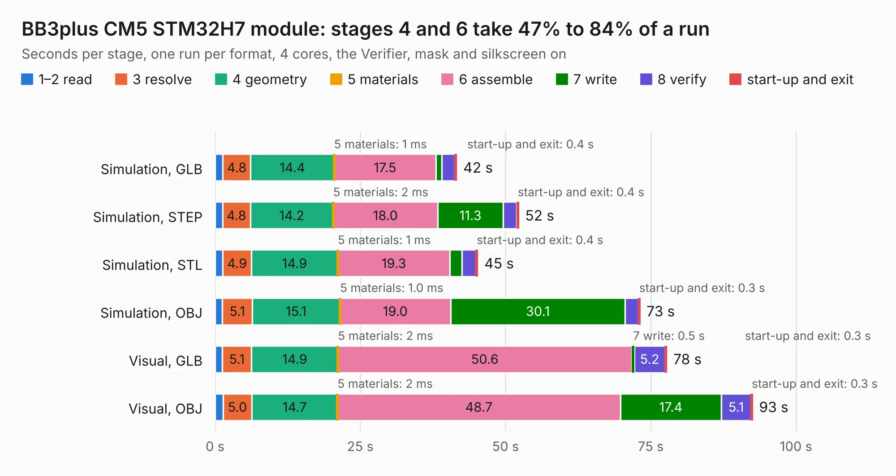

# 912. BB3plus CM5 STM32H7 module

Board 912 of the 3,105 of [Corpus Testing](../Corpus-Testing.md), on [Corpus Page 9](../CorpusTestingPages/Corpus-Testing-09.md#912-bb3plus-cm5-stm32h7-module).

| Mode and format | 1–2 read | 3 resolve | 4 geometry | 5 materials | 6 assemble | 7 write | 8 verify | start-up and exit | Total |
|---|---:|---:|---:|---:|---:|---:|---:|---:|---:|
| Simulation, GLB | 1.3 | 4.8 | 14.4 | 1&nbsp;ms | 17.5 | 1.0 | 2.3 | 0.4 | 41.6 |
| Simulation, STEP | 1.3 | 4.8 | 14.2 | 2&nbsp;ms | 18.0 | 11.3 | 2.3 | 0.4 | 52.3 |
| Simulation, STL | 1.3 | 4.9 | 14.9 | 1&nbsp;ms | 19.3 | 2.0 | 2.4 | 0.4 | 45.2 |
| Simulation, OBJ | 1.3 | 5.1 | 15.1 | 1.0&nbsp;ms | 19.0 | 30.1 | 2.2 | 0.3 | 73.2 |
| Visual, GLB | 1.2 | 5.1 | 14.9 | 2&nbsp;ms | 50.6 | 0.5 | 5.2 | 0.3 | 77.8 |
| Visual, OBJ | 1.4 | 5.0 | 14.7 | 2&nbsp;ms | 48.7 | 17.4 | 5.1 | 0.3 | 92.5 |

<table align="center"><tr><td valign="top">

| Board | Repo: [eez-open/eez-bb3plus-cm5-mcu](https://github.com/eez-open/eez-bb3plus-cm5-mcu) Board: `BB3plus CM5 STM32H7 module.kicad_pcb` |
|---|---|
| Folder | KiCad |
| Complexity | 402&nbsp;/&nbsp;1000 (size&nbsp;297, features&nbsp;105) |
| KESE&nbsp;features | through vias, rounded, trapezoid or chamfered pads, arc tracks, filled zones, TrueType text, stack-up, dielectric εr and tanδ |
| Tested | 9th November 2026 |
| Copper&nbsp;layers | 6 |
| File&nbsp;format | KiCad 10 (20260206) |
| Parts,&nbsp;tracks,&nbsp;vias | 154, 6,042, 725 |
| Triangles,&nbsp;simulation | 5,243,850 in 339 parts |
| Verifier | PASS in all six runs |

</td><td valign="top">

<table>
<tr><th>File type</th><th>File size</th><th>Peak memory used</th></tr>
<tr><th colspan="3" align="left">Simulation</th></tr>
<tr><td>GLB</td><td align="right">177&nbsp;MB</td><td align="right">1.3&nbsp;GB</td></tr>
<tr><td>STEP</td><td align="right">630&nbsp;MB</td><td align="right">1.7&nbsp;GB</td></tr>
<tr><td>STL</td><td align="right">262&nbsp;MB</td><td align="right">1.5&nbsp;GB</td></tr>
<tr><td>OBJ</td><td align="right">561&nbsp;MB</td><td align="right">3.3&nbsp;GB</td></tr>
<tr><th colspan="3" align="left">Visual</th></tr>
<tr><td>GLB</td><td align="right">102&nbsp;MB</td><td align="right">1.8&nbsp;GB</td></tr>
<tr><td>OBJ</td><td align="right">332&nbsp;MB</td><td align="right">2.3&nbsp;GB</td></tr>
</table>

</td></tr></table>

| Previous | Next |
|:---|---:|
| [911. BB3plus DVID TFT display](b0911b_eez-bb3plus_BB3plus-DVID-TFT-display.md) | [913. EEZ DIB AUX-PS](b0913b_modular-psu_EEZ-DIB-AUX-PS.md) |
