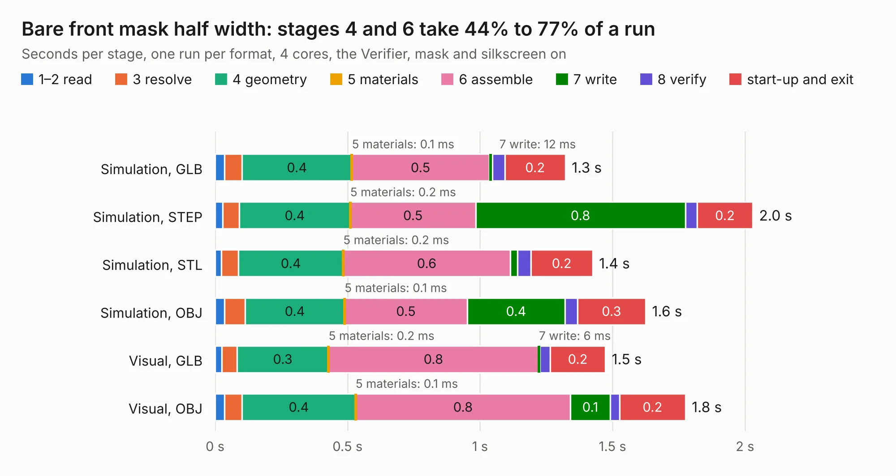

# 912. Bare front mask half width

Board 912 of the 3,111 of [Corpus Testing](../Corpus-Testing.md), on [Corpus Page 9](../CorpusTestingPages/Corpus-Testing-09.md#912-bare-front-mask-half-width).

| Mode and format | 1–2 read | 3 resolve | 4 geometry | 5 materials | 6 assemble | 7 write | 8 verify | start-up and exit | Total |
|---|---:|---:|---:|---:|---:|---:|---:|---:|---:|
| Simulation, GLB | 36&nbsp;ms | 66&nbsp;ms | 0.4 | 0.1&nbsp;ms | 0.5 | 12&nbsp;ms | 47&nbsp;ms | 0.2 | 1.3 |
| Simulation, STEP | 29&nbsp;ms | 63&nbsp;ms | 0.4 | 0.2&nbsp;ms | 0.5 | 0.8 | 45&nbsp;ms | 0.2 | 2.0 |
| Simulation, STL | 24&nbsp;ms | 65&nbsp;ms | 0.4 | 0.2&nbsp;ms | 0.6 | 28&nbsp;ms | 50&nbsp;ms | 0.2 | 1.4 |
| Simulation, OBJ | 36&nbsp;ms | 77&nbsp;ms | 0.4 | 0.1&nbsp;ms | 0.5 | 0.4 | 47&nbsp;ms | 0.3 | 1.6 |
| Visual, GLB | 26&nbsp;ms | 56&nbsp;ms | 0.3 | 0.2&nbsp;ms | 0.8 | 6&nbsp;ms | 40&nbsp;ms | 0.2 | 1.5 |
| Visual, OBJ | 36&nbsp;ms | 66&nbsp;ms | 0.4 | 0.1&nbsp;ms | 0.8 | 0.1 | 36&nbsp;ms | 0.2 | 1.8 |

<table align="center"><tr><td valign="top">

| Board | Repo: [eez-open/eez-bb3plus](https://github.com/eez-open/eez-bb3plus) Board: `Bare front mask half width.kicad_pcb` |
|---|---|
| Folder | KiCad / Front masks |
| Complexity | 94&nbsp;/&nbsp;1000 (size&nbsp;29, features&nbsp;65) |
| KESE&nbsp;features | filled zones, curved board outline, stack-up, dielectric εr and tanδ, mask and silkscreen colours |
| Tested | 9th November 2026 |
| Copper&nbsp;layers | 2 |
| File&nbsp;format | KiCad 10 (20260206) |
| Parts,&nbsp;tracks,&nbsp;vias | 2, 0, 0 |
| Triangles,&nbsp;simulation | 62,832 in 13 parts |
| Verifier | PASS in all six runs |

</td><td valign="top">

<table>
<tr><th>File type</th><th>File size</th><th>Peak memory used</th></tr>
<tr><th colspan="3" align="left">Simulation</th></tr>
<tr><td>GLB</td><td align="right">2.1&nbsp;MB</td><td align="right">146&nbsp;MB</td></tr>
<tr><td>STEP</td><td align="right">7.9&nbsp;MB</td><td align="right">153&nbsp;MB</td></tr>
<tr><td>STL</td><td align="right">3.1&nbsp;MB</td><td align="right">147&nbsp;MB</td></tr>
<tr><td>OBJ</td><td align="right">5.8&nbsp;MB</td><td align="right">149&nbsp;MB</td></tr>
<tr><th colspan="3" align="left">Visual</th></tr>
<tr><td>GLB</td><td align="right">741&nbsp;kB</td><td align="right">131&nbsp;MB</td></tr>
<tr><td>OBJ</td><td align="right">2.0&nbsp;MB</td><td align="right">132&nbsp;MB</td></tr>
</table>

</td></tr></table>

| Previous | Next |
|:---|---:|
| [911. Bare front mask full width](b0911b_eez-bb3plus_Bare-front-mask-full-width.md) | [913. BB3plus DVID TFT display](b0913b_eez-bb3plus_BB3plus-DVID-TFT-display.md) |
