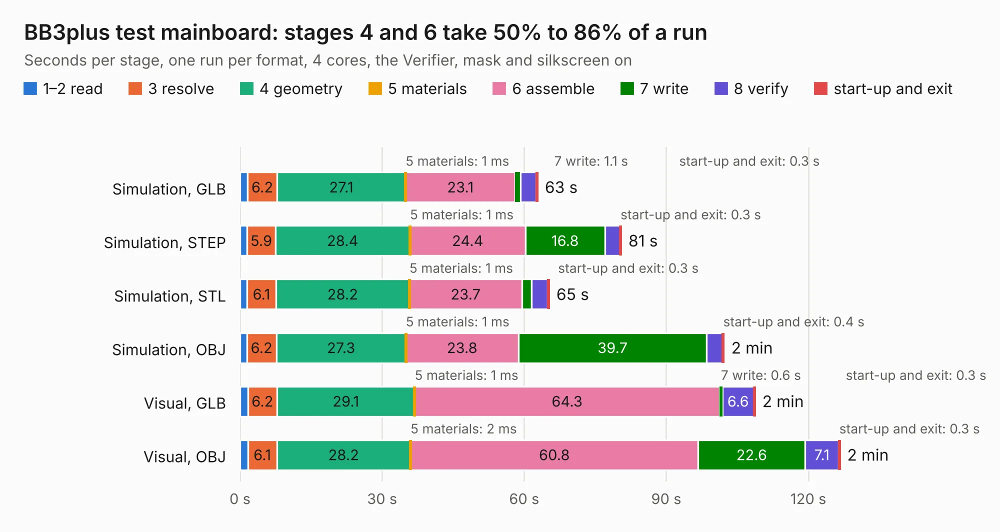

# 913. BB3plus test mainboard

Board 913 of the 3,130 of [Corpus Testing](../Corpus-Testing.md), on [Corpus Page 9](../CorpusTestingPages/Corpus-Testing-09.md#913-bb3plus-test-mainboard).

| Mode and format | 1–2 read | 3 resolve | 4 geometry | 5 materials | 6 assemble | 7 write | 8 verify | start-up and exit | Total |
|---|---:|---:|---:|---:|---:|---:|---:|---:|---:|
| Simulation, GLB | 1.6 | 6.2 | 27.1 | 1&nbsp;ms | 23.1 | 1.1 | 3.3 | 0.3 | 62.9 |
| Simulation, STEP | 1.5 | 5.9 | 28.4 | 1&nbsp;ms | 24.4 | 16.8 | 3.2 | 0.3 | 80.5 |
| Simulation, STL | 1.5 | 6.1 | 28.2 | 1&nbsp;ms | 23.7 | 2.1 | 3.4 | 0.3 | 65.3 |
| Simulation, OBJ | 1.4 | 6.2 | 27.3 | 1&nbsp;ms | 23.8 | 39.7 | 3.3 | 0.4 | 102.2 |
| Visual, GLB | 1.7 | 6.2 | 29.1 | 1&nbsp;ms | 64.3 | 0.6 | 6.6 | 0.3 | 108.8 |
| Visual, OBJ | 1.7 | 6.1 | 28.2 | 2&nbsp;ms | 60.8 | 22.6 | 7.1 | 0.3 | 126.7 |

<table align="center"><tr><td valign="top">

| Board | Repo: [eez-open/eez-bb3plus](https://github.com/eez-open/eez-bb3plus) Board: `BB3plus test mainboard.kicad_pcb` |
|---|---|
| Folder | Experimental / KiCad |
| Complexity | 449&nbsp;/&nbsp;1000 (size&nbsp;289, features&nbsp;160) |
| KESE&nbsp;features | through vias, slotted holes, custom pads, rounded, trapezoid or chamfered pads, arc tracks, filled zones, copper drawings, copper text, curved board outline, knockout text, stack-up, dielectric εr and tanδ |
| Tested | 9th November 2026 |
| Copper&nbsp;layers | 4 |
| File&nbsp;format | KiCad 9 (20241229) |
| Parts,&nbsp;tracks,&nbsp;vias | 274, 5,609, 871 |
| Triangles,&nbsp;simulation | 6,719,504 in 488 parts |
| Verifier | PASS in all six runs |

</td><td valign="top">

<table>
<tr><th>File type</th><th>File size</th><th>Peak memory used</th></tr>
<tr><th colspan="3" align="left">Simulation</th></tr>
<tr><td>GLB</td><td align="right">230&nbsp;MB</td><td align="right">1.9&nbsp;GB</td></tr>
<tr><td>STEP</td><td align="right">919&nbsp;MB</td><td align="right">2.4&nbsp;GB</td></tr>
<tr><td>STL</td><td align="right">336&nbsp;MB</td><td align="right">1.9&nbsp;GB</td></tr>
<tr><td>OBJ</td><td align="right">729&nbsp;MB</td><td align="right">4.3&nbsp;GB</td></tr>
<tr><th colspan="3" align="left">Visual</th></tr>
<tr><td>GLB</td><td align="right">139&nbsp;MB</td><td align="right">2.3&nbsp;GB</td></tr>
<tr><td>OBJ</td><td align="right">449&nbsp;MB</td><td align="right">2.8&nbsp;GB</td></tr>
</table>

</td></tr></table>

| Previous | Next |
|:---|---:|
| [912. BB3plus DVID adapter](b0912b_eez-bb3plus_BB3plus-DVID-adapter.md) | [914. BB3plus USB hub test](b0914b_eez-bb3plus_BB3plus-USB-hub-test.md) |
