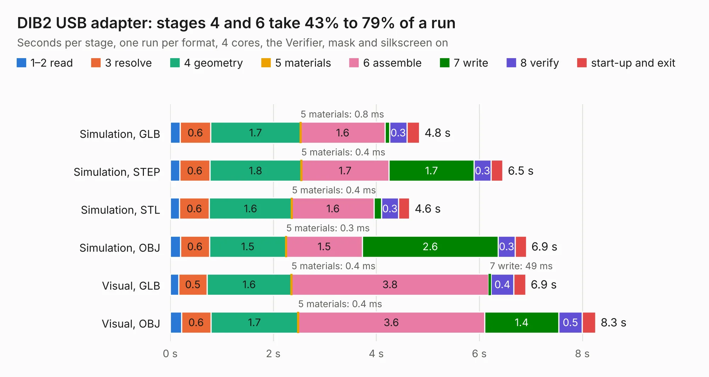

# 915. DIB2 USB adapter

Board 915 of the 3,122 of [Corpus Testing](../Corpus-Testing.md), on [Corpus Page 9](../CorpusTestingPages/Corpus-Testing-09.md#915-dib2-usb-adapter).

| Mode and format | 1–2 read | 3 resolve | 4 geometry | 5 materials | 6 assemble | 7 write | 8 verify | start-up and exit | Total |
|---|---:|---:|---:|---:|---:|---:|---:|---:|---:|
| Simulation, GLB | 0.2 | 0.6 | 1.7 | 0.8&nbsp;ms | 1.6 | 89&nbsp;ms | 0.3 | 0.2 | 4.8 |
| Simulation, STEP | 0.2 | 0.6 | 1.8 | 0.4&nbsp;ms | 1.7 | 1.7 | 0.3 | 0.2 | 6.5 |
| Simulation, STL | 0.2 | 0.6 | 1.6 | 0.4&nbsp;ms | 1.6 | 0.1 | 0.3 | 0.2 | 4.6 |
| Simulation, OBJ | 0.2 | 0.6 | 1.5 | 0.3&nbsp;ms | 1.5 | 2.6 | 0.3 | 0.2 | 6.9 |
| Visual, GLB | 0.2 | 0.5 | 1.6 | 0.4&nbsp;ms | 3.8 | 49&nbsp;ms | 0.4 | 0.2 | 6.9 |
| Visual, OBJ | 0.2 | 0.6 | 1.7 | 0.4&nbsp;ms | 3.6 | 1.4 | 0.5 | 0.3 | 8.3 |

<table align="center"><tr><td valign="top">

| Board | Repo: [eez-open/eez-bb3plus](https://github.com/eez-open/eez-bb3plus) Board: `DIB2 USB adapter.kicad_pcb` |
|---|---|
| Folder | Experimental / KiCad / DIB2 USB adapter |
| Complexity | 273&nbsp;/&nbsp;1000 (size&nbsp;163, features&nbsp;110) |
| KESE&nbsp;features | through vias, rounded, trapezoid or chamfered pads, arc tracks, filled zones, copper text, curved board outline, stack-up, dielectric εr and tanδ |
| Tested | 9th November 2026 |
| Copper&nbsp;layers | 4 |
| File&nbsp;format | KiCad 10 (20260206) |
| Parts,&nbsp;tracks,&nbsp;vias | 10, 389, 53 |
| Triangles,&nbsp;simulation | 560,658 in 63 parts |
| Verifier | PASS in all six runs |

</td><td valign="top">

<table>
<tr><th>File type</th><th>File size</th><th>Peak memory used</th></tr>
<tr><th colspan="3" align="left">Simulation</th></tr>
<tr><td>GLB</td><td align="right">19&nbsp;MB</td><td align="right">292&nbsp;MB</td></tr>
<tr><td>STEP</td><td align="right">73&nbsp;MB</td><td align="right">327&nbsp;MB</td></tr>
<tr><td>STL</td><td align="right">28&nbsp;MB</td><td align="right">292&nbsp;MB</td></tr>
<tr><td>OBJ</td><td align="right">57&nbsp;MB</td><td align="right">417&nbsp;MB</td></tr>
<tr><th colspan="3" align="left">Visual</th></tr>
<tr><td>GLB</td><td align="right">10&nbsp;MB</td><td align="right">322&nbsp;MB</td></tr>
<tr><td>OBJ</td><td align="right">31&nbsp;MB</td><td align="right">324&nbsp;MB</td></tr>
</table>

</td></tr></table>

| Previous | Next |
|:---|---:|
| [914. DIB2 USB adapter front mask](b0914b_eez-bb3plus_DIB2-USB-adapter-front-mask.md) | [916. BB3plus DSI TFT display](b0916b_eez-bb3plus_BB3plus-DSI-TFT-display.md) |
