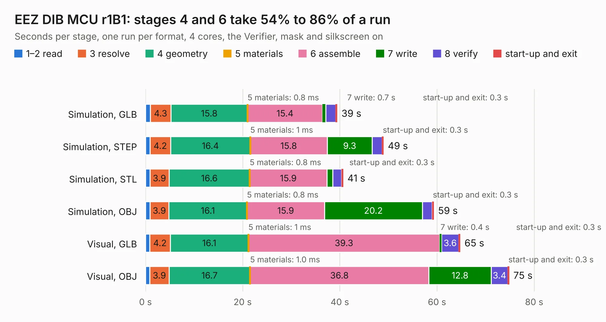

# 916. EEZ DIB MCU r1B1

Board 916 of the 3,107 of [Corpus Testing](../Corpus-Testing.md), on [Corpus Page 9](../CorpusTestingPages/Corpus-Testing-09.md#916-eez-dib-mcu-r1b1).

| Mode and format | 1–2 read | 3 resolve | 4 geometry | 5 materials | 6 assemble | 7 write | 8 verify | start-up and exit | Total |
|---|---:|---:|---:|---:|---:|---:|---:|---:|---:|
| Simulation, GLB | 1.0 | 4.3 | 15.8 | 0.8&nbsp;ms | 15.4 | 0.7 | 2.0 | 0.3 | 39.4 |
| Simulation, STEP | 0.9 | 4.2 | 16.4 | 1&nbsp;ms | 15.8 | 9.3 | 2.1 | 0.3 | 49.0 |
| Simulation, STL | 0.9 | 3.9 | 16.6 | 0.8&nbsp;ms | 15.9 | 1.2 | 1.9 | 0.3 | 40.7 |
| Simulation, OBJ | 0.9 | 3.9 | 16.1 | 0.8&nbsp;ms | 15.9 | 20.2 | 2.0 | 0.3 | 59.3 |
| Visual, GLB | 0.9 | 4.2 | 16.1 | 1&nbsp;ms | 39.3 | 0.4 | 3.6 | 0.3 | 64.8 |
| Visual, OBJ | 0.9 | 3.9 | 16.7 | 1.0&nbsp;ms | 36.8 | 12.8 | 3.4 | 0.3 | 74.8 |

<table align="center"><tr><td valign="top">

| Board | Repo: [eez-open/modular-psu](https://github.com/eez-open/modular-psu) Board: `EEZ DIB MCU r1B1.kicad_pcb` |
|---|---|
| Folder | previous designs / mcu / KiCad |
| Complexity | 292&nbsp;/&nbsp;1000 (size&nbsp;237, features&nbsp;55) |
| KESE&nbsp;features | through vias, rounded, trapezoid or chamfered pads, filled zones, curved board outline |
| Tested | 9th November 2026 |
| Copper&nbsp;layers | 4 |
| File&nbsp;format | KiCad 5 (20171130) |
| Parts,&nbsp;tracks,&nbsp;vias | 187, 5,990, 593 |
| Triangles,&nbsp;simulation | 4,621,818 in 275 parts |
| Verifier | PASS in all six runs |

</td><td valign="top">

<table>
<tr><th>File type</th><th>File size</th><th>Peak memory used</th></tr>
<tr><th colspan="3" align="left">Simulation</th></tr>
<tr><td>GLB</td><td align="right">160&nbsp;MB</td><td align="right">1.3&nbsp;GB</td></tr>
<tr><td>STEP</td><td align="right">660&nbsp;MB</td><td align="right">1.7&nbsp;GB</td></tr>
<tr><td>STL</td><td align="right">231&nbsp;MB</td><td align="right">1.3&nbsp;GB</td></tr>
<tr><td>OBJ</td><td align="right">497&nbsp;MB</td><td align="right">3.0&nbsp;GB</td></tr>
<tr><th colspan="3" align="left">Visual</th></tr>
<tr><td>GLB</td><td align="right">97&nbsp;MB</td><td align="right">1.7&nbsp;GB</td></tr>
<tr><td>OBJ</td><td align="right">312&nbsp;MB</td><td align="right">2.2&nbsp;GB</td></tr>
</table>

</td></tr></table>

| Previous | Next |
|:---|---:|
| [915. EEZ DIB B3C](b0915b_modular-psu_EEZ-DIB-B3C.md) | [917. EEZ DIB MCU r1B2](b0917b_modular-psu_EEZ-DIB-MCU-r1B2.md) |
