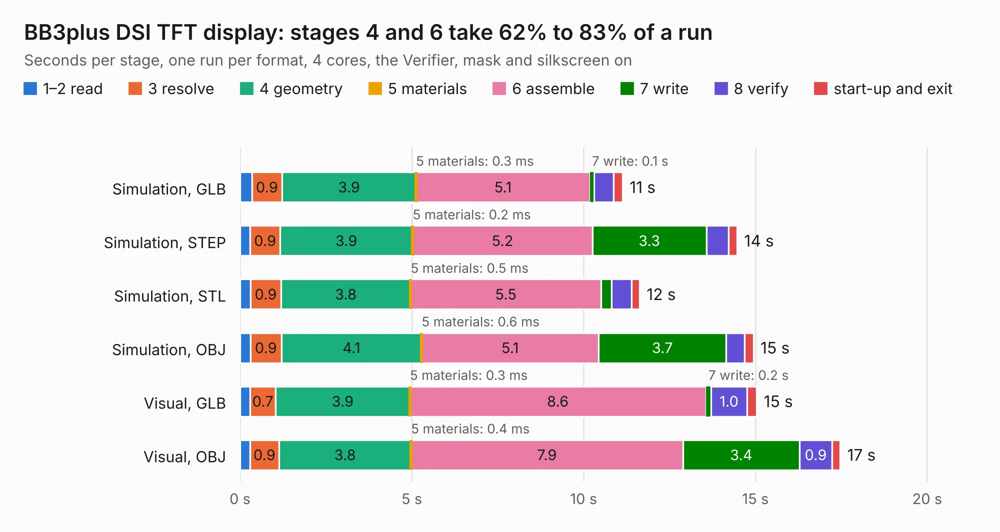

# 917. BB3plus DSI TFT display

Board 917 of the 3,128 of [Corpus Testing](../Corpus-Testing.md), on [Corpus Page 9](../CorpusTestingPages/Corpus-Testing-09.md#917-bb3plus-dsi-tft-display).

| Mode and format | 1–2 read | 3 resolve | 4 geometry | 5 materials | 6 assemble | 7 write | 8 verify | start-up and exit | Total |
|---|---:|---:|---:|---:|---:|---:|---:|---:|---:|
| Simulation, GLB | 0.3 | 0.9 | 3.9 | 0.3&nbsp;ms | 5.1 | 0.1 | 0.6 | 0.3 | 11.1 |
| Simulation, STEP | 0.3 | 0.9 | 3.9 | 0.2&nbsp;ms | 5.2 | 3.3 | 0.6 | 0.3 | 14.5 |
| Simulation, STL | 0.3 | 0.9 | 3.8 | 0.5&nbsp;ms | 5.5 | 0.3 | 0.6 | 0.2 | 11.6 |
| Simulation, OBJ | 0.3 | 0.9 | 4.1 | 0.6&nbsp;ms | 5.1 | 3.7 | 0.5 | 0.3 | 14.9 |
| Visual, GLB | 0.3 | 0.7 | 3.9 | 0.3&nbsp;ms | 8.6 | 0.2 | 1.0 | 0.3 | 15.0 |
| Visual, OBJ | 0.3 | 0.9 | 3.8 | 0.4&nbsp;ms | 7.9 | 3.4 | 0.9 | 0.2 | 17.5 |

<table align="center"><tr><td valign="top">

| Board | Repo: [eez-open/eez-bb3plus](https://github.com/eez-open/eez-bb3plus) Board: `BB3plus DSI TFT display.kicad_pcb` |
|---|---|
| Folder | Experimental / KiCad / TFT DSI module |
| Complexity | 294&nbsp;/&nbsp;1000 (size&nbsp;174, features&nbsp;120) |
| KESE&nbsp;features | through vias, rounded, trapezoid or chamfered pads, arc tracks, filled zones, curved board outline, knockout text, stack-up, dielectric εr and tanδ, mask and silkscreen colours |
| Tested | 9th November 2026 |
| Copper&nbsp;layers | 2 |
| File&nbsp;format | KiCad 9 (20241229) |
| Parts,&nbsp;tracks,&nbsp;vias | 34, 953, 137 |
| Triangles,&nbsp;simulation | 747,444 in 91 parts |
| Verifier | PASS in all six runs |

</td><td valign="top">

<table>
<tr><th>File type</th><th>File size</th><th>Peak memory used</th></tr>
<tr><th colspan="3" align="left">Simulation</th></tr>
<tr><td>GLB</td><td align="right">26&nbsp;MB</td><td align="right">434&nbsp;MB</td></tr>
<tr><td>STEP</td><td align="right">138&nbsp;MB</td><td align="right">478&nbsp;MB</td></tr>
<tr><td>STL</td><td align="right">37&nbsp;MB</td><td align="right">418&nbsp;MB</td></tr>
<tr><td>OBJ</td><td align="right">77&nbsp;MB</td><td align="right">545&nbsp;MB</td></tr>
<tr><th colspan="3" align="left">Visual</th></tr>
<tr><td>GLB</td><td align="right">23&nbsp;MB</td><td align="right">591&nbsp;MB</td></tr>
<tr><td>OBJ</td><td align="right">70&nbsp;MB</td><td align="right">593&nbsp;MB</td></tr>
</table>

</td></tr></table>

| Previous | Next |
|:---|---:|
| [916. DIB2 USB adapter](b0916b_eez-bb3plus_DIB2-USB-adapter.md) | [918. BB3plus mainboard](b0918b_eez-bb3plus_BB3plus-mainboard.md) |
