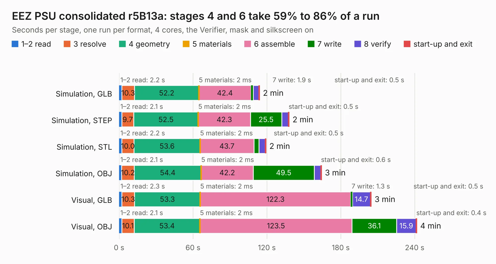

# 917. EEZ PSU consolidated r5B13a

Board 917 of the 3,104 of [Corpus Testing](../Corpus-Testing.md), on [Corpus Page 9](../CorpusTestingPages/Corpus-Testing-09.md#917-eez-psu-consolidated-r5b13a).

| Mode and format | 1–2 read | 3 resolve | 4 geometry | 5 materials | 6 assemble | 7 write | 8 verify | start-up and exit | Total |
|---|---:|---:|---:|---:|---:|---:|---:|---:|---:|
| Simulation, GLB | 2.2 | 10.3 | 52.2 | 2&nbsp;ms | 42.4 | 1.9 | 4.5 | 0.5 | 113.9 |
| Simulation, STEP | 2.1 | 9.7 | 52.5 | 2&nbsp;ms | 42.3 | 25.5 | 5.3 | 0.5 | 138.0 |
| Simulation, STL | 2.2 | 10.0 | 53.6 | 2&nbsp;ms | 43.7 | 4.1 | 5.1 | 0.5 | 119.2 |
| Simulation, OBJ | 2.1 | 10.2 | 54.4 | 2&nbsp;ms | 42.2 | 49.5 | 5.3 | 0.6 | 164.3 |
| Visual, GLB | 2.3 | 10.3 | 53.3 | 2&nbsp;ms | 122.3 | 1.3 | 14.7 | 0.5 | 204.6 |
| Visual, OBJ | 2.1 | 10.1 | 53.4 | 2&nbsp;ms | 123.5 | 36.1 | 15.9 | 0.4 | 241.6 |

<table align="center"><tr><td valign="top">

| Board | Repo: [eez-open/psu-hw](https://github.com/eez-open/psu-hw) Board: `EEZ PSU consolidated r5B13a.kicad_pcb` |
|---|---|
| Folder | Consolidated / KiCad |
| Complexity | 289&nbsp;/&nbsp;1000 (size&nbsp;234, features&nbsp;55) |
| KESE&nbsp;features | through vias, rounded, trapezoid or chamfered pads, filled zones, curved board outline |
| Tested | 9th November 2026 |
| Copper&nbsp;layers | 2 |
| File&nbsp;format | KiCad 5 (20171130) |
| Parts,&nbsp;tracks,&nbsp;vias | 541, 5,476, 1,204 |
| Triangles,&nbsp;simulation | 8,606,616 in 501 parts |
| Verifier | PASS in all six runs |

</td><td valign="top">

<table>
<tr><th>File type</th><th>File size</th><th>Peak memory used</th></tr>
<tr><th colspan="3" align="left">Simulation</th></tr>
<tr><td>GLB</td><td align="right">301&nbsp;MB</td><td align="right">2.5&nbsp;GB</td></tr>
<tr><td>STEP</td><td align="right">1.6&nbsp;GB</td><td align="right">3.2&nbsp;GB</td></tr>
<tr><td>STL</td><td align="right">430&nbsp;MB</td><td align="right">2.4&nbsp;GB</td></tr>
<tr><td>OBJ</td><td align="right">941&nbsp;MB</td><td align="right">5.5&nbsp;GB</td></tr>
<tr><th colspan="3" align="left">Visual</th></tr>
<tr><td>GLB</td><td align="right">230&nbsp;MB</td><td align="right">3.4&nbsp;GB</td></tr>
<tr><td>OBJ</td><td align="right">735&nbsp;MB</td><td align="right">4.5&nbsp;GB</td></tr>
</table>

</td></tr></table>

| Previous | Next |
|:---|---:|
| [916. EEZ DIB MCU r1B2](b0916b_modular-psu_EEZ-DIB-MCU-r1B2.md) | [918. PCIeDMA](b0918b_pciedma_PCIeDMA.md) |
