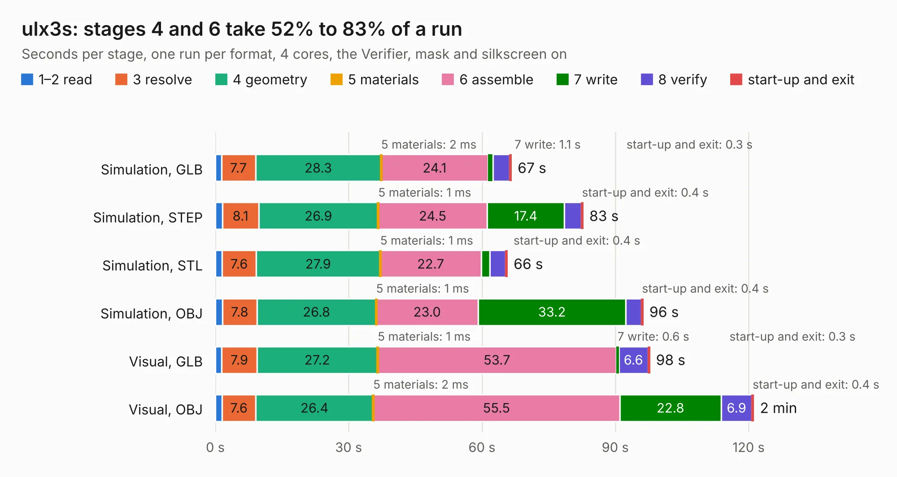

# 917. ulx3s

Board 917 of the 3,102 of [Corpus Testing](../Corpus-Testing.md), on [Corpus Page 9](../CorpusTestingPages/Corpus-Testing-09.md#917-ulx3s).

| Mode and format | 1–2 read | 3 resolve | 4 geometry | 5 materials | 6 assemble | 7 write | 8 verify | start-up and exit | Total |
|---|---:|---:|---:|---:|---:|---:|---:|---:|---:|
| Simulation, GLB | 1.4 | 7.7 | 28.3 | 2&nbsp;ms | 24.1 | 1.1 | 3.7 | 0.3 | 66.6 |
| Simulation, STEP | 1.6 | 8.1 | 26.9 | 1&nbsp;ms | 24.5 | 17.4 | 3.7 | 0.4 | 82.7 |
| Simulation, STL | 1.5 | 7.6 | 27.9 | 1&nbsp;ms | 22.7 | 1.9 | 3.6 | 0.4 | 65.7 |
| Simulation, OBJ | 1.6 | 7.8 | 26.8 | 1&nbsp;ms | 23.0 | 33.2 | 3.5 | 0.4 | 96.2 |
| Visual, GLB | 1.4 | 7.9 | 27.2 | 1&nbsp;ms | 53.7 | 0.6 | 6.6 | 0.3 | 97.7 |
| Visual, OBJ | 1.5 | 7.6 | 26.4 | 2&nbsp;ms | 55.5 | 22.8 | 6.9 | 0.4 | 121.1 |

<table align="center"><tr><td valign="top">

| Board | Repo: [emard/ulx3s](https://github.com/emard/ulx3s) Board: `ulx3s.kicad_pcb` |
|---|---|
| Complexity | 365&nbsp;/&nbsp;1000 (size&nbsp;290, features&nbsp;75) |
| KESE&nbsp;features | through vias, rounded, trapezoid or chamfered pads, filled zones, stack-up, dielectric εr and tanδ |
| Tested | 9th November 2026 |
| Copper&nbsp;layers | 4 |
| File&nbsp;format | KiCad 7 (20221018) |
| Parts,&nbsp;tracks,&nbsp;vias | 221, 4,811, 554 |
| Triangles,&nbsp;simulation | 5,258,670 in 343 parts |
| Verifier | PASS in all six runs |

</td><td valign="top">

<table>
<tr><th>File type</th><th>File size</th><th>Peak memory used</th></tr>
<tr><th colspan="3" align="left">Simulation</th></tr>
<tr><td>GLB</td><td align="right">181&nbsp;MB</td><td align="right">1.5&nbsp;GB</td></tr>
<tr><td>STEP</td><td align="right">939&nbsp;MB</td><td align="right">1.8&nbsp;GB</td></tr>
<tr><td>STL</td><td align="right">263&nbsp;MB</td><td align="right">1.5&nbsp;GB</td></tr>
<tr><td>OBJ</td><td align="right">569&nbsp;MB</td><td align="right">3.4&nbsp;GB</td></tr>
<tr><th colspan="3" align="left">Visual</th></tr>
<tr><td>GLB</td><td align="right">116&nbsp;MB</td><td align="right">1.9&nbsp;GB</td></tr>
<tr><td>OBJ</td><td align="right">372&nbsp;MB</td><td align="right">2.4&nbsp;GB</td></tr>
</table>

</td></tr></table>

| Previous | Next |
|:---|---:|
| [916. PCIeDMA](b0916b_pciedma_PCIeDMA.md) | [918. ice-dongle](b0918b_ice-dongle_ice-dongle.md) |
