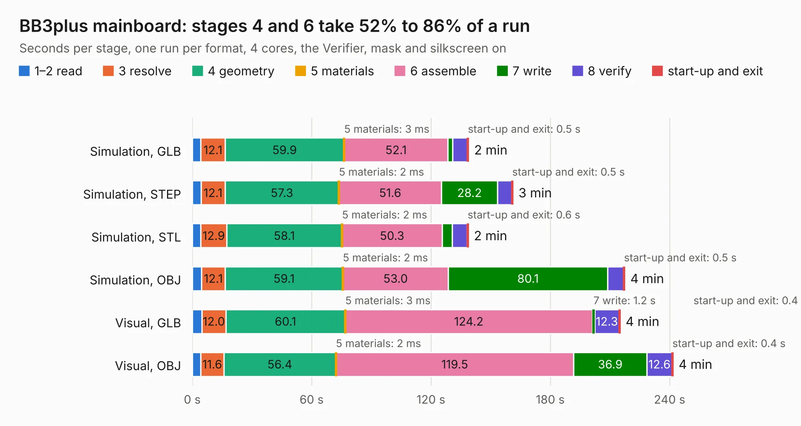

# 919. BB3plus mainboard

Board 919 of the 3,139 of [Corpus Testing](../Corpus-Testing.md), on [Corpus Page 9](../CorpusTestingPages/Corpus-Testing-09.md#919-bb3plus-mainboard).

| Mode and format | 1–2 read | 3 resolve | 4 geometry | 5 materials | 6 assemble | 7 write | 8 verify | start-up and exit | Total |
|---|---:|---:|---:|---:|---:|---:|---:|---:|---:|
| Simulation, GLB | 4.3 | 12.1 | 59.9 | 3&nbsp;ms | 52.1 | 2.5 | 7.4 | 0.5 | 138.9 |
| Simulation, STEP | 4.4 | 12.1 | 57.3 | 2&nbsp;ms | 51.6 | 28.2 | 7.1 | 0.5 | 161.1 |
| Simulation, STL | 4.3 | 12.9 | 58.1 | 2&nbsp;ms | 50.3 | 5.1 | 7.4 | 0.6 | 138.7 |
| Simulation, OBJ | 4.6 | 12.1 | 59.1 | 2&nbsp;ms | 53.0 | 80.1 | 7.9 | 0.5 | 217.4 |
| Visual, GLB | 4.9 | 12.0 | 60.1 | 3&nbsp;ms | 124.2 | 1.2 | 12.3 | 0.4 | 215.0 |
| Visual, OBJ | 4.2 | 11.6 | 56.4 | 2&nbsp;ms | 119.5 | 36.9 | 12.6 | 0.4 | 241.6 |

<table align="center"><tr><td valign="top">

| Board | Repo: [eez-open/eez-bb3plus](https://github.com/eez-open/eez-bb3plus) Board: `BB3plus mainboard.kicad_pcb` |
|---|---|
| Folder | KiCad / BB3plus mainboard |
| Complexity | 481&nbsp;/&nbsp;1000 (size&nbsp;301, features&nbsp;180) |
| KESE&nbsp;features | through vias, slotted holes, custom pads, rounded, trapezoid or chamfered pads, arc tracks, filled zones, copper drawings, copper text, curved board outline, knockout text, TrueType text, stack-up, dielectric εr and tanδ, mask and silkscreen colours |
| Tested | 9th November 2026 |
| Copper&nbsp;layers | 4 |
| File&nbsp;format | KiCad 10 (20260206) |
| Parts,&nbsp;tracks,&nbsp;vias | 399, 9,092, 1,533 |
| Triangles,&nbsp;simulation | 12,566,544 in 718 parts |
| Verifier | PASS in all six runs |

</td><td valign="top">

<table>
<tr><th>File type</th><th>File size</th><th>Peak memory used</th></tr>
<tr><th colspan="3" align="left">Simulation</th></tr>
<tr><td>GLB</td><td align="right">428&nbsp;MB</td><td align="right">3.0&nbsp;GB</td></tr>
<tr><td>STEP</td><td align="right">1.7&nbsp;GB</td><td align="right">3.8&nbsp;GB</td></tr>
<tr><td>STL</td><td align="right">628&nbsp;MB</td><td align="right">3.0&nbsp;GB</td></tr>
<tr><td>OBJ</td><td align="right">1.4&nbsp;GB</td><td align="right">8.0&nbsp;GB</td></tr>
<tr><th colspan="3" align="left">Visual</th></tr>
<tr><td>GLB</td><td align="right">240&nbsp;MB</td><td align="right">3.9&nbsp;GB</td></tr>
<tr><td>OBJ</td><td align="right">783&nbsp;MB</td><td align="right">5.1&nbsp;GB</td></tr>
</table>

</td></tr></table>

| Previous | Next |
|:---|---:|
| [918. BB3plus DSI TFT display](b0918b_eez-bb3plus_BB3plus-DSI-TFT-display.md) | [920. Bare front mask full width](b0920b_eez-bb3plus_Bare-front-mask-full-width.md) |
