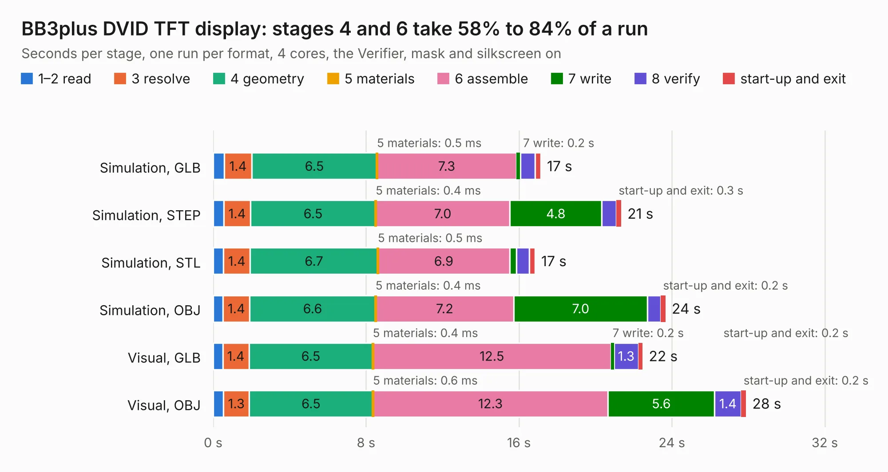

# 920. BB3plus DVID TFT display

Board 920 of the 3,122 of [Corpus Testing](../Corpus-Testing.md), on [Corpus Page 9](../CorpusTestingPages/Corpus-Testing-09.md#920-bb3plus-dvid-tft-display).

| Mode and format | 1–2 read | 3 resolve | 4 geometry | 5 materials | 6 assemble | 7 write | 8 verify | start-up and exit | Total |
|---|---:|---:|---:|---:|---:|---:|---:|---:|---:|
| Simulation, GLB | 0.6 | 1.4 | 6.5 | 0.5&nbsp;ms | 7.3 | 0.2 | 0.8 | 0.3 | 17.1 |
| Simulation, STEP | 0.6 | 1.4 | 6.5 | 0.4&nbsp;ms | 7.0 | 4.8 | 0.8 | 0.3 | 21.3 |
| Simulation, STL | 0.5 | 1.4 | 6.7 | 0.5&nbsp;ms | 6.9 | 0.4 | 0.7 | 0.3 | 16.8 |
| Simulation, OBJ | 0.5 | 1.4 | 6.6 | 0.4&nbsp;ms | 7.2 | 7.0 | 0.7 | 0.2 | 23.7 |
| Visual, GLB | 0.5 | 1.4 | 6.5 | 0.4&nbsp;ms | 12.5 | 0.2 | 1.3 | 0.2 | 22.5 |
| Visual, OBJ | 0.5 | 1.3 | 6.5 | 0.6&nbsp;ms | 12.3 | 5.6 | 1.4 | 0.2 | 27.9 |

<table align="center"><tr><td valign="top">

| Board | Repo: [eez-open/eez-bb3plus](https://github.com/eez-open/eez-bb3plus) Board: `BB3plus DVID TFT display.kicad_pcb` |
|---|---|
| Folder | KiCad / TFT module |
| Complexity | 358&nbsp;/&nbsp;1000 (size&nbsp;223, features&nbsp;135) |
| KESE&nbsp;features | through vias, rounded, trapezoid or chamfered pads, arc tracks, filled zones, curved board outline, knockout text, TrueType text, stack-up, dielectric εr and tanδ, mask and silkscreen colours |
| Tested | 9th November 2026 |
| Copper&nbsp;layers | 2 |
| File&nbsp;format | KiCad 10 (20260206) |
| Parts,&nbsp;tracks,&nbsp;vias | 66, 1,092, 166 |
| Triangles,&nbsp;simulation | 1,166,944 in 158 parts |
| Verifier | PASS in all six runs |

</td><td valign="top">

<table>
<tr><th>File type</th><th>File size</th><th>Peak memory used</th></tr>
<tr><th colspan="3" align="left">Simulation</th></tr>
<tr><td>GLB</td><td align="right">41&nbsp;MB</td><td align="right">579&nbsp;MB</td></tr>
<tr><td>STEP</td><td align="right">232&nbsp;MB</td><td align="right">665&nbsp;MB</td></tr>
<tr><td>STL</td><td align="right">58&nbsp;MB</td><td align="right">574&nbsp;MB</td></tr>
<tr><td>OBJ</td><td align="right">121&nbsp;MB</td><td align="right">831&nbsp;MB</td></tr>
<tr><th colspan="3" align="left">Visual</th></tr>
<tr><td>GLB</td><td align="right">35&nbsp;MB</td><td align="right">682&nbsp;MB</td></tr>
<tr><td>OBJ</td><td align="right">106&nbsp;MB</td><td align="right">868&nbsp;MB</td></tr>
</table>

</td></tr></table>

| Previous | Next |
|:---|---:|
| [919. Bare front mask half width](b0919b_eez-bb3plus_Bare-front-mask-half-width.md) | [921. BB3plus CM5 STM32H7 module](b0921b_eez-bb3plus-cm5-mcu_BB3plus-CM5-STM32H7-module.md) |
