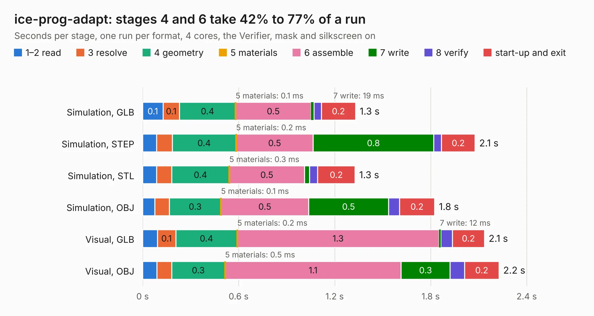

# 921. ice-prog-adapt

Board 921 of the 3,103 of [Corpus Testing](../Corpus-Testing.md), on [Corpus Page 9](../CorpusTestingPages/Corpus-Testing-09.md#921-ice-prog-adapt).

| Mode and format | 1–2 read | 3 resolve | 4 geometry | 5 materials | 6 assemble | 7 write | 8 verify | start-up and exit | Total |
|---|---:|---:|---:|---:|---:|---:|---:|---:|---:|
| Simulation, GLB | 0.1 | 0.1 | 0.4 | 0.1&nbsp;ms | 0.5 | 19&nbsp;ms | 47&nbsp;ms | 0.2 | 1.3 |
| Simulation, STEP | 88&nbsp;ms | 97&nbsp;ms | 0.4 | 0.2&nbsp;ms | 0.5 | 0.8 | 49&nbsp;ms | 0.2 | 2.1 |
| Simulation, STL | 86&nbsp;ms | 95&nbsp;ms | 0.4 | 0.3&nbsp;ms | 0.5 | 32&nbsp;ms | 50&nbsp;ms | 0.2 | 1.3 |
| Simulation, OBJ | 77&nbsp;ms | 91&nbsp;ms | 0.3 | 0.1&nbsp;ms | 0.5 | 0.5 | 68&nbsp;ms | 0.2 | 1.8 |
| Visual, GLB | 92&nbsp;ms | 0.1 | 0.4 | 0.2&nbsp;ms | 1.3 | 12&nbsp;ms | 73&nbsp;ms | 0.2 | 2.1 |
| Visual, OBJ | 90&nbsp;ms | 91&nbsp;ms | 0.3 | 0.5&nbsp;ms | 1.1 | 0.3 | 91&nbsp;ms | 0.2 | 2.2 |

<table align="center"><tr><td valign="top">

| Board | Repo: [emeb/ice-dongle](https://github.com/emeb/ice-dongle) Board: `ice-prog-adapt.kicad_pcb` |
|---|---|
| Folder | Hardware / ice-prog-adapt |
| Complexity | 132&nbsp;/&nbsp;1000 (size&nbsp;97, features&nbsp;35) |
| KESE&nbsp;features | through vias, filled zones |
| Tested | 9th November 2026 |
| Copper&nbsp;layers | 2 |
| File&nbsp;format | KiCad 6 (20211014) |
| Parts,&nbsp;tracks,&nbsp;vias | 3, 40, 4 |
| Triangles,&nbsp;simulation | 82,282 in 21 parts |
| Verifier | PASS in all six runs |

</td><td valign="top">

<table>
<tr><th>File type</th><th>File size</th><th>Peak memory used</th></tr>
<tr><th colspan="3" align="left">Simulation</th></tr>
<tr><td>GLB</td><td align="right">2.8&nbsp;MB</td><td align="right">173&nbsp;MB</td></tr>
<tr><td>STEP</td><td align="right">13&nbsp;MB</td><td align="right">183&nbsp;MB</td></tr>
<tr><td>STL</td><td align="right">4.1&nbsp;MB</td><td align="right">171&nbsp;MB</td></tr>
<tr><td>OBJ</td><td align="right">8.0&nbsp;MB</td><td align="right">176&nbsp;MB</td></tr>
<tr><th colspan="3" align="left">Visual</th></tr>
<tr><td>GLB</td><td align="right">2.1&nbsp;MB</td><td align="right">151&nbsp;MB</td></tr>
<tr><td>OBJ</td><td align="right">5.9&nbsp;MB</td><td align="right">151&nbsp;MB</td></tr>
</table>

</td></tr></table>

| Previous | Next |
|:---|---:|
| [920. ice-fpc-pmod](b0920b_ice-dongle_ice-fpc-pmod.md) | [922. icehat](b0922b_icehat_icehat.md) |
