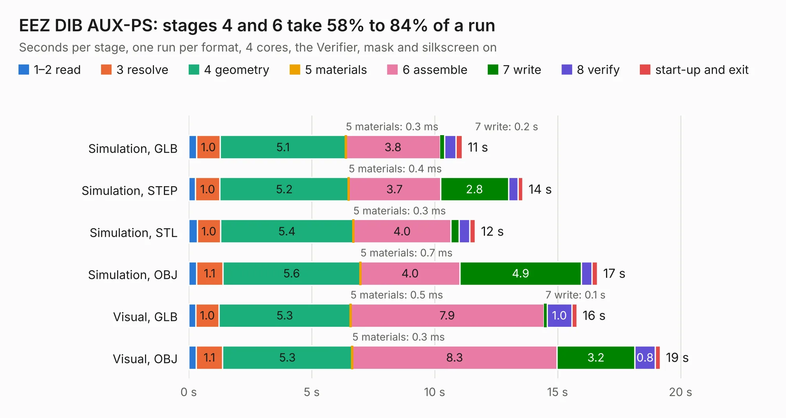

# 921. EEZ DIB AUX-PS

Board 921 of the 3,118 of [Corpus Testing](../Corpus-Testing.md), on [Corpus Page 9](../CorpusTestingPages/Corpus-Testing-09.md#921-eez-dib-aux-ps).

| Mode and format | 1–2 read | 3 resolve | 4 geometry | 5 materials | 6 assemble | 7 write | 8 verify | start-up and exit | Total |
|---|---:|---:|---:|---:|---:|---:|---:|---:|---:|
| Simulation, GLB | 0.3 | 1.0 | 5.1 | 0.3&nbsp;ms | 3.8 | 0.2 | 0.5 | 0.3 | 11.1 |
| Simulation, STEP | 0.3 | 1.0 | 5.2 | 0.4&nbsp;ms | 3.7 | 2.8 | 0.4 | 0.2 | 13.6 |
| Simulation, STL | 0.3 | 1.0 | 5.4 | 0.3&nbsp;ms | 4.0 | 0.3 | 0.4 | 0.2 | 11.7 |
| Simulation, OBJ | 0.3 | 1.1 | 5.6 | 0.7&nbsp;ms | 4.0 | 4.9 | 0.4 | 0.2 | 16.6 |
| Visual, GLB | 0.3 | 1.0 | 5.3 | 0.5&nbsp;ms | 7.9 | 0.1 | 1.0 | 0.2 | 15.8 |
| Visual, OBJ | 0.3 | 1.1 | 5.3 | 0.3&nbsp;ms | 8.3 | 3.2 | 0.8 | 0.2 | 19.2 |

<table align="center"><tr><td valign="top">

| Board | Repo: [eez-open/modular-psu](https://github.com/eez-open/modular-psu) Board: `EEZ DIB AUX-PS.kicad_pcb` |
|---|---|
| Folder | aux-ps / EDA files / KiCad |
| Complexity | 245&nbsp;/&nbsp;1000 (size&nbsp;180, features&nbsp;65) |
| KESE&nbsp;features | through vias, rounded, trapezoid or chamfered pads, filled zones, copper text, curved board outline |
| Tested | 9th November 2026 |
| Copper&nbsp;layers | 2 |
| File&nbsp;format | KiCad 7 (20221018) |
| Parts,&nbsp;tracks,&nbsp;vias | 82, 767, 129 |
| Triangles,&nbsp;simulation | 1,149,688 in 67 parts |
| Verifier | PASS in all six runs |

</td><td valign="top">

<table>
<tr><th>File type</th><th>File size</th><th>Peak memory used</th></tr>
<tr><th colspan="3" align="left">Simulation</th></tr>
<tr><td>GLB</td><td align="right">40&nbsp;MB</td><td align="right">492&nbsp;MB</td></tr>
<tr><td>STEP</td><td align="right">191&nbsp;MB</td><td align="right">555&nbsp;MB</td></tr>
<tr><td>STL</td><td align="right">57&nbsp;MB</td><td align="right">469&nbsp;MB</td></tr>
<tr><td>OBJ</td><td align="right">120&nbsp;MB</td><td align="right">835&nbsp;MB</td></tr>
<tr><th colspan="3" align="left">Visual</th></tr>
<tr><td>GLB</td><td align="right">26&nbsp;MB</td><td align="right">563&nbsp;MB</td></tr>
<tr><td>OBJ</td><td align="right">79&nbsp;MB</td><td align="right">626&nbsp;MB</td></tr>
</table>

</td></tr></table>

| Previous | Next |
|:---|---:|
| [920. BB3plus CM5 STM32H7 module](b0920b_eez-bb3plus-cm5-mcu_BB3plus-CM5-STM32H7-module.md) | [922. EEZ DIB B3C](b0922b_modular-psu_EEZ-DIB-B3C.md) |
