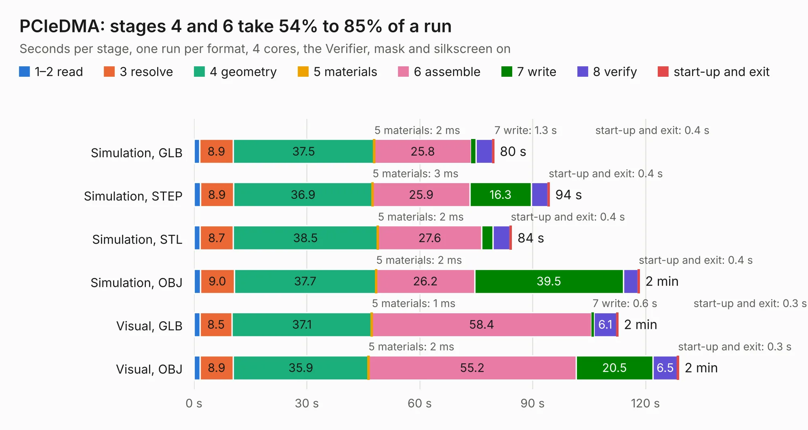

# 921. PCIeDMA

Board 921 of the 3,112 of [Corpus Testing](../Corpus-Testing.md), on [Corpus Page 9](../CorpusTestingPages/Corpus-Testing-09.md#921-pciedma).

| Mode and format | 1–2 read | 3 resolve | 4 geometry | 5 materials | 6 assemble | 7 write | 8 verify | start-up and exit | Total |
|---|---:|---:|---:|---:|---:|---:|---:|---:|---:|
| Simulation, GLB | 1.5 | 8.9 | 37.5 | 2&nbsp;ms | 25.8 | 1.3 | 4.4 | 0.4 | 79.8 |
| Simulation, STEP | 1.7 | 8.9 | 36.9 | 3&nbsp;ms | 25.9 | 16.3 | 4.4 | 0.4 | 94.5 |
| Simulation, STL | 1.7 | 8.7 | 38.5 | 2&nbsp;ms | 27.6 | 3.0 | 4.5 | 0.4 | 84.4 |
| Simulation, OBJ | 1.7 | 9.0 | 37.7 | 2&nbsp;ms | 26.2 | 39.5 | 3.9 | 0.4 | 118.4 |
| Visual, GLB | 1.6 | 8.5 | 37.1 | 1&nbsp;ms | 58.4 | 0.6 | 6.1 | 0.3 | 112.7 |
| Visual, OBJ | 1.6 | 8.9 | 35.9 | 2&nbsp;ms | 55.2 | 20.5 | 6.5 | 0.3 | 128.8 |

<table align="center"><tr><td valign="top">

| Board | Repo: [eggsampler/pciedma](https://github.com/eggsampler/pciedma) Board: `PCIeDMA.kicad_pcb` |
|---|---|
| Complexity | 452&nbsp;/&nbsp;1000 (size&nbsp;302, features&nbsp;150) |
| KESE&nbsp;features | through vias, slotted holes, rounded, trapezoid or chamfered pads, arc tracks, filled zones, curved board outline, stack-up, dielectric εr and tanδ, copper finish, plated board edge |
| Tested | 9th November 2026 |
| Copper&nbsp;layers | 6 |
| File&nbsp;format | KiCad 8 (20240108) |
| Parts,&nbsp;tracks,&nbsp;vias | 255, 2,459, 801 |
| Triangles,&nbsp;simulation | 6,162,192 in 457 parts |
| Verifier | PASS in all six runs |

</td><td valign="top">

<table>
<tr><th>File type</th><th>File size</th><th>Peak memory used</th></tr>
<tr><th colspan="3" align="left">Simulation</th></tr>
<tr><td>GLB</td><td align="right">207&nbsp;MB</td><td align="right">1.6&nbsp;GB</td></tr>
<tr><td>STEP</td><td align="right">780&nbsp;MB</td><td align="right">2.1&nbsp;GB</td></tr>
<tr><td>STL</td><td align="right">308&nbsp;MB</td><td align="right">1.6&nbsp;GB</td></tr>
<tr><td>OBJ</td><td align="right">661&nbsp;MB</td><td align="right">4.0&nbsp;GB</td></tr>
<tr><th colspan="3" align="left">Visual</th></tr>
<tr><td>GLB</td><td align="right">113&nbsp;MB</td><td align="right">1.9&nbsp;GB</td></tr>
<tr><td>OBJ</td><td align="right">364&nbsp;MB</td><td align="right">2.5&nbsp;GB</td></tr>
</table>

</td></tr></table>

| Previous | Next |
|:---|---:|
| [920. EEZ PSU consolidated r5B13a](b0920b_psu-hw_EEZ-PSU-consolidated-r5B13a.md) | [922. ulx3s](b0922b_ulx3s_ulx3s.md) |
