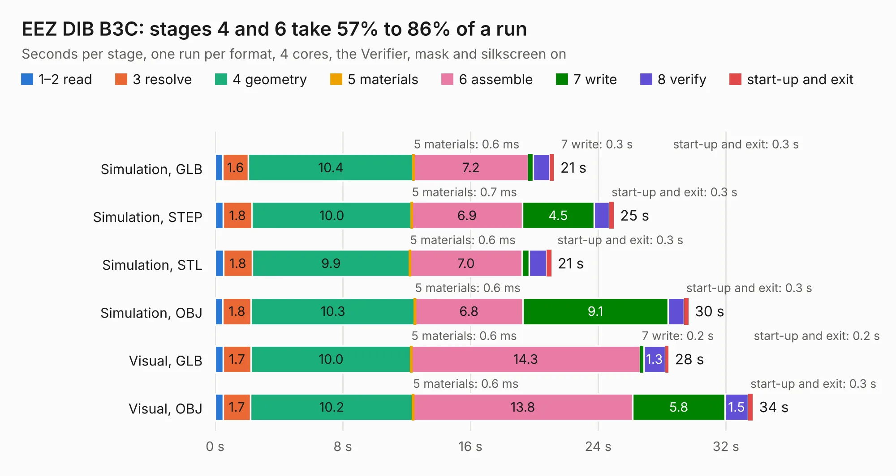

# 924. EEZ DIB B3C

Board 924 of the 3,128 of [Corpus Testing](../Corpus-Testing.md), on [Corpus Page 9](../CorpusTestingPages/Corpus-Testing-09.md#924-eez-dib-b3c).

| Mode and format | 1–2 read | 3 resolve | 4 geometry | 5 materials | 6 assemble | 7 write | 8 verify | start-up and exit | Total |
|---|---:|---:|---:|---:|---:|---:|---:|---:|---:|
| Simulation, GLB | 0.5 | 1.6 | 10.4 | 0.6&nbsp;ms | 7.2 | 0.3 | 1.0 | 0.3 | 21.2 |
| Simulation, STEP | 0.5 | 1.8 | 10.0 | 0.7&nbsp;ms | 6.9 | 4.5 | 1.0 | 0.3 | 25.0 |
| Simulation, STL | 0.5 | 1.8 | 9.9 | 0.6&nbsp;ms | 7.0 | 0.5 | 1.1 | 0.3 | 21.1 |
| Simulation, OBJ | 0.5 | 1.8 | 10.3 | 0.6&nbsp;ms | 6.8 | 9.1 | 1.0 | 0.3 | 29.7 |
| Visual, GLB | 0.5 | 1.7 | 10.0 | 0.6&nbsp;ms | 14.3 | 0.2 | 1.3 | 0.2 | 28.4 |
| Visual, OBJ | 0.5 | 1.7 | 10.2 | 0.6&nbsp;ms | 13.8 | 5.8 | 1.5 | 0.3 | 33.7 |

<table align="center"><tr><td valign="top">

| Board | Repo: [eez-open/modular-psu](https://github.com/eez-open/modular-psu) Board: `EEZ DIB B3C.kicad_pcb` |
|---|---|
| Folder | bp3c / EDA files / KiCad |
| Complexity | 231&nbsp;/&nbsp;1000 (size&nbsp;176, features&nbsp;55) |
| KESE&nbsp;features | through vias, rounded, trapezoid or chamfered pads, filled zones, curved board outline |
| Tested | 9th November 2026 |
| Copper&nbsp;layers | 2 |
| File&nbsp;format | KiCad 7 (20221018) |
| Parts,&nbsp;tracks,&nbsp;vias | 55, 698, 145 |
| Triangles,&nbsp;simulation | 1,777,810 in 97 parts |
| Verifier | PASS in all six runs |

</td><td valign="top">

<table>
<tr><th>File type</th><th>File size</th><th>Peak memory used</th></tr>
<tr><th colspan="3" align="left">Simulation</th></tr>
<tr><td>GLB</td><td align="right">64&nbsp;MB</td><td align="right">653&nbsp;MB</td></tr>
<tr><td>STEP</td><td align="right">321&nbsp;MB</td><td align="right">811&nbsp;MB</td></tr>
<tr><td>STL</td><td align="right">89&nbsp;MB</td><td align="right">662&nbsp;MB</td></tr>
<tr><td>OBJ</td><td align="right">194&nbsp;MB</td><td align="right">1.3&nbsp;GB</td></tr>
<tr><th colspan="3" align="left">Visual</th></tr>
<tr><td>GLB</td><td align="right">41&nbsp;MB</td><td align="right">814&nbsp;MB</td></tr>
<tr><td>OBJ</td><td align="right">124&nbsp;MB</td><td align="right">932&nbsp;MB</td></tr>
</table>

</td></tr></table>

| Previous | Next |
|:---|---:|
| [923. EEZ DIB AUX-PS](b0923b_modular-psu_EEZ-DIB-AUX-PS.md) | [925. EEZ DIB MCU r1B1](b0925b_modular-psu_EEZ-DIB-MCU-r1B1.md) |
