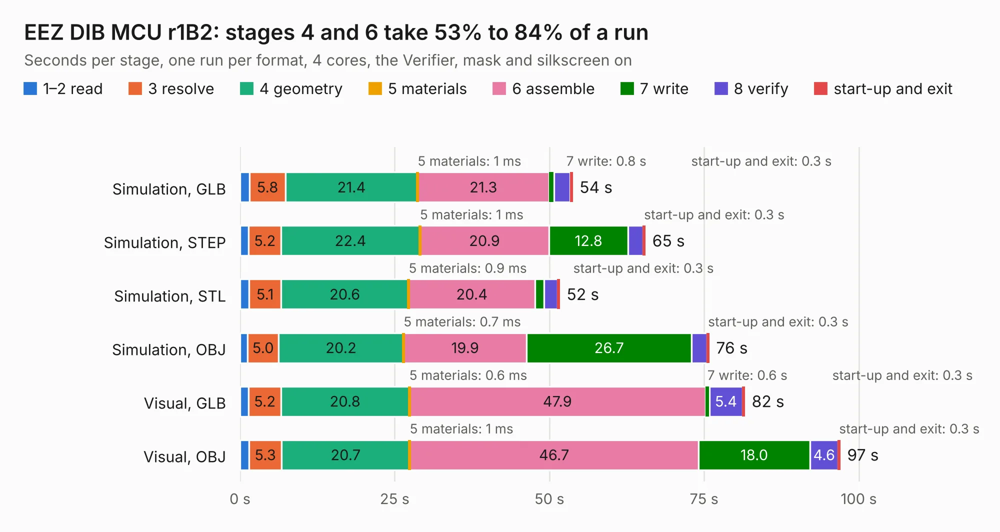

# 926. EEZ DIB MCU r1B2

Board 926 of the 3,123 of [Corpus Testing](../Corpus-Testing.md), on [Corpus Page 9](../CorpusTestingPages/Corpus-Testing-09.md#926-eez-dib-mcu-r1b2).

| Mode and format | 1–2 read | 3 resolve | 4 geometry | 5 materials | 6 assemble | 7 write | 8 verify | start-up and exit | Total |
|---|---:|---:|---:|---:|---:|---:|---:|---:|---:|
| Simulation, GLB | 1.6 | 5.8 | 21.4 | 1&nbsp;ms | 21.3 | 0.8 | 2.6 | 0.3 | 53.7 |
| Simulation, STEP | 1.4 | 5.2 | 22.4 | 1&nbsp;ms | 20.9 | 12.8 | 2.4 | 0.3 | 65.5 |
| Simulation, STL | 1.5 | 5.1 | 20.6 | 0.9&nbsp;ms | 20.4 | 1.4 | 2.2 | 0.3 | 51.6 |
| Simulation, OBJ | 1.2 | 5.0 | 20.2 | 0.7&nbsp;ms | 19.9 | 26.7 | 2.5 | 0.3 | 75.8 |
| Visual, GLB | 1.4 | 5.2 | 20.8 | 0.6&nbsp;ms | 47.9 | 0.6 | 5.4 | 0.3 | 81.5 |
| Visual, OBJ | 1.5 | 5.3 | 20.7 | 1&nbsp;ms | 46.7 | 18.0 | 4.6 | 0.3 | 97.0 |

<table align="center"><tr><td valign="top">

| Board | Repo: [eez-open/modular-psu](https://github.com/eez-open/modular-psu) Board: `EEZ DIB MCU r1B2.kicad_pcb` |
|---|---|
| Folder | previous designs / mcu / KiCad |
| Complexity | 313&nbsp;/&nbsp;1000 (size&nbsp;243, features&nbsp;70) |
| KESE&nbsp;features | through vias, custom pads, rounded, trapezoid or chamfered pads, filled zones, curved board outline |
| Tested | 9th November 2026 |
| Copper&nbsp;layers | 4 |
| File&nbsp;format | KiCad 5 (20171130) |
| Parts,&nbsp;tracks,&nbsp;vias | 187, 9,426, 591 |
| Triangles,&nbsp;simulation | 4,914,760 in 274 parts |
| Verifier | PASS in all six runs |

</td><td valign="top">

<table>
<tr><th>File type</th><th>File size</th><th>Peak memory used</th></tr>
<tr><th colspan="3" align="left">Simulation</th></tr>
<tr><td>GLB</td><td align="right">170&nbsp;MB</td><td align="right">1.4&nbsp;GB</td></tr>
<tr><td>STEP</td><td align="right">763&nbsp;MB</td><td align="right">1.8&nbsp;GB</td></tr>
<tr><td>STL</td><td align="right">246&nbsp;MB</td><td align="right">1.4&nbsp;GB</td></tr>
<tr><td>OBJ</td><td align="right">529&nbsp;MB</td><td align="right">3.2&nbsp;GB</td></tr>
<tr><th colspan="3" align="left">Visual</th></tr>
<tr><td>GLB</td><td align="right">109&nbsp;MB</td><td align="right">1.9&nbsp;GB</td></tr>
<tr><td>OBJ</td><td align="right">348&nbsp;MB</td><td align="right">2.3&nbsp;GB</td></tr>
</table>

</td></tr></table>

| Previous | Next |
|:---|---:|
| [925. EEZ DIB MCU r1B1](b0925b_modular-psu_EEZ-DIB-MCU-r1B1.md) | [927. EEZ PSU consolidated r5B13a](b0927b_psu-hw_EEZ-PSU-consolidated-r5B13a.md) |
